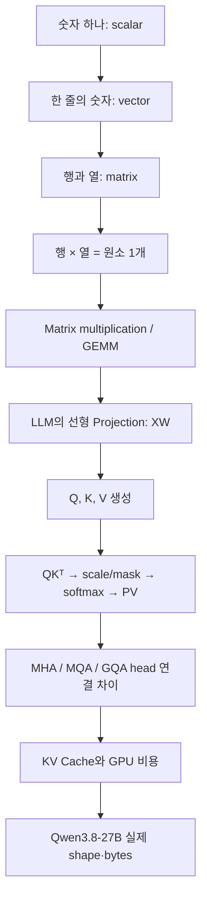
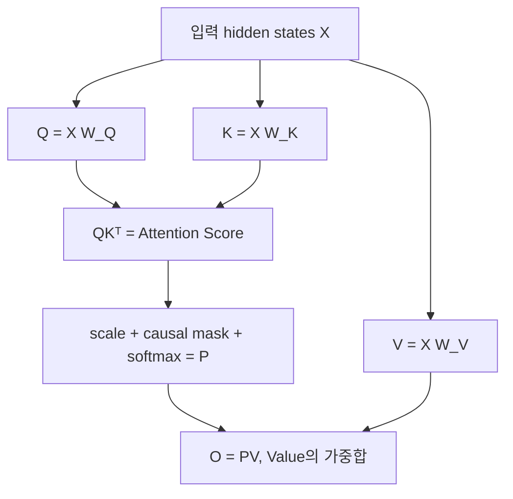
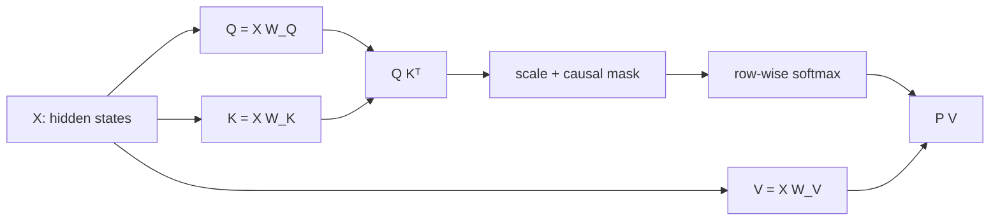

# 행렬곱을 처음 배우는 사람을 위한 GEMM → Self-Attention → MHA/MQA/GQA

> **학습 대상:** 행렬의 행·열을 구분하는 것부터 처음 배우는 LLM Serving Engineer  
> **예제 모델:** [Qwen/Qwen3.8-27B](https://huggingface.co/Qwen/Qwen3.8-27B) — **텍스트 언어 백본 기준**  
> **작성/공식 설정 확인:** 2026-11-02  
> **이 문서의 위치:** [Attention 학습 지도](README.md) → 이 기초 실습 → [Full Attention 심화](01-full-attention.md) → [서빙 종합 노트](LLM-serving-hardware-attention-master-notes.md)  
> **범위:** CUDA 커널 프로그래밍이 아닌 **숫자 하나가 어디에서 어떻게 계산되는지** 이해하는 것

## 먼저 알아야 할 결론

1. **행렬곱은 '왼쪽 행(row)'과 '오른쪽 열(column)'의 내적을 출력 칸마다 반복**하는 연산이다.
2. 왼쪽이 `[M,K]`, 오른쪽이 `[K,N]`이면 결과는 `[M,N]`이다. **안쪽 K는 같아야** 하고, 바깥쪽 M과 N이 남는다.
3. LLM의 선형층인 **Projection**은 대개 `Y=XW`라는 행렬곱으로 기술할 수 있다. 학습된 가중치 `W`가 입력의 여러 feature를 새 feature로 혼합한다.
4. **Tensor Core**는 지원되는 dtype/shape에서 matrix multiply-accumulate(MMA)를 높은 처리량으로 실행한다. 그러나 scaling, masking, softmax, normalization 같은 과정까지 전부 행렬곱은 아니다.
5. **Self-Attention은 (Q/K/V 생성) → QKᵀ 점수 → softmax → PV 가중합**이다. `Attention(Q,K,V)` 공식은 **MQA 전용이 아니라 한 head의 공통 기본 연산**이다.
6. **MHA/MQA/GQA**의 차이는 기본 attention 공식이 아니라 **Query head와 Key/Value head를 어떻게 연결·공유하느냐**다.
7. **KV Cache**는 미래 token이 추가되어도 변하지 않는 과거 causal prefix의 K/V를 재사용하기 위한 저장소다. 재계산은 줄지만 HBM 용량과 읽기 비용을 소비한다.

---

## 0. 학습 지도: 어디에서 무엇이 이어지는가?



**학습 팁:** `XW`, `QKᵀ`, `PV`가 모두 같은 종류의 '곱'이라는 것을 이해하면 서로 다른 수식처럼 보이던 내용이 연결된다. 다만 **두 행렬의 의미는 매번 다르다**.

---

# 1. 0차원부터: 스칼라, 벡터, 행렬, 텐서

## 1.1 Scalar — 숫자 하나

```math
a=3
```

숫자 하나는 축(axis)이 없다. 예를 들어 attention의 정규화 계수, 게이트 값, 확률 하나는 scalar로 생각할 수 있다.

## 1.2 Vector — 한 축으로 나열된 숫자들

```math
x=\begin{bmatrix}2&5&-1\end{bmatrix}
```

- **원소(element):** 2, 5, -1 각각의 숫자.
- **길이 또는 dimension:** 원소가 3개 → 차원 3.
- 위 표현은 **행 벡터(row vector)**이며 shape은 `[1,3]`이다.
- 같은 3개 숫자를 세로로 쓰면 **열 벡터(column vector)**, shape `[3,1]`이다.

```math
x^\top=\begin{bmatrix}2\\5\\-1\end{bmatrix}
```

여기서 $\top$은 **transpose(전치)**로 행과 열을 바꾼다는 뜻이다. 숫자 자체는 변하지 않는다.

## 1.3 Matrix — 행과 열이 있는 숫자 표

```math
A=\begin{bmatrix}
1&2&3\\
4&5&6
\end{bmatrix}
\quad\Rightarrow\quad
\mathrm{shape}(A)=[2,3]
```

- **행(row):** 가로줄. 첫 행은 `[1,2,3]`, 둘째 행은 `[4,5,6]`.
- **열(column):** 세로줄. 첫 열은 $[1,4]^\top$.
- $A_{2,3}=6$: 2번째 행, 3번째 열에 위치한 값.
- `[2,3]`은 **2행 3열**이다. $2\times3$이 '두 숫자를 곱하라'는 명령이 아니라 이 문맥에선 **shape 표기**라는 점에 유의한다.
- 원소의 총개수는 $2\times3=6$개다.

```text
           열 1   열 2   열 3
         ┌─────┬─────┬─────┐
행 1     │  1  │  2  │  3  │
         ├─────┼─────┼─────┤
행 2     │  4  │  5  │  6  │
         └─────┴─────┴─────┘
              shape = [2,3]
```

## 1.4 Tensor — 축이 더 많은 배열

Vector와 Matrix도 넓은 의미에서 Tensor이다. 딥러닝에서 Tensor는 보통 다차원 숫자 배열을 말한다.

| Tensor | 예시 shape | 축의 의미 |
|---|---|---|
| Scalar | `[]` | 숫자 1개 |
| Vector | `[5120]` | token 한 개의 hidden feature |
| Matrix | `[170000,5120]` | prompt의 여러 token × hidden feature |
| 3D Tensor | `[B,T,5120]` | batch × token × feature |
| 4D Tensor | `[B,H,T,D]` | batch × attention head × token × head feature |

**중요:** `[B,T,D]`의 '3차원 텐서'와 '벡터의 차원이 5120'이라는 표현은 서로 다른 의미다. 전자는 **축의 개수(rank)**, 후자는 **한 축의 길이**를 말한다. 또한 엄밀한 선형대수의 **matrix rank(독립 방향 수)**는 여기서 말하는 tensor rank(축 개수)와 다르다.

---

# 2. 행렬곱을 손으로 계산해 보자 — 이 장이 제일 중요하다

## 2.1 왜 두 행렬의 안쪽 차원이 같아야 하는가?

```math
A\in\mathbb{R}^{M\times K},
\qquad
B\in\mathbb{R}^{K\times N},
\qquad
C=AB\in\mathbb{R}^{M\times N}
```

```text
        A                 B                   C
     [M × K]          [K × N]              [M × N]
      ┌────┐           ┌─────┐             ┌─────┐
      │    │           │     │             │     │
      │    │     ×     │     │      =      │     │
      │    │           └─────┘             │     │
      └────┘                               └─────┘

          안쪽 K와 K가 일치해야 계산 가능
             결과는 바깥 M × N
```

출력 원소 $C_{i,j}$는 **A의 i번째 행**과 **B의 j번째 열**에서 대응하는 원소를 하나씩 곱해 모두 더한 값이다.

```math
C_{i,j}=\sum_{k=1}^{K} A_{i,k}B_{k,j}
```

- `i`: 출력의 **몇 번째 행인가?**
- `j`: 출력의 **몇 번째 열인가?**
- `k`: 하나의 출력 값을 만들기 위해 순회하는 **공통 축**.
- $\sum$: 해당 항들을 모두 더하라는 기호.

## 2.2 진짜 숫자로: 2×3 행렬 곱하기 3×2 행렬

```math
A=
\begin{bmatrix}
1&2&3\\
4&5&6
\end{bmatrix}
\quad
B=
\begin{bmatrix}
7&8\\
9&10\\
11&12
\end{bmatrix}
```

- `A`: **2행 3열**
- `B`: **3행 2열**
- `A`의 열 3 = `B`의 행 3이므로 곱할 수 있다.
- 결과 `C=AB`는 **2행 2열**이 된다.

출력의 **왼쪽 위** $C_{1,1}$을 계산해보자.

```text
A의 첫 번째 행 → [1, 2, 3]
B의 첫 번째 열 ↓ [7, 9, 11]

1×7 + 2×9 + 3×11
 = 7 + 18 + 33
 = 58
```

```math
C_{1,1} = 1(7)+2(9)+3(11)=58
```

출력의 **오른쪽 위** $C_{1,2}$는 **같은 첫 행**과 **B의 둘째 열**이다.

```math
C_{1,2}=1(8)+2(10)+3(12)=8+20+36=64
```

출력의 **왼쪽 아래**는 `A`의 두 번째 행으로 바꾼다.

```math
C_{2,1}=4(7)+5(9)+6(11)=28+45+66=139
```

마지막 **오른쪽 아래**:

```math
C_{2,2}=4(8)+5(10)+6(12)=32+50+72=154
```

따라서 최종 결과는:

```math
\boxed{
\begin{bmatrix}
1&2&3\\4&5&6
\end{bmatrix}
\begin{bmatrix}
7&8\\9&10\\11&12
\end{bmatrix}
=
\begin{bmatrix}
58&64\\139&154
\end{bmatrix}
}
```

### 머릿속에 남길 것

- **행 하나와 열 하나의 내적 = 출력 원소 하나.**
- **왼쪽 행 수 2개 × 오른쪽 열 수 2개 = 출력 칸 4개.**
- 4칸 각각에서 공통 축의 3개 항을 곱하고 더했다.

## 2.3 계산할 수 없는 행렬곱

`[2,3] × [2,2]`는 일반적인 행렬곱으로 **정의되지 않는다**. 안쪽의 3과 2가 다르기 때문이다.

`[2,3] × [3,4] = [2,4]`는 가능하다.

`[4,5120] × [5120,6144] = [4,6144]`도 가능하다.

**이 판정만 할 수 있어도 Q/K/V Projection의 shape을 읽을 준비가 된 것이다.**

## 2.4 행렬곱 ≠ 원소별 곱

다음 두 계산을 구분해야 한다.

**원소별(elementwise) 곱, Hadamard product:**

```math
\begin{bmatrix}1&2\\3&4\end{bmatrix}
\odot
\begin{bmatrix}5&6\\7&8\end{bmatrix}
=
\begin{bmatrix}5&12\\21&32\end{bmatrix}
```

**행렬곱:**

```math
\begin{bmatrix}1&2\\3&4\end{bmatrix}
\begin{bmatrix}5&6\\7&8\end{bmatrix}
=
\begin{bmatrix}19&22\\43&50\end{bmatrix}
```

기호 $\odot$가 있으면 elementwise를 의도한다. 행렬을 붙여 쓴 `AB`는 보통 행렬곱을 의미한다. 원소별 곱은 FFN의 gate 및 attention output gate를 설명할 때 다시 등장한다.

## 2.5 순서를 바꾸면 결과도 바뀐다

일반적으로 $AB\ne BA$다. **행렬곱은 교환법칙이 성립하지 않는다**.

위 예시의 `A`는 `[2,3]`, `B`는 `[3,2]`이므로:

- `AB`는 `[2,2]`
- `BA`는 `[3,3]`

shape부터 달라진다.

---

# 3. 내적, 전치, 외적 — Attention에서 다시 만나는 연산

## 3.1 내적(Dot Product) = 행 × 열

```math
a=\begin{bmatrix}2&3\end{bmatrix},
\quad
b=\begin{bmatrix}4\\5\end{bmatrix}
```

```math
ab=2(4)+3(5)=23
```

결과 `[1,1]` = **스칼라 한 개**다. Attention의 **Q와 K가 얼마나 부합하는가를 나타내는 점수**를 만드는 가장 작은 연산이다.

## 3.2 전치(Transpose) = 행↔열

```math
K=\begin{bmatrix}1&2\\3&4\\5&6\end{bmatrix}
\quad \mathrm{shape}(K)=[3,2]
```

```math
K^\top=\begin{bmatrix}1&3&5\\2&4&6\end{bmatrix}
\quad \mathrm{shape}(K^\top)=[2,3]
```

`Q=[2,2]`와 `K=[3,2]`는 곧바로 `QK`를 계산할 수 없지만, $QK^\top$는 `[2,2]×[2,3]=[2,3]`이므로 가능하다. **왜 Attention 수식에서 K에 전치가 붙는가**의 첫 번째 답이다.

## 3.3 외적(Outer Product) = 열 × 행

```math
u=\begin{bmatrix}2\\3\end{bmatrix},
\quad
v^\top=\begin{bmatrix}4&5&6\end{bmatrix}
```

```math
uv^\top=
\begin{bmatrix}
8&10&12\\
12&15&18
\end{bmatrix}
```

- `[2,1]×[1,3]=[2,3]`
- 내적은 **하나의 점수**, 외적(Outer Product)은 **하나의 행렬**을 만든다. 3차원 벡터의 수직 방향을 구하는 외적(Cross Product)과는 다른 연산이다.
- 나중에 Gated DeltaNet의 recurrent state를 공부할 때 $k_tv_t^\top$형태의 state 갱신이 왜 행렬인지 이해하는 토대가 된다.

---

# 4. GEMM과 Tensor Core: 지금까지의 계산을 GPU에 올리면?

## 4.1 GEMM이란?

**GEMM = General Matrix Multiply**. 통상 BLAS 관례에서는 다음 형태를 말한다.

```math
C=\alpha AB+\beta C_0
```

$\alpha=1$, $\beta=0$이면 `C=AB`, 우리가 방금 손으로 계산한 행렬곱이다. 단순 행렬곱 `Y=XW`도 GEMM 계열 계산으로 볼 수 있다.

행렬곱은 출력 칸마다 내적을 반복한다. 이는 많은 곱셈-덧셈을 병렬화하는 데 적합하다.

### 4.1.1 왜 AB만 쓰지 않고 αAB+βC까지 계산할까?

BLAS/cuBLAS의 표준 GEMM은 **기존 출력 행렬에 대한 누적까지 지원하는 범용 연산**이다. 일반식은 '오래된 C'와 '새 C'를 구분해 읽어야 한다.

```math
C_{\mathrm{new}}=\alpha AB+\beta C_{\mathrm{old}}
```

- **A:[M,K], B:[K,N]**: 입력 행렬 두 개. AB의 결과는 [M,N]이다.
- **α (alpha)**: AB 전체에 곱하는 **숫자 하나(스칼라)**.
- **β (beta)**: 기존 C 전체에 곱하는 **숫자 하나(스칼라)**.
- **C_old:[M,N]**: 기존 결과 행렬. AB와 shape이 같아야 원소별로 더할 수 있다.
- **C_new:[M,N]**: GEMM 실행 후 결과. 실제 API는 출력 C 버퍼를 갱신할 수 있다.

예제:

```math
AB=\begin{bmatrix}19&22\\43&50\end{bmatrix},
\qquad C_{\mathrm{old}}=\begin{bmatrix}1&2\\3&4\end{bmatrix}
```

| α, β | 결과 | 의미 |
|---|---|---|
| α=1, β=0 | [[19,22],[43,50]] | **기존 C를 무시**하고 AB로 결과를 채움 |
| α=1, β=1 | [[20,24],[46,54]] | AB에 **기존 C를 누적** |
| α=2, β=1 | [[39,46],[89,104]] | AB를 두 배 한 뒤 기존 C를 누적 |

**C는 어디서 튀어나왔나?** 수학에서 AB만 하던 문제에 갑자기 필수로 생기는 행렬이 아니다. **BLAS가 '결과 생성과 기존 값 누적'을 함께 표현할 수 있도록 정한 표준 입력/출력 피연산자**다. 긴 K 차원을 여러 타일로 나누어 계산할 때도 기존 부분합에 추가 결과를 더한다. 다만 **API 수준 βC와 Tensor Core 내부 누적은 구분**해야 한다. β=0인 GEMM조차 내부에서는 부분곱을 누적한다.

LLM에서 Q=XW_Q 같은 Projection을 설명할 때는 대개 α=1, β=0인 경우를 먼저 생각하면 된다. Bias를 따로 더하는 선형층, fused epilogue, residual connection 등은 GEMM의 'βC가 항상 적용된다'는 말과 동일하지 않다.

### 4.1.2 FMA에서 Fused가 뜻하는 것과 GEMM의 관계

**FMA(Fused Multiply-Add)**는 a×b+c를 **한 번의 융합 연산으로 계산하고 최종 반올림을 한 번 수행**한다는 뜻이다. 단순히 multiply와 add 명령을 순서대로 실행하는 것과 **반올림 의미가 다르다**.

```math
\mathrm{FMA}(a,b,c)=\mathrm{round}(a\times b+c)
```

반면 일반 분리 연산은 반올림이 두 번 일어날 수 있다.

```math
\mathrm{round}(\mathrm{round}(a\times b)+c)
```

예를 들어 2×3+4=10은 실수 계산상 단순하지만, 실제 유한 정밀도에서는 중간 반올림 여부가 결과에 영향을 줄 수 있다. **FMA 하나를 산술량 회계에서 보통 2 FLOP(곱셈 1, 덧셈 1)으로 센다.** 하드웨어 명령 하나가 두 종류의 부동소수점 산술을 수행할 수 있다는 것과 모순되지 않는다.

내적에서 누적은 다음처럼 진행된다.

```text
acc = 0
acc = FMA(a1, b1, acc)
acc = FMA(a2, b2, acc)
acc = FMA(a3, b3, acc)
...
```

이에 따라 대형 행렬곱 FLOP을 약 2MNK로 계산한다. 앞 절의 K번 곱셈 + (K-1)번 덧셈은 '첫 항에 0을 더하는 작업'을 제외한 직접 산술 횟수다. **FMA의 Fused(수치 반올림의 융합)**와 **FlashAttention Kernel Fusion(연산 단계를 한 커널로 결합해 메모리 IO 절감)**은 같은 'fusion'이라는 말이지만 서로 다른 계층이다.

원전: [NVIDIA cuBLAS GEMM 정의](https://docs.nvidia.com/cuda/cublas/index.html), [NVIDIA FMA 부동소수점 가이드](https://docs.nvidia.com/cuda/floating-point/index.html).

## 4.2 행렬곱 연산량은 얼마인가?

`A:[M,K]`, `B:[K,N]`라면 출력 칸이 `MN`개이며 각 칸에 **K번 곱셈 + (K-1)번 덧셈**이 들어간다.

정확한 기본 산술 횟수(단순 구현을 가정):

```math
\mathrm{Multiply}=MNK
```

```math
\mathrm{Add}=MN(K-1)
```

```math
\mathrm{Total}=MN(2K-1)\approx 2MNK
```

앞의 `[2,3]×[3,2]` 예시에서:

- 곱셈: `2×2×3=12`회
- 덧셈: `2×2×(3-1)=8`회
- 총 20회
- `2MNK=24` FLOP은 **큰 K에 대한 근사·관례적 계산량**이다.

FMA(Fused Multiply-Add) 한 번을 **2 FLOP**으로 세는 관례와 연결된다. **FLOP은 작업량, FLOPS는 초당 처리량**이다.

## 4.3 CUDA Core / Tensor Core를 구분하자

| 구분 | 주로 설명할 역할 | 주의할 점 |
|---|---|---|
| CUDA Core / 일반 SIMT 파이프 | 일반 산술, elementwise, 주소 계산 등 | 모든 일반 연산이 CUDA Core 한 종류에만 실리는 것은 아님 |
| Tensor Core | 지원 dtype과 tile shape의 Matrix Multiply-Accumulate | 모든 GEMM이 반드시 Tensor Core를 쓰는 것은 아님 |
| 그 밖의 실행 자원 | SFU, load/store, reduction 관련 경로 | Softmax 전체가 Tensor Core 행렬곱은 아님 |

**정확한 표현:** "LLM의 주요 선형층은 Tensor Core를 활용하기 좋은 행렬 연산이지만, 전체 추론 시간과 모든 kernel이 Tensor Core 계산으로만 이루어지지는 않는다."

## 4.4 왜 Prefill은 큰 GEMM이 되기 쉬운가?

가중치 `W:[K,N]`가 같아도 입력 행이 많으면 같은 weight tile을 여러 token에 재사용할 기회가 커진다.

```text
한 개 token   X:[1,K]     × W:[K,N] → [1,N]
여러 token    X:[8192,K]  × W:[K,N] → [8192,N]

같은 W를 읽어 많은 출력 행을 만드는 쪽이 재사용 측면에서 유리
```

물론 실제 실행은 tile, chunk, cache, dtype, kernel, batch가 영향을 준다. **Prefill이 항상 Compute-bound, Decode가 항상 Memory-bound라는 법칙은 아니다.**

---

# 5. LLM의 Projection: 토큰의 숫자를 다른 숫자로 바꾸는 과정

## 5.1 Token은 어떻게 숫자 행이 되는가?

예를 들어 텍스트 `"안녕 세계"`를 tokenizer가 2개 token ID로 나눴다고 **가정**하자. 실제 토큰 분할과는 무관한 설명 예제다.

```text
token ID #101 → embedding [ 1, 0, 2,-1 ]
token ID #205 → embedding [ 0, 1, 1, 2 ]

두 token을 행으로 쌓으면
X = [ [1,0,2,-1],
      [0,1,1, 2] ]   shape [2,4]
```

여기서 token ID는 정수 하나지만 embedding은 **학습된 길이 4의 벡터**라는 점이 중요하다. 실제 Qwen은 길이 4가 아니라 `hidden_size=5120`이다.

## 5.2 실제 숫자로 작은 Projection

입력 `X`와 학습된 가중치 `W`를 보자.

```math
X=\begin{bmatrix}
1&0&2&-1\\
0&1&1&2
\end{bmatrix},
\qquad
W=\begin{bmatrix}
1&0\\
2&1\\
0&3\\
1&-1
\end{bmatrix}
```

- `X:[2,4]` = 2개 token × 4개 입력 feature
- `W:[4,2]` = 4개 입력 feature를 2개 출력 feature로 혼합
- `Y=XW:[2,2]`

첫 token의 첫 출력:

```math
Y_{1,1}=1(1)+0(2)+2(0)+(-1)(1)=0
```

첫 token의 둘째 출력:

```math
Y_{1,2}=1(0)+0(1)+2(3)+(-1)(-1)=7
```

둘째 token 출력:

```math
Y_{2,1}=0(1)+1(2)+1(0)+2(1)=4
```

```math
Y_{2,2}=0(0)+1(1)+1(3)+2(-1)=2
```

따라서:

```math
\boxed{Y=XW=\begin{bmatrix}0&7\\4&2\end{bmatrix}}
```

### 이 연산이 의미하는 것

- token별로 `W`가 다르지 않다. **같은 가중치**를 두 token에 사용한다.
- 첫 feature, 둘째 feature 등 여러 입력 feature를 **학습된 계수로 재조합**해 출력 feature를 만든다.
- 출력 차원은 2이며, 차원을 줄이는 경우만 Projection이라 부르는 것은 아니다. **5120→6144처럼 늘어날 수도 있다.**
- 선형층은 보통 `Y=XW+b` 형태일 수 있지만, 여기서는 bias를 생략했다. 실제 Qwen config의 `attention_bias=false`와도 구분해 이해한다.

## 5.3 행벡터 관례와 열벡터 관례를 혼동하지 말자

이 문서에서는 **각 token을 한 행으로 놓는 `Y=XW` 관례**를 쓴다. 다른 교재에서는 한 token을 열벡터로 두고 `y=Wx`로 쓰기도 한다.

두 방식은 **서로 전치한 동일한 선형변환 설명**이다.

- 이 문서: $x:[1,d_{in}]$, $W:[d_{in},d_{out}]$
- 열벡터 문서: $x:[d_{in},1]$, $W:[d_{out},d_{in}]$

라이브러리의 실제 Weight 저장 배열 shape과 교재의 수학적 행렬 방향도 다를 수 있으니 **수학적 논리 shape과 파라미터 저장 layout을 동일시하지 않는다.**

---

## 5.4 Projection은 '정보를 버린다'가 아니라 '표현 축을 학습한 방식으로 바꾼다'

Projection(프로젝션, 사영)은 여기서 **행렬곱으로 feature를 새 좌표/특징 공간에 변환하는 학습된 선형변환**을 뜻한다. 기하학의 *직교사영*처럼 반드시 차원을 낮추거나 일부 성분을 지우는 과정이 아니다.

예를 들어 token 하나의 hidden vector가 x=[2,3]이고, 가상 가중치가 다음과 같다면:

```math
x=\begin{bmatrix}2&3\end{bmatrix},\quad
W=\begin{bmatrix}1&1\\1&-1\end{bmatrix}
```

```math
y=xW=\begin{bmatrix}2+3&2-3\end{bmatrix}
=\boxed{\begin{bmatrix}5&-1\end{bmatrix}}
```

원래 숫자 [2,3] 자체를 전달한 게 아니라 **두 성분의 합(5)과 차(-1)를 표현하는 새 feature 두 개**를 생성했다. 숫자가 바뀌었지만 token 수(행 수)는 그대로 1개다.

- XW_Q: 입력을 **다른 위치와 비교할 Query feature**로 변환
- XW_K: 입력을 **비교 대상 Key feature**로 변환
- XW_V: 입력을 **가중합해서 전달할 Value feature**로 변환
- Attention Output Projection W_O: head별 Attention 출력을 모델 hidden width로 다시 혼합
- FFN의 up/gate/down Projection: 각 token 위치에 대해 더 큰/다른 feature 공간으로 변환했다가 다시 혼합

즉, Projection은 '**한 token의 여러 숫자를 학습된 규칙에 따라 새 숫자들로 섞는다**'에 가깝다. 이 행렬곱만으로 토큰 A가 토큰 B를 참조하는 것은 아니다. **서로 다른 token 사이의 참조는 뒤의 Attention에서 발생**한다. 첫 layer의 X는 token embedding에서 유래하고 이후 layer의 X는 앞선 연산을 거친 hidden states다. 실제 아키텍처에는 RMSNorm, RoPE, gate, bias 여부 등의 세부 순서가 추가된다.

정규적인 수학 문헌에서 orthogonal projection은 특별한 성질(P²=P 등)을 요구할 수 있다. 여기서 LLM 구현의 'projection layer'는 그런 의미로 제한되지 않는다.

# 6. Self-Attention은 '같은 입력을 세 가지 역할로 변환'하는 것부터 시작


## 6.1 Q/K/V는 어디서 생기나?

**정답: 셋 모두 같은 입력 X에서 각각의 학습된 가중치로 계산한다. Q와 K의 곱으로 V를 만들지 않는다.**

```math
Q=XW_Q,\qquad K=XW_K,\qquad V=XW_V
```

- **X:** 이 Attention 층에 들어온 token별 hidden state를 행으로 모은 행렬. 첫 층에서는 embedding에서 유래한 표현이고, 깊은 층에서는 앞선 블록을 통과한 표현이다.
- **W_Q/W_K/W_V:** 모델이 학습하여 보유하는 세 개의 **서로 다른 파라미터 집합**. 추론 때 입력 문장에 따라 새로 학습되는 행렬이 아니다.
- **Q (Query):** 이 위치가 다른 위치에서 **어떤 특징을 찾을지** 표현.
- **K (Key):** 이 위치가 조회될 때 **어떤 특징으로 매칭될지** 표현.
- **V (Value):** 조회 비율이 결정되면 **실제로 전달·혼합할 정보**의 표현.

Self-Attention의 **self**는 Q/K/V가 같은 시퀀스의 X에서 유래한다는 뜻이다. Q, K, V가 같은 숫자라는 뜻은 아니다. Q/K/V는 사람이 붙인 역할 이름이지 자연어 문장으로 번역된 질문·답변·내용 자체가 아니다.

### 6.1.1 X에서 Q/K/V가 갈라지는 과정을 숫자로 확인

두 token이 한 Attention 층에 들어왔다고 가정한다. 행은 token, 열은 feature다. 수치는 **학습 흐름을 보여 주는 가상의 작은 예제**이며 실제 Qwen 파라미터가 아니다.

```math
X=
\begin{bmatrix}
1&1\\
0&1
\end{bmatrix}
\quad [2,2]
```

서로 다른 세 가중치 행렬을 다음과 같이 **예제로 정한다**.

```math
W_Q=\begin{bmatrix}1&-1\\0&1\end{bmatrix},
\quad
W_K=\begin{bmatrix}1&0\\0&1\end{bmatrix},
\quad
W_V=\begin{bmatrix}10&-20\\0&20\end{bmatrix}
```

**Query 생성:** 입력 X의 첫 행 [1,1]과 W_Q의 각 열을 내적하면 [1×1+1×0, 1×(-1)+1×1]=[1,0]이다. 둘째 행은 [0,1]이 된다.

```math
Q=XW_Q=
\begin{bmatrix}1&0\\0&1\end{bmatrix}
```

**Key 생성:** X에 **다른** 가중치 W_K를 곱한다.

```math
K=XW_K=
\begin{bmatrix}1&1\\0&1\end{bmatrix}
```

**Value 생성:** X에 **또 다른** 가중치 W_V를 곱한다. 첫 token의 Value 첫 성분은 1×10+1×0=10, 둘째 성분은 1×(-20)+1×20=0이다.

```math
V=XW_V=
\begin{bmatrix}10&0\\0&20\end{bmatrix}
```

| 시점 | Q (찾는 특징) | K (매칭 특징) | V (전달할 숫자) |
|---|---|---|---|
| Token 1 | [1,0] | [1,1] | [10,0] |
| Token 2 | [0,1] | [0,1] | [0,20] |

여기까지는 **Projection 세 번**일 뿐이다. 아직 Q–K 비교도, 어떤 Value를 가져올지 결정하는 계산도 일어나지 않았다.

### 6.1.2 흔히 헷갈리는 '생성'과 '조회'를 구분하기



| 질문 | 정확한 답 |
|---|---|
| Q와 K를 내적하면 V가 나오는가? | **아니오.** QKᵀ의 출력은 토큰 위치끼리의 **점수 행렬 S**다. |
| 그럼 V는 언제 만들어지는가? | Q/K와 **나란히**, XW_V Projection으로 이미 만들어진다. |
| Softmax로 생성된 P는 무엇인가? | 각 Query가 **어느 위치의 V를 얼마나 섞을지** 나타내는 가중치다. |
| V에 무엇을 곱하는가? | **P×V**. 해당 위치의 Value 벡터를 가중합해 O를 만든다. |
| O는 최종 생성 token인가? | **아니오.** Attention 블록의 중간 출력이다. 이후 output projection 및 후속 블록/레이어 연산을 거친다. |

또한 **QKᵀ를 계산하는 행렬곱**과 **Outer Product(외적)**은 다른 개념이다. QKᵀ의 **각 원소는 Query 한 행과 Key 한 행의 내적**으로 만든다. 행렬곱 자체를 외적 관점으로 전개할 수는 있지만 여기서는 **점수 생성 = 내적 기반 행렬곱**으로 이해하면 된다.

이 예제에서 만들어진 **바로 그 Q/K/V**를 7장에서 그대로 사용해 Score→Mask→Softmax→Value 혼합을 끝까지 계산한다.

## 6.2 아직 head를 무시한, 한 head의 모양

예를 들어 sequence 길이 `T=3`, feature 차원 `D=2`라고 가정한다.

```math
Q:[3,2],\quad K:[3,2],\quad V:[3,2]
```

$QK^\top$를 계산하면:

```math
[3,2]\times[2,3]=[3,3]
```

이 $3\times3$은 "**3개 Query 위치 각각이 3개 Key 위치에 대해 갖는 점수**"다.

```text
                  Key 위치
              K1    K2    K3
           ┌─────┬─────┬─────┐
Query  Q1  │s1,1 │s1,2 │s1,3 │
위치   Q2  │s2,1 │s2,2 │s2,3 │
       Q3  │s3,1 │s3,2 │s3,3 │
           └─────┴─────┴─────┘
                Score [3,3]
```

곱해 만든 숫자들은 **유사도/적합도에 관한 학습된 점수**다. 반드시 코사인 유사도 또는 사람에게 보이는 의미상 유사도와 같지는 않다.

## 6.3 일반적인 Scaled Dot-Product Attention 공식

```math
\boxed{
\mathrm{Attention}(Q,K,V)=
\mathrm{softmax}\left(
\frac{QK^\top}{\sqrt{d_k}}+M
\right)V
}
```

**이 식은 MQA 공식이 아니라, 한 head의 기본 Attention 연산**이다. MHA/MQA/GQA는 각 head가 **어느 K와 V를 참조하는지**를 규정한다.

네 단계로 쪼개면:

1. $S=QK^\top$: Query–Key 내적. **행렬곱**.
2. $Z=S/\sqrt{d_k}+M$: 점수 스케일 및 Mask. **원소별 연산**.
3. $P=\mathrm{softmax}(Z)$: 각 Query 행을 확률성 가중치로 정규화. **지수·합·나눗셈**, 일반 GEMM과 다름.
4. `O=PV`: Value를 가중합. **행렬곱**.



---


## 6.4 가중합(Weighted Sum): 값이 아닌 '비중'을 곱하고 더한다

평범한 합은 80+100=180이다. 가중합은 **각 항에 서로 다른 계수(weight)를 곱한 다음 더한다**.

```math
80\times0.3+100\times0.7=94
```

그 계수의 합이 1이면 **가중평균**이기도 하다. **가중합 자체는 계수의 합이 1일 필요가 없다.** Attention의 Softmax 출력 P는 각 Query 행에서 유효 위치의 계수가 0 이상이고 합이 1이므로, 그 P로 V를 섞는 연산은 일종의 벡터 가중평균이 된다.

```math
v_1=[10,0],\quad v_2=[0,20],\quad
p=[0.25,0.75]
```

```math
o=0.25v_1+0.75v_2=[2.5,15]
```

- **모델 가중치 W_Q/W_K/W_V**: 학습 후 보존되는 매개변수.
- **Attention 가중치 P**: **그 요청의 해당 Q/K를 계산해서 얻은 동적 참조 비율**.
- **V**: P를 곱해서 합칠 feature 벡터. Q×K로 V를 생성하는 것이 아니다.
- **O=PV**: 각 Query의 참조 결과를 새 hidden representation으로 구성한다.

따라서 '가중합'은 '가장 비중이 큰 token 하나만 선택'과 다르다.

## 6.5 왜 sqrt(d_k)로 나눌까? d_k가 정확히 무엇인가?

d_k는 **한 Query/Key Head 벡터에 들어 있는 feature 숫자의 개수**다. 전체 모델 hidden size나 입력 token 수가 아니다. 예를 들어 head_dim=64면 sqrt(d_k)=8, head_dim=256이면 16이다.

```math
s=q\cdot k=q_1k_1+\cdots+q_{d_k}k_{d_k}
```

직관: 같은 평균 크기의 곱셈 항을 2개보다 256개 합치면, **점수의 전형적인 변동 크기**가 커질 수 있다. 정밀하게는 q_i,k_i가 서로 독립, 평균 0, 분산 1이고 항 사이 독립이라고 단순 가정할 때:

```math
\mathrm{Var}(q_i k_i)=1,\qquad
\mathrm{Var}\Big(\sum_{i=1}^{d_k}q_i k_i\Big)=d_k
```

표준편차(Standard Deviation)는 분산의 제곱근이므로:

```math
\mathrm{Std}(q\cdot k)=\sqrt{d_k}
```

그래서 **점수를 sqrt(d_k)로 나누면**, 해당 단순 가정에서 점수의 표준편차를 대략 1 수준으로 맞출 수 있다. 큰 내적 값 때문에 Softmax가 한 위치에 지나치게 집중(포화)되는 문제를 완화하려는 설계다. 정확히 모든 데이터 분포가 이 가정을 따른다는 뜻은 아니다. 여기의 **루트는 행렬에 하는 것이 아니라 d_k라는 숫자에 하는 계산**이다.

이 scaling은 **훈련 때 정의된 수식**이며 추론에도 동일하게 적용한다. 모델마다 추가적인 normalization이나 scale 조정은 가능하다.

근거: [Attention Is All You Need, 2017](https://arxiv.org/abs/1706.03762), §3.2.1.

## 6.6 exp가 갑자기 등장하는 이유 — Softmax를 만들어야 해서

**exp(x)=e^x**는 자연상수 e≈2.71828을 밑으로 하는 지수 함수다.

```math
\exp(0)=1,\quad \exp(1)\approx2.718,\quad
\exp(-1)\approx0.368
```

exp(x)는 유한한 실수 x에 대해 항상 양수이며, x가 크면 결과도 커지는 **단조 증가 함수**다. 따라서 서로 다른 점수를 **양수인 상대적 비율**로 바꾸는 데 편리하다. Softmax는 exp 결과를 합으로 나눠 총합을 1로 만든다.

```math
\mathrm{softmax}(z_i)=
\frac{\exp(z_i)}{\sum_j\exp(z_j)}
```

예를 들어 두 점수가 [0, ln(3)]라고 하자. ln은 exp의 역함수로, ln(3)≈1.0986이다.

```math
[\exp(0),\exp(\ln3)]=[1,3]
```

```math
\mathrm{softmax}([0,\ln3])=
\left[\frac{1}{4},\frac{3}{4}\right]
=[0.25,0.75]
```

앞 절의 가중합에서 사용한 25%/75%가 바로 이처럼 만들어질 수 있다. **exp는 QKᵀ에서 자동으로 나오는 연산이 아니다.** 모델이 점수를 가중치로 바꾸기 위해 **Softmax를 명시적으로 사용하기 때문에** 별도의 함수가 등장한 것이다.

큰 z 때문에 exp(z)가 overflow하지 않도록 실제 구현에서는 보통 행의 최대값 m을 빼고 계산한다.

```math
\mathrm{softmax}(z_i)=
\frac{\exp(z_i-m)}{\sum_j\exp(z_j-m)},
\qquad m=\max_j z_j
```

이것은 비율을 바꾸지 않는다(분자/분모에 같은 e^-m이 곱해져 상쇄). 구현에서는 fused/online softmax로 계산해 전체 Score 행렬을 HBM에 저장하지 않을 수도 있다.

## 6.7 행렬곱이 아닌 연산은 CUDA Core? Tensor Core? CPU?

**CUDA는 GPU에서 프로그램을 실행시키는 프로그래밍 모델/생태계**이지, Tensor Core와 대립하는 별도 연산장치 이름이 아니다. 일반 CUDA 커널이 같은 SM 안의 여러 하드웨어 자원을 사용한다.

| Self-Attention/블록 연산 | 수학적 성격 | GPU에서 주로 사용하는 실행 경로 |
|---|---|---|
| XW_Q, XW_K, XW_V, W_O, FFN의 큰 MatMul | 행렬곱과 누적 | 지원 dtype/형태라면 **Tensor Core**를 쓰기 좋음 |
| QKᵀ, PV | 행렬곱 | 큰 타일은 **Tensor Core** 사용 가능. 짧은 Decode에서는 다른 경로도 가능 |
| Score scale, mask, Value의 원소별 변환 | 원소별 산술/비교 | 일반 **SIMT 산술(CUDA Core 등)** |
| exp, 역수, sqrt, SiLU 등 | 초월함수/일반 산술 | 일반 산술/근사 수학 명령/**SFU** 등, 아키텍처와 커널에 따라 달라짐 |
| Softmax의 max/sum | Reduction(여러 값의 합/최댓값) | Warp 협력, shuffle, registers/shared memory 및 일반 산술 경로 |
| RMSNorm, RoPE 등 | Reduction + elementwise, 위치별 회전 | 주로 일반 CUDA 커널 산술 경로. 경우에 따라 fused |
| HBM에서 타일 로드 | 메모리 이동 | Load/store, cache, 메모리 파이프라인. 계산 FLOP과 구별 |

**중요:** 이 표는 '정확히 한 연산이 반드시 한 종류 Core에서만 실행된다'는 매핑이 아니다. 실제 커널은 **Tensor Core MMA + 일반 산술 + 메모리 이동을 하나로 결합**할 수 있다. 예를 들어 FlashAttention은 Score 행렬곱, 온라인 Softmax, PV 가중합을 타일 단위로 융합해 HBM 입출력을 줄인다. **Softmax가 Tensor Core의 행렬곱으로 바뀐 것은 아니다.** 연산 종류마다 서로 다른 자원을 사용하되 하나의 커널로 연속 실행할 수 있다는 뜻이다.

출처: [CUDA Programming Guide — 메모리/SM 구조](https://docs.nvidia.com/cuda/cuda-programming-guide/01-introduction/programming-model.html), [NVIDIA FlashAttention 튜닝](https://developer.nvidia.com/blog/tuning-flash-attention-for-peak-performance-in-nvidia-cuda-tile/).

# 7. Attention 전체를 손으로 계산하기 — Token 2개, Feature 2개

## 7.1 6장에서 직접 만든 Q/K/V를 그대로 가져오자

6.1절의 **같은 X를 세 가중치에 곱해 생성한 결과**를 사용한다. 이전 장의 숫자와 다른 행렬을 갑자기 도입하지 않는다. 세 행렬은 **이미 Projection을 마친 값**이다.

```math
Q=
\begin{bmatrix}1&0\\0&1\end{bmatrix},
\quad
K=
\begin{bmatrix}1&1\\0&1\end{bmatrix},
\quad
V=
\begin{bmatrix}10&0\\0&20\end{bmatrix}
```

각각 shape [2,2]이고, Key 차원 d_k=2다.

- **Q의 첫 행 q₁=[1,0]:** 첫 token이 사용할 Query.
- **K의 첫 행 k₁=[1,1]:** 첫 token이 제공하는 Key.
- **V의 첫 행 v₁=[10,0]:** 첫 token이 실제 전달할 Value.
- **Q의 둘째 행 q₂=[0,1]:** 둘째 token이 첫째/둘째 token의 정보를 조회할 때 쓰는 Query.

## 7.2 첫 번째 곱: QKᵀ — V가 아니라 '점수'를 만든다

Key는 각 token이 행으로 쌓여 있으므로 전치한 뒤 Query와 곱한다.

```math
K^\top=
\begin{bmatrix}1&0\\1&1\end{bmatrix}
```

```math
S=QK^\top=
\begin{bmatrix}1&0\\0&1\end{bmatrix}
\begin{bmatrix}1&0\\1&1\end{bmatrix}
=
\boxed{\begin{bmatrix}1&0\\1&1\end{bmatrix}}
```

이 숫자를 **칸별 내적**으로 확인해 보자.

- S₁₁ = q₁·k₁ = 1×1+0×1 = **1**.
- S₁₂ = q₁·k₂ = 1×0+0×1 = **0**.
- S₂₁ = q₂·k₁ = 0×1+1×1 = **1**.
- S₂₂ = q₂·k₂ = 0×0+1×1 = **1**.

S의 행은 **질의하는 Query 위치**, 열은 **조회 대상 Key 위치**를 나타낸다. 아직 V는 계산에 참여하지 않았다. S에 저장된 것은 정보 내용이 아니라 **어떤 위치를 참조할지 판단하는 점수**다.

## 7.3 왜 sqrt(d_k)로 나누나?

d_k=2이므로 sqrt(2)≈1.4142로 나눈다. 차원이 커질 때 dot product 점수의 크기가 과도하게 커져 softmax가 포화되기 쉬운 현상을 완화하려는 scaling이다.

```math
\frac{S}{\sqrt{2}}\approx
\begin{bmatrix}
0.7071&0\\
0.7071&0.7071
\end{bmatrix}
```

## 7.4 Causal Mask를 적용하는 이유

Auto-regressive Decoder에서 **첫 token은 미래의 둘째 token을 참조할 수 없고**, 둘째 token은 첫째와 자기 자신을 참조할 수 있다.

```math
M=
\begin{bmatrix}0&-\infty\\0&0\end{bmatrix}
```

```math
Z=\frac{S}{\sqrt{2}}+M=
\begin{bmatrix}
0.7071&-\infty\\
0.7071&0.7071
\end{bmatrix}
```

Mask의 -∞는 이후 Softmax에서 해당 위치의 가중치가 0이 되도록 하는 수학적 표기다. 구현에서는 masking과 Softmax가 별도 메모리 행렬로 저장되지 않을 수도 있다.

## 7.5 Softmax: 점수를 '섞는 비율'로 만들기

각 Query 행에서 다음을 계산한다.

```math
p_j=\frac{\exp(z_j)}{\sum_r\exp(z_r)}
```

- **첫 행** [0.7071, -∞]: 둘째 위치가 차단되어 [1,0].
- **둘째 행** [0.7071,0.7071]: 두 점수가 동일하므로 각각 1/2. [0.5,0.5].

```math
P=\mathrm{softmax}(Z)=
\boxed{\begin{bmatrix}1&0\\0.5&0.5\end{bmatrix}}
```

P에서 **둘째 행 첫 칸 0.5**의 뜻은 “둘째 token이 첫째 token의 Value에 50%의 가중치를 준다”는 것이다. 첫째/둘째 **토큰 중 하나만 고르는 작업이 아니다**. 여기의 Softmax는 최종 vocabulary token sampling과도 다르다.

## 7.6 두 번째 곱: O=PV — 이미 만들어진 V를 섞기

V는 처음부터 XW_V로 얻은 **동일한 Value 행렬**을 사용한다. **QKᵀ에서 V가 생긴 것이 아니다**.

```math
O=PV=
\begin{bmatrix}1&0\\0.5&0.5\end{bmatrix}
\begin{bmatrix}10&0\\0&20\end{bmatrix}
```

첫 token의 출력:

```math
o_1=1[10,0]+0[0,20]=[10,0]
```

둘째 token의 출력:

```math
o_2=0.5[10,0]+0.5[0,20]=[5,10]
```

따라서:

```math
\boxed{O=\begin{bmatrix}10&0\\5&10\end{bmatrix}}
```

세 번의 행렬곱과 의미를 구별하자.

| 계산 | 입력 | 출력 | 의미 |
|---|---|---|---|
| Q/K/V Projection | X×W_Q, X×W_K, X×W_V | Q, K, V | 같은 입력을 역할별 특징으로 변환 |
| Score | Q[2,2]×Kᵀ[2,2] | S[2,2] | 각 Query–Key 내적 관계 |
| Weighted Value | P[2,2]×V[2,2] | O[2,2] | 각 Query가 조회한 Value의 가중합 |

```text
X [2,2] ──×W_Q──→ Q [2,2] ──┐
       ├──×W_K──→ K [2,2] ──┴─→ QKᵀ = S [2,2]
       └──×W_V──→ V [2,2]             ↓ scale/mask/softmax
                      │             P [2,2]
                      └───────────→ P×V = O [2,2]
```

**핵심:** Q와 K는 “누구의 정보를 얼마나 참고할까”에 대한 비율 P를 결정한다. V는 “그 비율로 가져올 실제 숫자 정보”다. O는 각 token의 문맥이 반영된 **중간 표현**이며, 마지막 생성 token이나 vocabulary logit 자체는 아니다.

---

# 8. Prefill과 Decode에서 Attention 행렬 shape이 왜 다른가?

지금까지 한 Sequence의 길이를 `T`라고 하자.

## 8.1 Prefill: 여러 Query를 한 번에 계산

한 head의 전형적인 shape은:

```math
Q:[T,d_h],\quad K:[T,d_h],\quad V:[T,d_v]
```

```math
QK^\top:\ [T,d_h][d_h,T]=[T,T]
```

```math
PV:\ [T,T][T,d_v]=[T,d_v]
```

Query가 여러 개이므로 **큰 MatMul/GEMM 형태**가 될 수 있다. 여러 token의 Projection 역시 $X:[T,d_{model}]$와 `W`의 큰 행렬곱이다.

**주의:** 수학적으로 $T\times T$ score matrix가 존재한다고 해서 이를 실제 HBM에 통째로 만들어야 하는 것은 아니다. FlashAttention 같은 kernel은 타일 단위로 처리한다. 또한 causal mask가 적용된다.

## 8.2 Decode: 신규 Query 하나로 과거 K/V를 조회

과거 길이를 `T`라고 하자. 신규 token을 포함한 유효 KV 위치 수의 정의에 따라 `T` 또는 `T+1`로 적을 수 있으므로 여기서는 **조회 대상 K/V 길이를 `L`**이라고 부르자.

```math
q:[1,d_h],\qquad K_{\mathrm{cache}}:[L,d_h]
```

```math
qK_{\mathrm{cache}}^\top:
[1,d_h][d_h,L]=[1,L]
```

```math
pV_{\mathrm{cache}}:
[1,L][L,d_v]=[1,d_v]
```

즉 **새 Query 1개가 L개 Key와 비교**한다.

- Query 길이 `1`과 cache 길이 `L`을 혼동하지 않는다.
- 활성 Sequence 여러 개가 있으면 Decode의 투입 token 행 수가 증가한다.
- 작은 Batch에서는 skinny GEMM 또는 GEMV에 가까운 연산이 나타나고, Weight/KV를 읽는 비용과 latency가 중요해질 수 있다.
- **'Prefill=항상 Compute-bound, Decode=항상 Memory-bound'는 편리한 첫 근사일 뿐 불변 법칙이 아니다.**

---

## 8.3 Prefill의 '전체 입력 행렬'은 정확히 무엇을 뜻할까?

텍스트를 바로 GPU의 W에 넣는 것이 아니다. 먼저 Tokenizer가 token ID를 만들고, Embedding이 각 ID를 숫자 벡터로 매핑한다. 이후 layer 입력 hidden state는 [T,D] 형태다.

```text
"나는 사과를 먹었다"
→ tokenizer → [id_1,id_2,...,id_T]
→ embedding/hidden states X: [T,D]
→ layer 1: (Q/K/V Projection → Attention → FFN 등)
→ layer 2: 새로운 hidden states X'
→ ...
→ 최종 hidden state → final norm / LM head → logits
```

- **Prefill:** prompt의 여러 위치를 한 forward 과정에서 처리한다. Layer마다 **서로 다른, 그 Layer에 학습된 W_Q/W_K/W_V 및 FFN 가중치**를 쓴다. 첫 Layer의 W를 모든 Layer가 공유하는 것이 아니다.
- **동시 처리:** Attention causal mask 때문에 미래를 못 보게 하면서도 여러 위치의 수치 계산은 병렬화한다. 요청이 길거나 스케줄러 정책에 따라 **chunked prefill**을 수행할 수 있으므로 한 번에 반드시 모든 T token이 한 kernel에 들어가는 것은 아니다.
- **Cache:** 각 Full-Attention Layer가 만들어낸 이전 token의 K/V를 뒤의 Decode에서 다시 사용하도록 보관한다. Hybrid 모델은 GDN 등 recurrent layer의 state도 따로 관리한다.
- **첫 출력 토큰:** Prefill이 모든 prompt 위치를 처리한 **마지막 위치의 최종 hidden state**에서 다음 token logits를 계산하고 첫 token을 선택할 수 있다. 첫 token을 출력하려고 반드시 별도의 Decode forward를 한 번 실행해야 하는 것은 아니다.

**왜 큰 GEMM인가?** 각 Layer의 X:[T,D]에 W:[D,F]를 곱하면, 같은 W를 T개 token 행에 재사용하면서 [T,F] 출력 행을 계산한다. 큰 T는 **weight를 한 번 가져왔을 때 할 수 있는 산술 작업의 양**을 늘린다. 따라서 연산기에 비해 메모리 읽기가 상대적으로 덜 두드러져 Compute-bound가 되기 쉽다.

## 8.4 Decode에서는 W를 '더 많이 읽는다'고 표현해도 될까?

정확한 문장은 **'생성 token 한 개당, 실행해야 할 계산에 비해 읽어야 할 Weight와 KV 데이터가 많아져 산술집약도가 낮아진다'**다.

- **모델 가중치 W는 Decode 때 새로 학습하거나 생성하지 않는다.** GPU 메모리(HBM)에 상주하는 모델 파라미터다. 단계마다 Layer의 계산을 위해 필요한 Weight 타일을 GPU 연산 자원 쪽으로 가져와 사용한다.
- **HBM → (공유 L2/SM의 L1·Shared Memory/Register 등) → 산술 유닛**으로 생각하면 된다. 타일 단위/캐시 적중/데이터 경로는 구현과 아키텍처마다 달라진다. 모델 전체 가중치를 **SM 하나의 메모리에 통째로 적재하는 것은 아니다.**
- 일반적인 dense FFN, Q/K/V, output projection의 가중치는 token마다 작은 행렬곱에서도 필요하다. 문제는 **그렇게 많은 Weight를 읽고도 한 token의 출력만 계산한다는 것**이다.
- Full-Attention의 새 Query는 **과거/현재 L개 K와 비교하고, V를 가중합**해야 하므로 긴 문맥에서 KV Cache 읽기도 중요한 비용이다. **KV Cache를 쓰면 읽기 자체가 없어지는 게 아니라 과거 K/V 재계산을 줄이는 것**이다.
- 여러 요청을 함께 Decode하면 유효 token batch B가 커져 W 재사용이 좋아질 수 있고, L2 Cache 적중·quantization·커널 선택·문맥 길이에 따라 병목이 달라진다.

**'Decode의 전체 메모리 접근량이 항상 Prefill보다 많다'는 잘못된 결론**이다. Prompt가 아주 길면 Prefill의 **총 계산량과 총 바이트 이동량이 더 클 수 있다.** 핵심은 같은 산술량 또는 **생성 token당 읽는 byte가 얼마나 큰지**, 그리고 **FLOP/byte가 얼마나 낮은지**다.

### 8.4.1 4,096×4,096 BF16 가중치 하나로 수치 비교

설명용 가상 Linear Layer 하나만 보자. 실제 모델에는 Layer별 여러 행렬이 있으므로 전체 모델 계산량은 훨씬 크다.

```math
W:[4096,4096],\qquad
|W|=4096^2\times2=33{,}554{,}432\ \mathrm{bytes}=32\ \mathrm{MiB}
```

입력 행 수 m개에 대해 Matrix Multiplication의 산술량은 약:

```math
\mathrm{FLOPs}\approx 2m\times4096^2
```

**이상화 가정:** Weight를 HBM에서 **1회만 읽고**, 입력/출력 activation, 캐시 미스, 실행 오버헤드 등은 우선 제외한다.

| 상황 | m (행 수) | FLOPs (근사) | W 읽기 | W 읽기만 고려한 연산집약도 |
|---|---:|---:|---:|---:|
| 한 요청의 작은 Decode | 1 | 33.55M | 32 MiB | 약 1 FLOP/byte |
| 긴 Prefill의 한 Linear | 1,024 | 34.36G | 32 MiB | 약 1,024 FLOP/byte |

**이 수치가 실제 GPU 측정 결과는 아니다.** Prefill에서 activation IO까지 합치면 실제 산술집약도는 위 이상화 값보다 낮아지고, Tile/Kernel/Cache에 따라 실제 Weight가 HBM에서 몇 회 읽히는지도 바뀐다. 하지만 **m이 커지면 같은 W로 훨씬 많은 계산을 수행한다는 경향**을 드러낸다.

일반적으로:

```math
I=\frac{\mathrm{FLOPs}}{\mathrm{Bytes\ transferred\ from\ target\ memory}}
\quad [\mathrm{FLOP/byte}]
```

이 지표가 **Arithmetic Intensity(산술집약도)**다. 비교 기준이 HBM인지 L2인지 명시해야 하고, 성능의 한계는 연산 처리량(FLOP/s)과 메모리 대역폭(byte/s)에 의해 달라진다(Roofline 관점).

### 8.4.2 시간상에서 GPU가 실제로 하는 일

```text
모델 로드: W를 GPU HBM에 적재한 상태 (추론 여러 요청에서 재사용)

Prefill layer:
  X [T,D] + W [D,F] → 큰 Linear 연산 → 많은 token의 Q/K/V 등
  → Attention 처리 + 해당 layer의 Cache 저장
  → FFN 및 잔여 연산 → 다음 layer

Decode 한 step (Batch B이면 [B,D]에 가까운 입력):
  새 token(s)의 hidden states → 현재 layer의 W 타일 이용
  → 새 Q/K/V 생성 → 기존 KV Cache + 현재 위치 KV 참조
  → FFN 등 연산 → 다음 layer
  → 마지막 layer 이후 logits → next token 선택
```

Prefill/Decode 모두 **동일한 모델 가중치 전체 구조**를 사용한다. 단지 처리 token의 수, Cache 재사용, Weight를 재사용하며 수행할 수 있는 연산량이 다르다. 실무적 관측으로는 **작은 batch Decode는 Memory-bandwidth-bound, 긴 Prefill의 큰 GEMM은 Compute-bound일 가능성이 크지만** 항상 그런 것은 아니다.

출처: [vLLM: Anatomy of a High-Throughput LLM Inference System](https://vllm-project.github.io/2025/09/05/anatomy-of-vllm.html), [NVIDIA GPU Memory Programming Model](https://docs.nvidia.com/cuda/cuda-programming-guide/01-introduction/programming-model.html).

## 8.5 Attention과 FFN 중 누가 '다음 토큰 Logits'를 만들까?

**둘 다 직접 마지막 vocabulary Logits를 출력하는 모듈은 아니다.** 두 모듈은 **최종 예측에 필요한 hidden state를 계속 변환하는 구성 요소**다.

- **Attention:** 해당 위치의 Query가 다른 유효 위치의 K와 비교한 가중치로 V를 집계한다. 토큰 위치 간 **문맥 정보 교환**을 담당한다.
- **FFN/MLP:** 주로 **각 token 위치에 독립적으로** 동일한 학습된 비선형 변환을 적용해 feature를 바꾼다. 일반적인 dense FFN은 직접 다른 token 위치를 조회하지 않는다.
- **Residual/Normalization/기타:** 이전 표현을 더하고 정규화한다. 순서와 세부 구조는 모델별로 다르다.
- **최종 출력:** 모든 Transformer/Hybrid Layer를 지나 **최종 Normalization → LM Head(출력 Projection)**에서 vocabulary 크기의 Logits가 나온다. 마지막 위치 Logits를 바탕으로 sampling/argmax 등으로 다음 token ID를 선택한다.

```text
token IDs
  → embedding (숫자 vector)
  → Layer 1: Attention(or GDN), FFN, residual/norm
  → Layer 2: Attention(or GDN), FFN, residual/norm
  → ... 모든 Layer
  → final normalization
  → LM Head: [1,hidden_size] × [hidden_size,vocab_size]
  → logits: [1,vocab_size]  ← vocabulary token별 점수
  → (sampling에 필요한 변환/정책) → 다음 token ID
  → 그 token ID를 다시 embedding해서 후속 Decode step 진행
```

**Attention Softmax와 최종 token 선택의 Softmax는 다르다.** 전자는 **Key 위치에 대한 분포**(P, token 수 기반), 후자는 필요할 때 **Vocabulary 후보에 대한 분포**(Logits, vocabulary 수 기반)를 만든다. Greedy decoding처럼 최댓값만 고를 때 마지막 vocabulary Softmax를 반드시 계산할 필요는 없다.

**Prefill에서도 최종 위치의 Logits로 첫 출력 token을 예측한다.** Decode에서는 새로 입력된 token이 각 Layer를 순서대로 통과하고, 마지막 Layer 뒤 LM Head가 **그 다음 token**의 Logits를 제공한다. 한 토큰을 위해 하나의 Attention layer만 실행하는 것이 아니다.

이 교재의 Qwen3.8-27B처럼 **Gated DeltaNet + Full Attention의 Hybrid Layer**에도 논리적인 최종 출력 경로는 동일하다. 모든 Layer가 Full Attention이라는 뜻은 아니다.

출처: [Hugging Face CausalLM Output 정의](https://github.com/huggingface/transformers/blob/main/src/transformers/modeling_outputs.py).

## 8.6 확인용 문장 — 맞는 말인지 판정하기

| 설명 | 판정 | 올바른 표현 |
|---|---|---|
| 'α와 β는 GEMM에서 입력 행렬 개수다' | 틀림 | 둘 다 AB 및 기존 C에 곱하는 스칼라 |
| 'C는 모든 Projection에 반드시 원래 있던 행렬이다' | 틀림 | GEMM API가 기존 결과 누적까지 지원하기 위한 선택적 경로(β=0 가능) |
| 'Fused는 단순히 두 줄의 명령을 같은 코드에 붙여 썼다는 뜻' | 틀림 | FMA의 핵심은 곱·합의 단일 반올림 |
| 'Projection은 token들의 관계를 직접 계산한다' | 틀림 | token별 feature 변환이며 다른 위치 참조는 Attention 단계 |
| 'exp는 QKᵀ 연산자가 자동 계산한다' | 틀림 | Softmax 정의에 exp가 별도로 포함됨 |
| 'Decode에서는 전체 HBM 읽기 총량이 Prefill보다 언제나 많다' | 틀림 | **산술집약도**가 대체로 낮다는 것이 핵심 |
| 'W는 매 Decode step마다 새로 HBM에 로드되어 모델이 다시 적재된다' | 틀림 | W는 HBM에 상주하고 Kernel 실행 시 필요한 부분을 캐시·SM 쪽으로 공급 |
| 'KV Cache는 모든 Q/K 비교 계산을 없앤다' | 틀림 | 이전 K/V 생성 재계산을 줄일 뿐 현재 Q의 조회 계산은 남음 |
| 'FFN 결과가 곧 vocabulary logits다' | 틀림 | **최종 hidden state를 LM Head에 넣어 logits 생성** |
| 'Attention은 예측과 무관하다' | 틀림 | 직접 vocab logits를 만들지 않지만 **예측에 사용되는 문맥 표현을 생성** |

---

# 9. 한 줄 Attention 공식이 MHA·MQA·GQA 중 무엇인가?

정답은 **셋 중 하나로 고정된 공식이 아니라, 한 head의 공통 scaled dot-product attention**이라는 것이다.

```math
\mathrm{Attn}(Q,K,V)
=\mathrm{softmax}\left(
\frac{QK^\top}{\sqrt{d_h}}+M
\right)V
```

**'head 하나에서 어떤 K/V를 사용할지'**를 정해야 MHA/MQA/GQA가 결정된다.

## 9.1 Head란?

여러 feature 공간에서 서로 다른 query–key 관계를 계산하도록 `Q/K/V`를 **여러 개의 작은 집합(head)**으로 나눈 것이다. Head 수는 token 수가 아니라 **병렬로 학습된 표현의 묶음 개수**다.

예를 들어 `H_q=4`, `d_h=2`라면 각 token은 논리적으로 Query head 4개, head당 feature 2개를 가진다. Query projection 출력 폭은 $4\times2=8$이다.

Head별 `Q_i`는 서로 다른 값이며, 학습된 기능을 '문법 전담', '검색 전담'처럼 고정적으로 단정할 수는 없다.

## 9.2 MHA: Query마다 별도의 KV Head

Query head가 4개라면 KV head도 4개.

```text
Q0 ──→ K0, V0
Q1 ──→ K1, V1
Q2 ──→ K2, V2
Q3 ──→ K3, V3
```

Head `i`의 연산:

```math
O_i=\mathrm{Attn}(Q_i,K_i,V_i)
```

이후 head 출력을 concatenate하고 Output Projection에 넣는다.

```math
Y=\mathrm{Concat}(O_0,\ldots,O_{H_q-1})W_O
```

## 9.3 MQA: Query는 여러 개지만 KV는 한 벌

```text
Q0 ──┐
Q1 ──┤
Q2 ──┼──→ K0, V0   (공유)
Q3 ──┘
```

```math
O_i=\mathrm{Attn}(Q_i,K_0,V_0)
```

**모든 Query head의 출력이 동일해지는 것은 아니다.** `Q_i`가 다르기 때문에 같은 K/V를 참조해도 점수와 가중합이 다르다.

## 9.4 GQA: Query 여러 개가 그룹별로 KV 공유

Query head 4개, KV head 2개라면:

```text
Q0 ──┐
Q1 ──┴──→ K0, V0

Q2 ──┐
Q3 ──┴──→ K1, V1
```

`g(i)`를 Query head `i`가 참조하는 KV 그룹이라고 하자.

```math
O_i=\mathrm{Attn}(Q_i,K_{g(i)},V_{g(i)})
```

균등·연속 그룹의 대표적 매핑:

```math
g(i)=\left\lfloor\frac{i}{H_q/H_{kv}}\right\rfloor
```

여기서 head 인덱스는 0부터 시작한다. 그룹 매핑은 모델의 학습된 구조와 일치해야 한다.

### 숫자 4/2/1로 세 가지 비교

`T=2` token, `d_h=2`, Query head `4`개라고 하자.

| 메커니즘 | `H_q` | $H_{kv}$ | Query shape | K shape | V shape |
|---|---:|---:|---|---|---|
| MHA | 4 | 4 | `[2,4,2]` | `[2,4,2]` | `[2,4,2]` |
| GQA | 4 | 2 | `[2,4,2]` | `[2,2,2]` | `[2,2,2]` |
| MQA | 4 | 1 | `[2,4,2]` | `[2,1,2]` | `[2,1,2]` |

위 shape은 설명을 위한 `[Token,Head,Feature]` 표기다. 구현에서는 `[B,H,T,D]`처럼 재배열될 수 있다.

**모든 경우 각 Query head의 `[T,d_h]×[d_h,T]` Attention 계산이라는 뼈대는 유지된다.** MQA/GQA는 KV 저장과 읽기에서 중요한 절약이 생기지만 Query head별 점수/출력 계산이 공짜로 없어지는 것은 아니다.

## 9.5 왜 GQA가 KV Cache를 절약하는가?

Attention layer 하나에 저장하는 **token당 KV 원소 수**:

```math
N_{\mathrm{KV,token,layer}}=2H_{kv}d_h
```

`2`는 K와 V 두 종류이기 때문이다.

같은 `H_q=4`, `d_h=2`에서:

| 방식 | token/층당 K+V 원소 | MHA 대비 |
|---|---:|---:|
| MHA, KV=4 | `2×4×2=16` | 100% |
| GQA, KV=2 | `2×2×2=8` | 50% |
| MQA, KV=1 | `2×1×2=4` | 25% |

**주의:** 이것은 **KV Cache 원소 수**의 상대 비교다. 모델 전체 VRAM이나 토큰 생성 속도가 동일한 비율로 개선된다는 뜻이 아니다. 구조 이름만으로 정확도 우열을 단정할 수도 없다.

---

# 10. 왜 KV Cache가 필요할까? (과거를 저장하는 이유)

Causal decoder에서 위치 `t`까지의 표현은 미래 `t+1`을 보지 못한다. 기본 추론에서 같은 prefix와 weight라면 과거 token의 K/V는 이후 token 생성 시 그대로 재사용할 수 있다.

```text
[Token 1] → K1,V1
[Token 2] → K2,V2
[Token 3] → K3,V3

다음 Decode:
   새 token → q4,k4,v4
   q4는 [K1,K2,K3,K4]를 조회
   (K1,V1~K3,V3는 다시 Projection하지 않고 재사용)
```

### Cache가 없으면

새 token을 처리할 때 이전 prefix의 중간 결과를 다시 만들어야 할 수 있다. 출력이 길어지면 동일한 과거 계산을 반복하는 비용이 커진다.

### Cache가 있으면

과거 K/V를 저장하고 신규 K/V를 추가한다. 단, **현재 Query가 과거 K/V를 읽고 점수를 계산하는 연산은 여전히 필요**하다.

**KV Cache는 답변 token이나 Attention 확률을 저장한 것이 아니라, 각 레이어에서 재사용할 과거 Key/Value 표현을 저장하는 것**이다.

추론 엔진은 흔히 KV tensor를 **GPU HBM**에 할당·보존하며, kernel이 필요한 부분을 L2/Shared Memory/Register로 옮겨 계산한다. 'HBM에 상주'와 'SM on-chip SRAM에 전량 상주'는 다르다.

---

# 11. 실제 Qwen3.8-27B의 숫자를 대입하자

## 11.1 무엇이 공식 config이고 무엇이 설명용 가정인가?

다음 값은 [Qwen/Qwen3.8-27B 공식 config.json](https://huggingface.co/Qwen/Qwen3.8-27B/blob/main/config.json)의 **text_config**에서 가져온다. 이 모델의 상위 `architectures`는 `Qwen3_5ForConditionalGeneration`이며 Vision Encoder와 MTP 관련 설정도 포함하지만, 여기서는 **기본 텍스트 언어 추론 경로**를 다룬다.

```json
{
  "text_config": {
    "dtype": "bfloat16",
    "hidden_size": 5120,
    "intermediate_size": 17408,
    "num_hidden_layers": 64,
    "num_attention_heads": 24,
    "num_key_value_heads": 4,
    "head_dim": 256,
    "full_attention_interval": 4,
    "linear_num_key_heads": 16,
    "linear_num_value_heads": 48,
    "linear_key_head_dim": 128,
    "linear_value_head_dim": 128,
    "mamba_ssm_dtype": "float32",
    "max_position_embeddings": 262144
  }
}
```

`layer_types`는 길이 64의 배열로, `linear_attention, linear_attention, linear_attention, full_attention`가 16회 반복된다. 따라서 **GDN 계열 48층 + Full/Gated Attention 16층**이다.

> **수치 분류:** config 값은 공식 설정. 아래에서 연산한 projection width와 KV byte는 **설정에서 수학적으로 유도한 값**. `170K+2K` workload와 BF16 KV 저장 가정은 **설명용 시나리오**다. 실제 vLLM allocator/TP 분할/Graph/Workspace 메모리는 별개다.

## 11.2 실제 Q Projection: 5120 → 6144

Full Attention 층의 Query head는 24개, 각 head가 256차원이므로:

```math
d_Q=24\times256=6144
```

한 layer에 입력 token이 `M`개면:

```math
X:[M,5120],\qquad
W_Q:[5120,6144]
```

```math
Q=XW_Q:\ [M,6144]
```

다음에 이 폭을 24개 head로 나누면:

```math
Q:\ [M,24,256]
```

**24개 Head가 있다는 것은 24개 token이 있다는 뜻이 아니다.** 동일한 token 각각이 24개 Query 표현을 갖는다.

## 11.3 실제 K/V Projection: 5120 → 1024

KV head 수는 4개이며 head당 256차원:

```math
d_K=d_V=4\times256=1024
```

```math
W_K:[5120,1024],\qquad W_V:[5120,1024]
```

```math
K:[M,4,256],\qquad V:[M,4,256]
```

따라서 `24 / 4 = 6`: **Query head 6개가 KV head 하나를 공유**한다.

```text
Q head  0~ 5  ──→ KV head 0
Q head  6~11  ──→ KV head 1
Q head 12~17  ──→ KV head 2
Q head 18~23  ──→ KV head 3
```

**구현 주의:** 위 `W_Q`, `W_K`, `W_V` shape은 행벡터 곱셈을 위한 **논리적 Projection shape**다. 실제 weight 저장 방향, QK norm, RoPE, output gate, fusion, kernel layout은 구현에 따라 더 복잡하다. Output Projection도 포함해 총 연산량을 계산해야 한다.

## 11.4 Prefill 예시: 입력 4 token이라면?

`M=4`, Full Attention 층 하나에서:

```text
Input X             [4, 5120]

  × W_Q [5120,6144] → Q flat [4,6144] → Q [4,24,256]
  × W_K [5120,1024] → K flat [4,1024] → K [4, 4,256]
  × W_V [5120,1024] → V flat [4,1024] → V [4, 4,256]

각 Query Head의 score:
  Q_h [4,256] × K_gᵀ [256,4] = [4,4]

Softmax 후 Value 결합:
  P_h [4,4] × V_g [4,256] = [4,256]

24개 Head 결과를 결합:
  24 × 256 = 6144 features/token

Output Projection:
  [4,6144] × [6144,5120] = [4,5120]
```

이 그림에서 **행렬곱 3종류**를 구분하자.

1. **Projection:** `[M,5120]×[5120,out]` — 학습된 weight 사용.
2. **Score:** `[T,256]×[256,T]` — 현재 Query와 현재/과거 Key의 곱.
3. **Value Mixing:** `[T,T]×[T,256]` — softmax 가중치와 Value의 곱.

이 셋을 모두 'GEMM'이라고 뭉뚱그리기보다는 **모두 행렬곱 형태이지만 목적·shape·성능 특성이 다르다**고 이해하는 것이 정확하다.

## 11.5 FFN도 왜 큰 행렬곱인가?

공식 `intermediate_size=17408`이며, gated MLP의 개념적 흐름은 다음과 같다.

```math
G=\mathrm{SiLU}(XW_{gate}),\qquad
U=XW_{up}
```

```math
Y=(G\odot U)W_{down}
```

shape:

```text
X:                [M, 5120]
W_gate, W_up:     [5120, 17408]
G, U:            [M, 17408]
G ⊙ U:           [M, 17408]    ← 원소별 곱
W_down:          [17408, 5120]
Y:               [M, 5120]
```

3개의 큰 선형층에 대한 대략적인 token당 행렬 연산량:

```math
3\times(2\times5120\times17408)
=534,773,760\ \mathrm{FLOPs/token}
```

이는 **세 가지 주요 행렬곱의 이론적 연산량만 센 근삿값**이다. SiLU, elementwise gate, normalization, attention, 메모리 이동 등을 더해야 실제 모델 실행 비용이 된다.

## 11.6 Qwen GQA KV Cache 크기를 직접 계산하자

**가정:** BF16 KV = 2 byte/element, TP/Replication/Allocator overhead를 무시한 **logical raw KV**.

Full Attention 층 **하나**에서 token 하나가 저장하는 원소:

```math
2\ (\mathrm{K,V})\times4\ (\mathrm{KV\ heads})\times256
=2048\ \mathrm{elements}
```

byte 변환:

```math
2048\times2=4096\ \mathrm{bytes}
=4\ \mathrm{KiB}
```

이 모델에는 Full Attention 층이 **16개** 있다.

```math
4096\times16
=65536\ \mathrm{bytes/token}
=64\ \mathrm{KiB/token}
```

`T=172000` token의 길이 예산이라면:

```math
64\ \mathrm{KiB/token}\times172000
=10.498046875\ \mathrm{GiB}
```

이것은 **요청 한 개의 Full Attention 층 전체 raw KV**이다. 모델 전체의 64개 층이 모두 Full Attention이라고 계산하면 잘못된 결과가 된다.

### 만약 16개 Full Attention 층이 다른 Head 구조였다면? (가상 비교)

**나머지 head_dim, dtype, layer 수 및 172K 길이를 동일하게 유지**하는 가상 비교다. 실제 pretrained Qwen checkpoint의 구조를 임의로 MHA/MQA로 바꾸어도 동일한 품질로 동작한다는 뜻은 아니다.

| 가상 구조 | KV head 수 | raw KV / token (16층) | raw KV / 172K sequence |
|---|---:|---:|---:|
| MHA | 24 | 384 KiB | 62.988 GiB |
| **Qwen 실제 GQA** | **4** | **64 KiB** | **10.498 GiB** |
| MQA | 1 | 16 KiB | 2.625 GiB |

여기서 **GQA의 KV 저장량이 MHA 대비 1/6**이라는 사실을 확인할 수 있다. 그러나 Attention score 계산의 Query head 24개가 사라지는 것은 아니다.

## 11.7 Recurrent State는 어디로 갔나?

Qwen3.8-27B의 나머지 **48개 Gated DeltaNet(Linear Attention) 층**은 Full Attention과 달리 token마다 Full K/V 목록을 똑같이 유지하지 않는다. 대신 recurrent state 및 convolution tail 등이 필요하다.

설정에 기반한 **주요 recurrent matrix state의 raw 크기**를 개념적으로 계산하면:

```math
H_{key}=16,\quad d_k=128,\quad
H_{value}=48,\quad d_v=128
```

Key head 하나가 대응하는 Value head 묶음은 `48/16=3`개이므로 하나의 key head가 다루는 value feature 폭은 $3\times128=384$다.

```math
N_{\mathrm{state\ elements/layer}}
=16\times128\times384
=786432
```

FP32 state의 원소당 4 byte를 적용하면:

```math
786432\times4=3\ \mathrm{MiB/layer}
```

48개 층:

```math
48\times3=144\ \mathrm{MiB/sequence}
```

이는 **recurrent matrix state만의 raw 값**으로, convolution state와 실제 allocator overhead는 포함하지 않는다. GDN을 "**KV Cache를 무조건 없애는 기술**"이라고 설명하면 안 된다. Hybrid 모델은 **16개 Full Attention 층의 KV와 48개 GDN 층의 state를 함께** 가진다.

---

# 12. 하드웨어와 다시 연결: 이 수식이 실제로 어떤 비용인가?

| 수식/동작 | 계산의 성격 | 주로 고려할 물리적 비용 |
|---|---|---|
| `Q=XW_Q`, `K=XW_K`, `V=XW_V` | Linear Projection/GEMM | Tensor Core 처리량, weight 읽기 |
| FFN의 `XW` 3회 | 큰 GEMM + activation/gate | Compute, weight/activation traffic |
| Prefill $QK^\top$ | 여러 token 위치의 MatMul | 연산량, tiling, attention IO |
| $\mathrm{softmax}$ | 지수·정규화·reduction | 특수 연산 및 데이터 접근 |
| `PV` | Value weighted sum MatMul | 연산량 및 Value 접근 |
| Decode 시 cache 조회 | Query 1개와 긴 K/V history | HBM 대역폭·latency |
| KV Cache 유지 | token별 저장소 | HBM capacity |
| 여러 GPU에 모델 분산 | rank 간 activation/부분결과 교환 | NVLink/PCIe/IB 및 collective |

### 중요한 교정 세 가지

1. **GPU-Util 100% ≠ Tensor Core 100% Peak.**
2. **FLOPs가 많다 ≠ 반드시 latency가 길다.** 실제 처리 시간에는 data movement, batch, utilization, communication, scheduling이 포함된다.
3. **'LLM의 대부분 연산은 행렬곱'은 핵심 Dense Projection/FFN/Attention의 큰 산술 비중을 설명하는 말**이지, 모든 layer의 모든 kernel을 GEMM 하나로 단순화하는 말이 아니다. 특히 GDN은 recurrent state update와 convolution도 수행한다.

---

# 13. 슬라이드에 적용할 순서 (그림 중심 발표용)

| 순서 | 슬라이드에 남길 한 가지 그림·수식 | 발표에서 실제로 설명할 것 |
|---:|---|---|
| A | Tensor Core MMA: `D=AB+C` | 왜 행렬곱을 가속하는 연산기가 필요한가 |
| B | `[2,3]×[3,2]=[2,2]` + 숫자 예제 | 행 하나×열 하나→출력 원소 하나 |
| C | `XW` → Q/K/V 세 분기 | Projection과 학습 가중치 |
| D | $QK^\top$ → Mask/Softmax → `PV` | Query가 과거를 조회하는 실제 수식 |
| E | MHA / GQA / MQA의 head-to-KV 화살표 | 같은 공식, 다른 Head 공유 |
| F | Prefill `[T,D]×[D,T]`, Decode `[1,D]×[D,L]` | 실행 shape과 물리적 병목의 연결 |
| G | Qwen `5120→6144` / `5120→1024` | 공식 config의 숫자 회수 |
| H | $64\ \mathrm{KiB/token}$ / 172K = 10.498 GiB | Cache가 실제 용량 비용으로 이어짐 |

발표 슬라이드는 여기 적힌 **수식과 도식만** 넣고, 계산 방법·이유·예외·설명 예제는 이 문서를 발표자 노트로 활용하면 된다.

---

# 14. 이해 확인 문제 — 직접 풀어보기

답을 먼저 보지 말고 종이나 메모에 **shape을 먼저 쓰고** 계산해보자.

### 문제 1. 행렬곱이 가능한가?

- A: `[3,5]`, B: `[5,2]` → 결과 shape?
- A: `[3,5]`, B: `[3,2]` → 계산 가능?
- A: `[1,5120]`, W: `[5120,6144]` → 결과 shape?

### 문제 2. 원소 하나를 계산하라

```math
A=\begin{bmatrix}2&1\\0&3\end{bmatrix},
\qquad
B=\begin{bmatrix}4&5\\6&7\end{bmatrix}
```

`C=AB`일 때 $C_{1,2}$는?

### 문제 3. Attention shape

한 head에서 Query 3 token, Key 5 token, head dimension 8이라면 $QK^\top$ shape은? (일반적인 cross-length 연산을 위한 단순 shape 질문이며, causal self-attention에서는 허용 위치에 마스크가 적용됨.)

### 문제 4. GQA

Q head 24, KV head 4, head dimension 256이면:

- Query projection 출력 폭?
- Key projection 출력 폭?
- Query head 몇 개가 KV head 하나를 공유?

### 문제 5. KV Cache

Full Attention 16개 층, KV head 4, head dimension 256, BF16일 때 1 token의 총 raw KV byte는?


### 문제 7. GEMM과 FMA

- α=1, β=0인 GEMM에서 기존 C는 결과에 기여하는가?
- FMA 1회를 왜 보통 2 FLOP으로 계산하는가?
- FMA의 Fused와 FlashAttention의 Kernel Fusion은 같은 의미인가?

### 문제 8. Softmax와 가중합

- score가 [0, ln(3)]이면 Softmax의 두 가중치는?
- Value v₁=[10,0], v₂=[0,20]일 때 가중합은?
- sqrt(d_k)의 d_k는 token 수인가, Key head의 feature 수인가?

### 문제 9. Prefill / Decode / Logits

- Decode가 Memory-bound라면 Prefill보다 **절대 Byte 총량**이 반드시 큰가?
- W는 SM 하나에 모델 전체를 한 번에 적재하는가?
- Attention 출력/FFN 출력과 Vocabulary Logits 생성은 어떻게 구분할까?

### 문제 6. Q/K/V 데이터 흐름

- Q와 K를 곱하면 V가 만들어지는가?
- `P=softmax(QKᵀ/√d_k+M)`의 P와 `V=XW_V`는 각각 무엇인가?

<details>
<summary>정답과 풀이</summary>

1. `[3,2]` / 불가능(5≠3) / `[1,6144]`.
2. 첫 행과 둘째 열: $2\times5+1\times7=17$.
3. `[3,8]×[8,5]=[3,5]`.
4. `24×256=6144` / `4×256=1024` / 6개.
5. `2(K,V)×16(layer)×4(head)×256(dim)×2(byte)=65536` bytes = 64 KiB.
6. **아니다.** Q/K를 곱하면 Score S가 나오고, scale/mask/softmax를 거쳐 P가 된다. V는 X에 W_V를 곱해 **별도로** 생성한 Value이고, 마지막에 P×V로 가중합한다.
7. α=1, β=0이면 기존 C는 무시된다 / FMA는 곱 1 + 덧셈 1을 한 융합 연산으로 수행하지만 2 FLOP으로 계산 / 수치적 융합과 커널 실행 융합은 서로 다른 개념.
8. [0.25, 0.75] / [2.5, 15] / d_k는 한 Query/Key Head의 feature 길이.
9. 아니오, 총 Byte가 아니라 대체로 Byte 대비 계산량이 작다는 뜻 / 아니오, HBM의 가중치 타일을 캐시·SM 자원으로 가져옴 / Attention과 FFN은 hidden state를 변환하고, 모든 Layer 이후 final norm과 LM Head에서 Vocabulary Logits를 생성.

</details>

---

# 15. 후속 학습에서 이어질 질문

- GQA가 head 축을 줄인다면 MLA는 **무엇을 압축**하는가?
- GDN은 왜 token-by-token KV를 저장하지 않고도 과거를 활용할 수 있는가?
- $k_tv_t^\top$ 외적이 recurrent state와 연결되는 원리는 무엇인가?
- 같은 산술 FLOPs여도 왜 작은 Decode Batch에서 Weight를 읽는 시간이 커지는가?
- FlashAttention은 왜 $QK^\top$의 수학적 형태를 유지하면서 HBM IO를 줄일 수 있는가?

위 질문은 [Full Attention](01-full-attention.md), [Linear/Recurrent Attention](03-linear-recurrent-attention.md), [LLM 서빙 종합 마스터 노트](LLM-serving-hardware-attention-master-notes.md)에 이어진다.

---

# 참고자료 / 출처

**기존 교재에서 계승한 내용:** `GEMM / Projection / Prefill·Decode / Attention / KV Cache / Qwen 회계`의 논리 구조는 이 저장소의 [LLM 서빙과 Attention 종합 마스터 노트](LLM-serving-hardware-attention-master-notes.md) 2, 4–7, 12–14장과 첨부된 2026-11-02 판본을 따른다. 행렬곱의 손계산·2-token Attention·설명용 numeric matrix는 **본 문서에서 학습을 위해 새로 구성한 예제**다.

**공식/외부 검증 자료:**

1. Qwen — [Qwen3.8-27B 공식 `config.json`](https://huggingface.co/Qwen/Qwen3.8-27B/blob/main/config.json): hidden size, layer type, head count, head dimension, dtype, context.
2. Qwen — [공식 Model Repository](https://huggingface.co/Qwen/Qwen3.8-27B): Hybrid language backbone, 모델 특성.
3. Vaswani et al., *Attention Is All You Need* (2017): [arXiv:1706.03762](https://arxiv.org/abs/1706.03762).
4. Shazeer, *Fast Transformer Decoding: One Write-Head is All You Need* (2019): [arXiv:1911.02150](https://arxiv.org/abs/1911.02150).
5. Ainslie et al., *GQA: Training Generalized Multi-Query Transformer Models from Multi-Head Checkpoints* (2023): [arXiv:2305.13245](https://arxiv.org/abs/2305.13245).
6. NVIDIA — [CUDA Programming Guide](https://docs.nvidia.com/cuda/cuda-programming-guide/) 및 [Hopper Architecture In-Depth](https://developer.nvidia.com/blog/nvidia-hopper-architecture-in-depth/): SM, Tensor Core, 연산과 메모리 계층.
8. NVIDIA — [cuBLAS GEMM 일반식 αAB+βC](https://docs.nvidia.com/cuda/cublas/index.html): α/β 스칼라와 누적 C의 의미.
9. NVIDIA — [Floating-Point and FMA](https://docs.nvidia.com/cuda/floating-point/index.html): FMA single-rounding 정의.
10. Vaswani et al. (2017) — [Attention Is All You Need](https://arxiv.org/abs/1706.03762): sqrt(d_k) scale, Softmax, Value의 가중합.
11. NVIDIA — [CUDA Programming Guide](https://docs.nvidia.com/cuda/cuda-programming-guide/01-introduction/programming-model.html): GPU Memory, SM, caches/register/shared memory.
12. NVIDIA — [FlashAttention 튜닝 노트](https://developer.nvidia.com/blog/tuning-flash-attention-for-peak-performance-in-nvidia-cuda-tile/): Online Softmax, fusion과 HBM IO.
13. vLLM — [Anatomy of a High-Throughput LLM Inference System](https://vllm-project.github.io/2025/09/05/anatomy-of-vllm.html): prefill/decode와 compute/memory 경향.
14. Hugging Face — [CausalLMOutputWithPast](https://github.com/huggingface/transformers/blob/main/src/transformers/modeling_outputs.py): vocab logits와 KV cache/hidden states 구분.

7. Hugging Face Transformers — [Qwen3.5 configuration implementation](https://github.com/huggingface/transformers/blob/main/src/transformers/models/qwen3_5/configuration_qwen3_5.py): 설정의 실제 의미와 Layer Type 생성 규칙.

**주의:** 외부 자료의 아키텍처 구조는 버전별로 달라질 수 있다. 본 문서의 Qwen 수치는 **2026-11-02에 확인한 공식 config 기반**이며, 실제 서빙 측정 결과를 대체하지 않는다.
