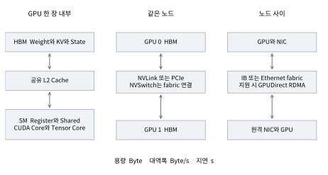
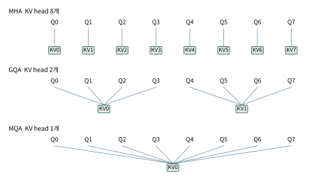
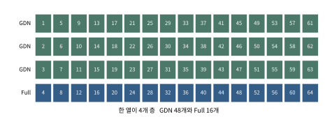
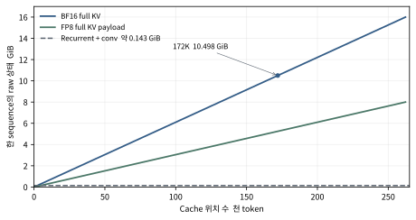
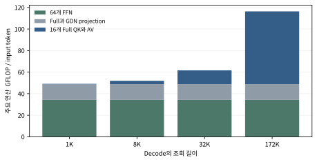

이 교재의 목적은 고객이 “Qwen3.8-27B를 배포해 주세요”라고 요청했을 때, 모델 이름과 GPU 개수 이상의 근거로 답할 수 있게 하는 것이다. 입력 길이와 동시성에 따라 필요한 메모리와 데이터 이동량이 어떻게 달라지는지 계산하고, Attention 설계가 그 비용을 어느 축에서 줄이는지 이해한다.

핵심 사례는 **Qwen/Qwen3.8-27B의 밀집형 언어 백본을 통한 기본 텍스트 추론**이다. 공개 config에는 64개 층, Gated DeltaNet 48개와 Gated Attention 16개의 혼합 구조가 명시되어 있다. 모델 전체에는 비전 인코더도 있지만, 본문의 요청 상태와 계산 예제는 텍스트 경로를 대상으로 한다. [13–15]

핵심 결론은 다음과 같다. Attention은 과거를 읽는 연산인 동시에 과거를 저장하는 규칙이다. Head를 공유하는 GQA, token 표현을 압축하는 MLA, 조회 범위를 제한하는 SWA, sequence를 압축하는 CSA/HCA, 이력을 상태로 접는 Gated DeltaNet은 서로 다른 비용을 줄인다. 어떤 방법도 모델 품질과 GPU 실행 비용을 함께 평가하는 과정을 대신하지 않는다.

문서의 수식은 벡터와 행렬의 차원을 정의한 뒤 유도한다. **공식 설정**, **공식 구현**, **수식에서 유도한 값**, **설명용 가정**을 해당 문단에서 구분한다. 산술값은 raw tensor 기준이며 실제 엔진의 할당량과 동일하지 않다. 본문 인용 번호는 끝의 주석 참고문헌과 대응한다.

# 한 페이지 핵심 요약

**고객에게 답할 근거는 모델이 만드는 tensor와 그 이동 경로다.** 같은 27B라도 긴 prompt와 높은 동시성은 짧은 단일 요청과 다른 구성이 필요하다.

| 구분 | 이 교재에서 설명할 핵심 |
|---|---|
| 계산 | Projection은 GEMM이고 attention은 score와 value 혼합이다 |
| 저장 | Weight는 모델 공유 상태이고 KV와 recurrent state는 요청별이다 |
| 이동 | HBM과 GPU 링크와 네트워크의 bandwidth는 서로 다른 경로다 |
| Prefill | 여러 prompt 위치를 처리하고 첫 출력의 logits를 만든다 |
| Decode | 새 token의 KV 또는 state를 갱신하며 다음 token을 예측한다 |
| 구조의 차이 | Head 공유와 latent 압축과 위치 선택과 recurrence는 다른 선택이다 |
| 실행의 차이 | FlashAttention과 PagedAttention과 Graph는 다른 최적화 층위다 |

Qwen3.8-27B의 64개 층 중 full attention은 16개다. BF16 full KV는 **64 KiB/token**이며 172K 예산에서 약 **10.498 GiB/request**다. 48개 GDN 층의 FP32 recurrent state는 raw 기준 **144 MiB/request**이고 convolution state는 별도다.

이 수치는 capacity 계산의 재료다. 실제 속도를 답하려면 weight/KV 읽기, GEMM, state update, GPU collective와 queueing을 함께 측정해야 한다. 메모리에 들어간다는 사실과 SLO 안에서 처리한다는 사실은 다르다.

# 목차

| 장 | 주제 |
|---:|---|
| 0 | 발표 설계와 설명의 연결 |
| 1 | 배포 요구를 하드웨어 질문으로 바꾸기 |
| 2 | 행렬 곱과 Projection의 기초 |
| 3 | GPU와 데이터 이동의 구조 |
| 4 | 밀집 모델의 Prefill과 Decode 실행 |
| 5 | Softmax Attention을 계산으로 이해하기 |
| 6 | KV Cache의 유도와 저장 정밀도 |
| 7 | MHA MQA GQA의 구조와 정량 비교 |
| 8 | MLA의 저랭크 표현과 Matrix Absorption |
| 9 | SWA와 Sparse와 Compressed Attention |
| 10 | Linear Attention을 Recurrent State로 유도하기 |
| 11 | Mamba와 Delta Rule과 Gated DeltaNet |
| 12 | Qwen3.8 27B의 층과 상태를 직접 계산하기 |
| 13 | FlashAttention과 PagedAttention과 CUDA Graph |
| 14 | 요청 길이와 동시성의 메모리 계산 |
| 15 | 분산 배포와 통신의 Trade off |
| 16 | 운영에서 확인할 항목과 해석 |
| 17 | Attention 최적화의 계보와 학습 지도 |
| 18 | 별도 참고 P D Disaggregation |
| 19 | 주석이 포함된 원문 참고자료 |
| 20 | 용어집과 발표자 확인 항목 |

# 0 발표 설계와 설명의 연결

## 0.1 제안한 구성의 평가

고객의 배포 요청으로 시작하는 도입은 적절하다. 청중이 먼저 “왜 이 공부가 필요한가”를 이해하고, GPU와 모델을 배포 의사결정의 근거로 읽게 된다. 다만 속도와 처리량을 완전히 양자택일로 제시하면 과도한 단순화다. 먼저 TTFT, ITL, SLO를 만족하는 처리량과 자원 비용의 우선순위 및 허용 범위를 정한다. Batch를 늘려 처리량과 장치 효율을 함께 높일 수 있는 구간도 있고, 그 이후에는 지연이 악화될 수 있다.

원안의 마지막에 모인 GEMM, CUDA Graph, 연산량 계산은 서로 다른 층위다. GEMM은 처음부터 등장하는 계산 언어이므로 CPU/GPU 다음에 소개한다. CUDA Graph는 그 계산의 제출·실행 최적화이므로 원리를 배운 뒤 다룬다. 수치 계산은 초반의 작은 예와 마지막의 전체 회계로 두 번 제시하면, 마지막 장이 새 용어를 한꺼번에 배우는 장이 되지 않는다.

분산 배포는 GPU 외부 통신 다음에 개괄하고, Prefill/Decode 이후에 다시 해석한다. 첫 등장에서는 “쪼개면 통신이 생긴다”까지만 설명하고, 뒤에서 왜 작은 decode message가 latency에 민감한지 수식으로 회수한다. 계보는 한 장의 지도로 먼저 보여주되, 연도 암기보다 각 기술이 줄이는 축을 표시한다.

표기는 MHA, Conv State, CUDA Core로 통일한다. MLA는 full-history softmax 계열에 놓을 수 있지만 cache 표현과 실행 경로가 MHA/GQA와 같지는 않다. Mamba는 selective SSM이며 DeltaNet을 거쳐 직선으로 진화한 후속 버전이 아니다. 이 구분을 지키면 계보 그림이 기술적 오해를 만들지 않는다. [1–12]

## 0.2 권장 발표 순서와 마스터 노트의 대응

아래는 발표용 큰 묶음 15개다. 한 행을 반드시 슬라이드 한 장에 넣으라는 뜻은 아니다. 특히 수식 비교와 상태 갱신은 여러 장에 나누어 설명한다. 본문은 상세 학습을 위한 참조 구조이며 발표 때는 이 표의 순서로 읽는다.

| 순서 | 발표의 질문 | 상세 학습 위치 |
|---:|---|---|
| 1 | 고객의 “빠르게”는 어떤 SLO인가 | 1장과 16장 |
| 2 | 우리가 바꿀 수 있는 것은 무엇인가 | 1.3절 |
| 3 | CPU와 GPU가 어떻게 협업하는가 | 2장과 3장 |
| 4 | GEMM과 projection은 무엇을 계산하는가 | 2.1–2.5절 |
| 5 | GPU 스펙과 내부 계층을 어떻게 읽는가 | 3.1–3.3절과 3.6절 |
| 6 | GPU 밖으로 무엇이 이동하는가 | 3.4–3.5절 |
| 7 | TP와 PP와 replica는 무엇을 나누는가 | 15장 |
| 8 | Prefill과 decode에서 상태는 어떻게 바뀌는가 | 4장과 12.8절 |
| 9 | Attention과 KV cache의 기본 비용은 무엇인가 | 5장과 6장 |
| 10 | 어떤 병목 때문에 구조가 갈라졌는가 | 17장과 0.3절 |
| 11 | MHA MQA GQA MLA는 무엇을 공유하는가 | 7장과 8장 |
| 12 | SWA CSA HCA는 과거를 어떻게 줄이는가 | 9장 |
| 13 | State로 과거를 요약한다는 뜻은 무엇인가 | 10–12장 |
| 14 | 같은 수식을 더 효율적으로 실행할 방법은 무엇인가 | 13.1–13.5절 |
| 15 | 170K 요청과 동시성을 어떤 구성으로 수용할 것인가 | 13.6–13.10절과 14–16장 |

청중이 Attention을 처음 듣는다면 9번의 기본식을 먼저 충분히 설명한다. 계보는 그 뒤에 둔다. 제한 시간이 짧으면 CSA/HCA의 indexer 수식과 Mamba-2의 상세 유도는 교재 참조로 남기고, Full/GQA와 recurrent의 저장·조회 차이 및 실제 Qwen 회계는 발표 본문에 남긴다. 이는 학습 난이도를 조절하는 제안이며 기술 내용의 중요도 순위를 뜻하지 않는다.

## 0.3 슬라이드별 발표자가 풀어낼 논리

### 고객의 요구를 성능 계약으로 바꾸기

화면에는 고객의 “Qwen 27B를 배포해 주세요”와 엔지니어의 “첫 응답, token 간격, 동시 요청 중 어떤 조건을 만족해야 하나요”를 놓는다. 발표자는 같은 모델도 1K 입력 한 건과 170K 입력 16건은 전혀 다른 자원 문제라고 설명한다. NVLink/IB 유무는 요구를 만족할 수 있는 실행 경로를 바꾸지만 그 자체가 목표는 아니다.

다음 장으로 넘길 때는 “목표가 정해졌다면 무엇을 바꿔서 맞출 수 있을까”라고 연결한다. “자원이 유한하면 모든 성능을 무한히 높일 수 없다”는 말은 유지하되, 최적점이 하나로 고정돼 있다고 말하지 않는다. Workload와 SLO가 바뀌면 최적점도 달라진다.

### 통제 가능한 영역과 구조가 정한 영역

화면에는 1.3절의 세 범주를 보여준다. Head 수와 layer pattern은 주어진 checkpoint의 학습 결과이고, TP와 batch와 KV dtype은 지원되는 범위에서 배포자가 선택한다. KV FP8은 수식의 저장 byte를 바꾸지만 GQA를 MLA로 바꾸지 않는다. 품질 검증이 필요한 옵션을 “통제 가능하므로 무위험”이라고 말하지 않는다.

다음 장은 “옵션은 결국 CPU가 어떤 GPU 작업을 언제 제출하고 어디에 데이터를 놓는지를 정한다”로 연결한다.

### CPU GPU와 GEMM

행렬 곱 하나를 실행 단위로 사용한다. CPU는 요청·스케줄·제출을 관리하고 GPU는 큰 tensor 계산을 병렬 수행한다. CPU가 모든 수식을 먼저 계산해 GPU에 결과를 보내는 구조가 아니다. GPU kernel이 device memory의 tensor를 읽고 계산하며, host와 device가 실행 순서를 협력한다. [19,35]

GEMM에서는 dot product를 여러 출력 원소에 반복한다. 두 입력 차원이 맞는 이유, FMA를 2 FLOP으로 세는 이유, batch/token 행을 늘릴 때 같은 weight를 재사용하는 이유를 작은 행렬 예제로 설명한다. “Tensor Core가 빠르다” 전에 “어떤 행렬을 왜 곱하는가”를 이해시킨다.

### GPU 스펙과 내부 계층

화면에 H200 SXM의 용량, HBM bandwidth, dtype별 Tensor Core 수치와 sparsity 각주를 같이 놓는다. 가장 큰 TFLOPS 한 개를 읽어 모델 속도로 환산하지 않는다. 이후 SM, warp, register/shared, L2, HBM을 보여주고 데이터를 가져와야 곱셈을 할 수 있다는 실행 순서를 연결한다. [19,21,35]

발표자의 핵심 문장은 “연산기를 더 빨리 만들어도 데이터를 공급하지 못하면 기다린다”다. GPU utilization 100%와 peak 계산 성능은 다르다. On-chip memory를 과도하게 점유해 occupancy가 줄어드는 trade-off도 함께 짚는다.

### 외부 통신과 분산 배포

화면에는 GPU 내부 HBM 경로, node 내부 NVLink/PCIe, node 사이 NIC/fabric 경로를 구분한다. NVSwitch는 저장 공간을 합쳐 하나의 HBM으로 만드는 장치가 아니라 GPU 간 경로를 연결하는 fabric이다. GPU별 memory ownership과 원격 접근 비용은 남는다. [19–21]

TP에서는 같은 layer의 tensor를 나누므로 결과를 합치는 비용이 생긴다. Replica는 서로 다른 요청을 나누므로 같은 요청의 layer마다 collective를 할 필요가 없다. “GPU를 두 장 썼다”라는 말만으로 두 구성을 비교할 수 없는 이유를 설명한다. PP는 layer 구간을 나누지만 한 sequence의 다음 layer 의존성은 그대로다.

### Prefill Decode와 KV

화면에는 prompt 처리 뒤 첫 출력이 선택되는 지점과 다음 one-token step을 구분한다. 과거 KV가 같은 causal prefix에 대해 변하지 않으므로 저장해 재사용한다. KV가 없으면 과거 layer 계산을 되풀이해야 한다. Cache가 있어도 현재 query가 과거를 읽는 비용은 남는다. [1,5,6]

발표자는 cache를 “정답을 저장한 것”보다 “다음 계산에서 다시 사용할 중간 표현”으로 설명한다. Weight는 요청 간 공유하지만 KV/state는 각 sequence의 이력이다. 이 차이가 동시성에 따른 메모리 증가의 근원이다.

### 기본 Attention과 발전 지도

Q와 K의 내적으로 점수를 만들고 softmax로 정규화한 뒤 V를 가중합하는 두 위치 예제를 먼저 푼다. 그 다음 지도에는 head 공유, token별 latent, 위치 제한, sequence 압축, recurrent state, kernel과 allocator를 별도 축으로 표시한다. 하나의 새 방식이 모든 이전 방식을 대체했다고 말하지 않는다.

MHA/MQA/GQA/MLA를 비교할 때는 동일한 기호와 동일 길이로 cache bytes를 계산한다. MQA/GQA가 query head 계산까지 KV head 비율만큼 없애는 것은 아니며 MLA의 latent도 모든 과거 위치에 대해 저장할 수 있다. 품질 순위를 구조 이름만으로 단정하지 않는다. [2–4]

### 긴 문맥과 상태 요약

SWA는 “최근 W개에 접근”, CSA는 “압축된 history 중 선택”, HCA는 “더 강하게 압축한 history 전체 조회”라는 접근 대상을 먼저 고정한다. Indexer가 원본 전체 KV를 공짜로 복구한다고 설명하지 않는다. 저장 항목 수와 읽는 항목 수를 각각 세어야 한다. [17,18]

Recurrent에서는 과거의 목록을 제한된 행렬에 누적한다. Delta rule은 현재 key로 예측한 value의 오류를 보정한다. Conv state는 최근 입력 tail이고 recurrent matrix와 용도가 다르다. Qwen의 16개 KV 저장소와 48개 matrix state 및 48개 conv tail을 요청 하나의 상태로 연결한다. [7–16]

### 실행 최적화와 고객에게 돌아오는 결론

FlashAttention은 같은 softmax 수식의 IO, PagedAttention은 저장 block 관리, CUDA Graph는 launch와 dependency 제출을 바꾼다. 세 기술을 attention 구조의 후속 모델처럼 한 줄에 놓지 않는다. [5,6,19,22]

마지막 화면에는 170K+2K 요청의 raw state, FFN/projection/full attention FLOPs, HBM 읽기 가정과 통신량을 따로 놓는다. 발표자는 “이 구성이라면 반드시 몇 token/s”라는 미검증 답 대신, 충족해야 할 용량 조건과 유력 병목, TP/replica 후보 및 필요한 실측을 근거로 답한다. 16.4절의 답변 예시로 처음 고객 질문을 회수한다.

# 1 배포 요구를 하드웨어 질문으로 바꾸기

## 1.1 고객과의 대화에서 시작하기

고객이 “좋다고 하니 이 모델을 배포해 달라”고 말하면 우리는 먼저 목표를 묻는다. 첫 답변을 빨리 받는 것이 중요한지, 긴 답변의 token 간격이 중요한지, 동시에 많은 요청을 처리하는 것이 중요한지를 구분한다. 이어서 prompt와 출력 길이의 분포, 동시 활성 요청 수, 요청 도착률, 허용 가능한 tail latency를 확인한다.

한 GPU에 모델이 들어간다고 배포 설계가 끝나는 것은 아니다. 살아 있는 요청들은 각자 KV cache와 recurrent state를 점유한다. 긴 prompt는 첫 응답 이전 계산을 늘리고, 긴 출력은 그 상태를 오래 유지하며 매 token의 조회를 반복한다. GPU를 여러 장 사용하면 한 장의 용량 제한을 넘을 수 있지만 통신과 동기화 비용이 추가된다.

| 요구 | 먼저 볼 비용 | 확인할 지표 |
|---|---|---|
| 첫 응답이 빨라야 함 | 대기열과 prompt 처리 | TTFT와 prefill 시간 |
| 생성이 매끄러워야 함 | decode step의 데이터 읽기와 실행 지연 | ITL과 TPOT의 분포 |
| 동시 처리량이 커야 함 | 상태 용량과 batch 처리 효율 | 활성 요청 수와 SLO 충족 처리량 |
| 긴 문맥을 써야 함 | KV 증가와 attention 조회량 | 실제 token 길이와 요청별 state bytes |
| 멀티 GPU를 써야 함 | shard 배치와 collective | topology와 통신 시간 |

**TTFT**는 요청부터 첫 token까지의 지연이다. **ITL**은 인접한 출력 token 사이의 간격이며, **TPOT**는 출력 token당 평균 시간을 가리키는 계측 관례다. 서비스마다 queue와 전송 시간을 포함하는 경계가 다를 수 있으므로 정의를 보고 비교한다. Throughput은 초당 처리량, goodput은 목표 SLO를 만족하는 유효 처리량이다. [27,28]

## 1.2 이 교재에서 계속 사용할 질문

계산을 볼 때는 “몇 FLOP인가”, 저장을 볼 때는 “몇 byte가 언제까지 살아 있는가”, 이동을 볼 때는 “어느 경로로 몇 byte를 몇 번 옮기는가”를 묻는다. 이 셋을 분리하면 고성능 GPU에서도 느린 이유와, 메모리는 남는데 동시성을 늘리기 어려운 이유를 설명할 수 있다.

기본 사례는 입력 170,000 token과 출력 2,000 token이다. 편의상 최대 cache 길이를 172,000으로 잡는다. 이는 길이 예산을 위한 보수적 계산이며, 마지막 출력 token을 다시 모델에 입력하지 않고 종료하는 일반 경로에서는 실제 cache 위치가 하나 적을 수 있다. 이 차이는 4장에서 실행 순서와 연결한다.

## 1.3 배포자가 통제하는 것과 모델이 정한 것

“모델 아키텍처는 통제 불가능하다”는 말은 **주어진 checkpoint를 같은 모델로 배포한다는 조건**에서 이해한다. 모델 선정이나 재학습까지 업무 범위에 들어가면 구조를 바꾸는 결정도 가능하지만, 실행 옵션을 바꾸는 일과는 비용·검증 범위가 다르다.

| 범주 | 예시 | 변경의 의미 |
|---|---|---|
| 주어진 checkpoint의 구조 | layer 수와 종류, Q/KV head, latent/state 차원, FFN 폭 | weight shape와 학습된 표현을 정의 |
| 지원 범위의 실행 선택 | TP/PP, replica, batching, chunk 크기, attention backend, Graph mode | 같은 모델을 배치하고 실행하는 방법 |
| 품질·호환성 검증이 필요한 선택 | weight/KV dtype, context 확장, offload, cache eviction | 수치·접근 범위 또는 data path를 변경 |

KV dtype을 FP8로 바꾸면 저장 원소의 byte와 오차가 바뀐다. GQA의 KV head 수를 임의로 4에서 1로 줄이면 원래 checkpoint의 K/V projection 의미까지 바뀌므로 같은 종류의 옵션 조정이 아니다. FlashAttention과 CUDA Graph는 지원되는 수식을 효율적으로 실행하며, GDN을 softmax attention으로 치환하는 기능이 아니다. [2–6,13,22–24]

재현 가능한 비교를 하려면 고정할 값과 바꿀 값을 먼저 적는다. Checkpoint와 tokenizer, workload를 고정한 뒤 TP만 바꾸는 실험과, KV dtype·chunk·동시성까지 한꺼번에 바꾼 실험은 다른 근거를 제공한다. 실행 옵션도 kernel 지원과 layout 제약을 받으므로 “통제 가능”은 “어떤 조합이든 가능”이라는 뜻이 아니다.

NVLink가 없으면 multi-GPU를 못 쓰는 것은 아니다. PCIe 경로를 사용할 수 있으나 통신 비용이 다르다. IB가 없어도 TCP나 지원되는 RoCE 등으로 multi-node를 구성할 수 있으나, 실제 collective 경로와 지연·대역폭을 다시 확인해야 한다. 링크 이름 하나로 가능/불가능을 이분하지 않는다. [19–21]

# 2 행렬 곱과 Projection의 기초

## 2.1 Token이 hidden vector가 되는 과정

Tokenizer는 텍스트를 정수 ID의 열로 만든다. Embedding은 각 ID를 길이 $d_{\mathrm{model}}$인 벡터로 바꾼다. 각 층은 이 벡터를 문맥에 맞게 변환하고, 마지막 층의 결과에서 vocabulary별 점수인 logits를 만든다. 같은 token ID라도 위치와 이전 문맥에 따라 층을 지난 hidden state는 달라진다. [1]

행렬을 읽기 위한 최소 규칙은 다음과 같다. $A\in\mathbb{R}^{m\times k}$와 $B\in\mathbb{R}^{k\times n}$은 안쪽 차원 $k$가 같으므로 곱할 수 있고 결과는 $m\times n$이다. 전치 $A^\top$는 행과 열을 바꾼다. 내적은 두 벡터를 하나의 점수로 만들고, 외적은 두 벡터로 행렬을 만든다.

$$
C_{ij}=\sum_{r=1}^{k}A_{ir}B_{rj},\qquad C\in\mathbb{R}^{m\times n}.
$$

각 $C_{ij}$를 만들려면 대략 $k$번의 곱과 덧셈이 필요하다. Multiply-add를 2 FLOP으로 세는 관례에서 큰 행렬 곱의 연산량은 약 $2mkn$ FLOP이다. 경계의 덧셈 하나 차이는 큰 행렬의 근사에서 생략한다.

> **초심자용 연결:** 기존 GEMM/Projection 설명의 α, β, C, FMA의 Fused와 GPU CUDA Core/SFU/ Tensor Core 구분은 [행렬곱 입문 4.1.1–4.1.2절, 6.7절](00a-matrix-gemm-to-qkv-from-zero.md)에서 숫자 예제와 함께 설명한다.

## 2.2 GEMM과 GPU가 잘하는 일

GEMM은 General Matrix Multiply이며 보통 $C\leftarrow\alpha AB+\beta C$ 형태를 말한다. LLM의 선형층은 대부분 이 행렬 곱에 해당한다. 여러 token을 $X\in\mathbb{R}^{N\times d}$의 행으로 묶고, 학습된 weight $W\in\mathbb{R}^{d\times d_{\mathrm{out}}}$를 곱하면 $Y=XW$가 된다.

$$
\mathrm{FLOP}_{XW}\simeq 2Ndd_{\mathrm{out}}.
$$

Prefill은 한 요청에서도 많은 위치를 $N$에 묶을 수 있다. 한 token decode는 동시 요청이 적으면 $N$이 작다. 같은 weight를 읽더라도 큰 $N$에서는 많은 token이 weight tile을 재사용할 수 있어 연산기의 처리량을 활용하기 쉬워진다.

## 2.3 Projection은 역할을 가진 선형변환

Projection은 hidden representation을 학습된 가중치 행렬로 다른 feature 공간에 옮기는 것이다. 기하학에서 말하는 직교 투영처럼 반드시 차원을 줄이거나 어떤 축을 제거하는 연산은 아니다. 차원을 늘릴 수도 있다.

행 단위 입력 표기로 Q/K/V는 다음과 같다.

$$
Q=XW_Q,\qquad K=XW_K,\qquad V=XW_V.
$$

$W_Q$는 무엇을 찾을지, $W_K$는 어떤 기준으로 매칭할지, $W_V$는 매칭된 위치에서 어떤 정보를 전달할지를 학습한다. 구현에서는 세 선형변환을 한 큰 projection으로 묶어 계산한 뒤 view/split할 수 있다. 이 fusion은 수학적 역할을 합친다는 뜻이 아니라 실행과 메모리 접근을 효율화하는 방법이다.

**중요한 구분:** Q와 K를 곱해 V를 만드는 것이 아니다. **Q/K/V는 X에서 각각 생성**되며, `QKᵀ`는 토큰 간 Score, 그 Score를 정규화한 P는 가중치, `PV`는 **이미 생성된 V의 가중합**이다. 같은 숫자 예제를 처음부터 끝까지 따라가려면 [행렬곱 입문 6.1~7장](00a-matrix-gemm-to-qkv-from-zero.md)을 먼저 참고한다.

Output projection은 head별 결과를 이어 붙여 residual stream으로 돌려보낸다.

$$
Y=\mathrm{Concat}(O_1,\ldots,O_{H_q})W_O.
$$

밀집형 gated MLP는 예를 들어 다음처럼 쓴다.

$$
U=XW_u,\quad G=\mathrm{SiLU}(XW_g),\quad
\mathrm{MLP}(X)=(U\odot G)W_d.
$$

$\odot$는 원소별 곱이다. 이 FFN gate와 attention output gate, recurrent state의 forgetting gate는 모두 “gate”라는 단어를 쓰지만 작용 위치와 의미가 다르다. 뒤 장에서는 무엇에 곱하는 gate인지 항상 명시한다.

## 2.4 Weight와 요청 상태를 구분하기

| 종류 | 무엇인가 | 수명과 증가 요인 |
|---|---|---|
| Weight | 학습된 projection과 정규화 등의 파라미터 | 모델을 적재한 동안 유지 |
| Activation | 현재 연산의 중간 hidden tensor | layer나 step 동안 주로 유지 |
| KV cache | attention에 재사용할 과거 위치의 K와 V | 요청 길이와 요청 수에 따라 증가 |
| Recurrent state | 과거를 누적한 제한 크기의 상태 | sequence별 유지와 갱신 |
| Convolution state | causal convolution의 최근 입력 기록 | kernel 길이만큼의 tail 유지 |
| Workspace | kernel이나 라이브러리가 쓰는 임시 공간 | shape와 backend에 따라 예약 |

Weight는 여러 요청이 같은 모델을 실행하며 공유한다. KV/state는 요청마다 다르다. Activation과 workspace는 처리 중인 batch와 prefill chunk에 따라 peak가 달라진다. 그래서 모델 parameter 수에 dtype byte를 곱한 값만으로 동시성을 계산할 수 없다.

## 2.5 같은 GEMM인데 Prefill과 Decode가 다른 이유

$X\in\mathbb R^{N\times d}$와 $W\in\mathbb R^{d\times m}$의 곱에서 $N$은 이번 호출에서 처리하는 token 행 수다. Decode에서 활성 sequence 8개가 각각 한 token이면 $N=8$이고, prefill chunk의 8192 token이면 $N=8192$다. $N$을 전체 context 길이 $T$와 구별해야 한다. Decode에서도 cache의 $T$는 매우 클 수 있다.

곱셈 하나에서 입력과 weight와 출력을 각각 한 번만 HBM에서 읽거나 쓴다는 이상화로, 동일 원소 크기 $b$일 때:

$$
F=2Ndm,\qquad D_{\mathrm{ideal}}=b(Nd+dm+Nm).
$$

$$
I_{\mathrm{ideal}}=\frac{2Ndm}{b(Nd+dm+Nm)}.
$$

$N$이 작고 weight 항 $dm$이 지배하면 $I\simeq2N/b$다. BF16의 $b=2$에서는 약 $N$ FLOP/byte다. Weight를 읽어 같은 batch의 여러 token에 쓸수록 byte당 연산이 늘어난다. 이는 실제 HBM traffic 보장이 아니라 재사용을 설명하는 최소 이동 모형이다. Tile 재로드, cache, layout, activation fusion은 실제 traffic을 바꾼다. [35]

예를 들어 Qwen의 한 FFN projection을 $d=5120,m=17408,b=2$로 보면 weight는 178,257,920 byte다. $N=1$에서는 계산 약 0.178 GFLOP, 입력·출력 포함 최소 이동 약 178.3 MB, intensity는 약 1이다. $N=8192$에서는 계산 약 1.460 TFLOP, 최소 이동 약 547.4 MB, intensity는 약 2668 FLOP/byte다. 같은 weight라도 호출 shape가 달라 GPU의 다른 제약을 만난다.

작은 decode batch의 “GEMM”은 수학적으로 matrix multiply여도 skinny GEMM/GEMV에 가깝게 실행될 수 있다. Tensor Core 사용 여부는 kernel과 shape·dtype에 달려 있다. Tensor Core에 실리는 명령만 세어도 데이터 이동과 reduction, scheduling 비용은 사라지지 않는다. FLOPs가 적어서 반드시 지연이 작은 것도 아니다.

SwiGLU FFN은 $d\to m$ 두 번과 $m\to d$ 한 번의 큰 선형변환을 사용한다. 따라서 주요 연산은 token당 $6dm$이다. FFN을 “신경망 한 번”이라고만 세면 이 세 행렬과 중간 activation 수명을 놓친다. 두 행렬의 출력이 모두 필요할 수 있고 fusion 정책에 따라 peak 메모리도 달라진다. [36]

# 3 GPU와 데이터 이동의 구조

CPU는 요청 수신과 tokenization, 스케줄링, GPU 작업 제출과 결과 전달을 주로 맡는다. GPU는 많은 token과 feature의 행렬 연산을 병렬 실행한다. 이는 일반적인 serving 배치이며 sampling 등 일부 작업의 실행 위치는 엔진마다 다르다. CPU의 제어 흐름 처리와 GPU의 대량 병렬 계산은 협력 관계다. GPU가 빨라도 host가 다음 작업을 제때 제출하지 못하면 전체 실행이 기다릴 수 있다. [19,22,28]

## 3.1 용량과 대역폭과 연산 성능

FLOP은 연산 횟수, FLOP/s 또는 FLOPS는 초당 연산 처리량이다. GB와 GiB는 저장량, GB/s와 TB/s는 데이터 이동 속도다. Latency는 전송이나 작업을 시작하고 완료하는 데 드는 시간이다. 이 지표들은 다른 제약을 설명한다.

십진수 $1\,\mathrm{GB}=10^9$ byte이고 $1\,\mathrm{GiB}=2^{30}$ byte다. GPU 제품 용량을 표기한 GB와 소프트웨어가 출력하는 GiB를 바꿔 쓸 때 단위를 함께 적는다.

Roofline 모델은 실제 처리량의 상한을 다음처럼 본다. [25]

$$
P\le\min(P_{\mathrm{peak}},\ B_{\mathrm{HBM}}\ I),\qquad
I=\frac{\mathrm{FLOP}}{\mathrm{HBM\ bytes\ moved}}.
$$

메모리가 초당 $B_{\mathrm{HBM}}$ byte를 공급하고 byte당 $I$ FLOP을 수행한다면 공급 가능한 연산은 초당 $BI$다. 큰 GEMM에서 tile을 재사용하면 $I$를 높일 수 있다. 반대로 매번 많은 weight/KV를 읽고 조금만 계산하면 연산기가 기다릴 수 있다. 예를 들어 설명용 $P_{\mathrm{peak}}=300$ TFLOP/s, $B=3$ TB/s라면 두 상한이 만나는 강도는 100 FLOP/byte다.

## 3.2 SM과 실행 단위

GPU는 여러 SM을 가진다. SM은 Streaming Multiprocessor이며 thread block을 받아 실행하는 스케줄링과 연산 자원의 묶음이다. CUDA의 논리적 계층은 grid, block, thread이고, NVIDIA warp는 32개 thread의 실행 묶음이다. 실제 SM 내부의 scheduler, 실행 유닛, register와 cache 구성은 GPU 세대와 compute capability에 따라 다르다. [19]

Register는 thread 가까이에 있는 작은 상태 공간이고, shared memory는 block이 협업하며 tile을 재사용하는 on-chip 메모리다. L1과 shared memory는 세대에 따라 일부 자원을 공유하며, L2는 GPU 전반에서 접근하는 cache 계층이다. HBM은 대형 weight와 KV/state 등을 보관하는 주 device memory다. Register/shared memory를 과도하게 쓰면 동시에 상주할 block 수가 줄어 occupancy가 낮아질 수 있다.

## 3.3 CUDA Core와 Tensor Core

Tensor Core는 지원하는 dtype과 형태의 행렬 multiply-accumulate를 높은 처리량으로 수행하는 유닛이다. GEMM kernel은 데이터를 tile로 가져오고 matrix instruction을 실행한다. 주소 계산, 분기, elementwise 연산, reduction과 정규화는 일반 SIMT 연산기와 여러 실행 파이프를 함께 사용한다. Tensor Core가 모든 GPU 작업을 대신하지 않는다. [19]

GPU-Util은 보통 샘플 구간에서 GPU가 작업을 실행 중이었는지 나타낸다. 95%라고 해도 Tensor Core가 peak FLOPS로 일한다는 뜻은 아니다. Memory stall, 작은 kernel의 반복, collective와 동기화, CPU launch overhead가 섞일 수 있다. SM active, tensor pipe, HBM bandwidth, occupancy, kernel timeline을 같이 봐야 한다.

{width=6.2in}

그림 1. HBM의 용량과 대역폭, GPU 사이 링크, 노드 사이 네트워크는 서로 다른 구간의 제약이다. Cache는 모든 load가 반드시 순서대로 통과하는 소프트웨어 pipeline을 의미하지 않는다.

## 3.4 HBM에 상주한다는 말의 의미

일반적인 GPU serving에서 KV tensor는 GPU HBM에 할당되어 decode step 사이에도 유지된다. 이때 “계속 올라와 있다”는 말은 GPU device memory에 보존된다는 뜻이다. 전체 KV가 SM의 SRAM에 상주한다는 뜻은 아니다.

Attention kernel은 필요한 일부 tile을 HBM/global memory에서 읽는다. 접근 정책과 locality에 따라 L2나 SM 근처 cache가 도움을 주고, kernel은 일부를 shared memory/register에서 계산한다. 긴 context의 KV는 on-chip cache보다 훨씬 클 수 있다. Tiling과 fusion의 효과는 이 이동 횟수와 재사용도를 개선하는 데 있다. [5,19]

CPU DRAM, NVMe, remote GPU의 KV는 별도 저장 계층이다. Offload는 GPU capacity를 확장하지만 필요한 순간 전송 또는 재계산 지연을 더한다. HBM의 KV와 remote cache의 KV를 같은 지연으로 접근한다고 보면 안 된다.

## 3.5 GPU 사이와 노드 사이 연결

NVLink는 GPU 사이의 고속 연결이고 NVSwitch는 여러 NVLink 경로를 연결하는 switching fabric이다. PCIe는 CPU, GPU, NIC 등을 잇는 범용 I/O 경로다. InfiniBand와 Ethernet/RoCE는 주로 노드 사이 fabric을 구성한다. RDMA는 NIC가 원격 메모리에 접근하는 방식이며, GPUDirect RDMA는 지원되는 환경에서 GPU memory를 직접 DMA 대상으로 사용해 host staging을 줄인다. [19–21]

| 제품 예시 | GPU당 메모리 | 명목 메모리 대역폭 | 배포 시 확인 |
|---|---|---|---|
| H100 SXM | 80 GB HBM3 | 약 3.35 TB/s | PCIe/NVL SKU와 구분 |
| H200 SXM | 141 GB HBM3e | 약 4.8 TB/s | HGX NVLink/NVSwitch topology |
| L40S | 48 GB GDDR6 | 약 864 GB/s | NVLink 미지원과 PCIe 경로 |

위 값은 공식 제품 자료의 해당 form factor 예시이며 실효 bandwidth가 아니다. GPU당 수치와 8-GPU node aggregate, 단방향과 양방향 합산을 구분한다. 예를 들어 NVLink 900 GB/s라는 aggregate 제품값을 그대로 한 pair의 단방향 payload bandwidth로 대입하지 않는다. 제품의 정확한 SKU와 실제 topology를 먼저 확인한다. [21]

## 3.6 실제 스펙 표를 읽고 실행 가설을 만들기

스펙은 SKU와 form factor, dtype, dense/sparse 조건, GPU당/시스템 합산, 단방향/양방향 정의의 순서로 읽는다. 모델 weight가 BF16이라고 모든 kernel이 같은 BF16 Tensor Core peak로 실행되지는 않는다. FP32 accumulation, normalization, softmax와 state update의 경로는 따로 본다. [19,21,35]

H200 공식 제품 표는 SXM과 NVL을 구분하고, BF16 Tensor Core 1,979 TFLOPS와 1,671 TFLOPS에 “With sparsity” 각주를 붙인다. 이 숫자를 일반 dense BF16 GEMM의 보장 처리량으로 그대로 넣으면 안 된다. 모델이 dense라는 표현과 하드웨어의 구조적 sparsity 지원 조건도 다른 개념이다. 표의 가장 큰 숫자보다 각주가 계산의 적용 범위를 결정한다. [21]

HBM 141 GB는 보관할 수 있는 양이고 4.8 TB/s는 명목 데이터 이동률이다. 예를 들어 raw BF16 weight를 54 GB로 가정하면 한 번 읽는 이상 하한은 $54/4800=0.01125$ s다. 실제로 모든 step에서 정확히 한 번만 읽는다는 보장은 없고 batch와 L2 재사용, sharding과 kernel 경로가 바뀐다. 이 값으로 모델 tokens/s를 확정하지 않는다.

NVLink 900 GB/s와 PCIe Gen5 128 GB/s라는 제품 표기도 집계·방향·port 조건을 확인한 뒤 사용한다. NIC의 400 Gb/s는 bit 단위이며 단순 byte 환산은 50 GB/s다. 링크의 line rate와 GPU buffer 사이의 실제 end-to-end payload throughput은 다르다. [19–21]

GPU 내부에서도 bandwidth라는 한 숫자로 모든 경로를 대체하지 않는다. Register와 shared memory는 HBM보다 작고 가깝지만 점유량이 커지면 동시에 실행할 warp/block이 줄 수 있다. Cache hit가 늘어 HBM traffic이 줄어드는 경우와, warp가 부족해 latency를 숨기지 못하는 경우를 같이 고려한다. 큰 batch는 weight reuse를 돕지만 activation과 workspace 및 대기 시간을 늘릴 수 있다.

프로파일에서 SM active, tensor instruction 활성, HBM throughput, kernel duration, GPU 간 collective duration을 연결해서 본다. GPU-Util은 실행 중인 시간의 신호일 수 있고 Tensor Core 포화도를 뜻하지 않는다. NVLink가 있다는 사실 역시 collective와 compute가 잘 overlap된다는 보장이 아니다. [19,20,35]

# 4 밀집 모델의 Prefill과 Decode 실행

## 4.1 모든 층을 순서대로 통과한다

기본 decoder의 token hidden state는 첫 layer부터 마지막 layer까지 순서대로 진행한다. 각 층에서 attention 또는 recurrent token mixing을 거치고 residual, normalization, FFN을 수행한다. Hybrid 모델에서도 층을 건너뛰는 것이 아니라, 층마다 과거 정보에 접근하는 연산이 다를 수 있다. [1,13,15]

서로 다른 요청이나 token을 GPU에서 함께 실행할 수 있어도, 한 token의 layer $l+1$은 layer $l$의 결과에 의존한다. Pipeline parallelism은 층을 장치별 stage로 배치하며 이 dependency를 없애지 않는다.

## 4.2 Prefill과 첫 출력 token

Prompt가 $p_1,\ldots,p_N$이면 prefill은 이 위치들을 causal 조건으로 처리한다. Full-attention 층은 각 위치의 Q/K/V를 계산하고, 이후 decode에 쓸 K/V를 보존한다. Recurrent 층은 전체 sequence를 scan 또는 chunk 방식으로 처리해 마지막 상태를 얻는다. 모든 층의 모든 hidden activation을 영구 보존하는 것은 아니다.

기본적인 추론에서 **마지막 prompt 위치의 logits로 첫 출력 $y_1$을 선택할 수 있다**. 첫 출력이 나온 뒤, 다음 decode step에는 $y_1$을 입력해 $y_2$를 예측한다. 엔진의 계측 경계나 실행 분할은 다를 수 있지만, 첫 token을 만들기 위해 언제나 별도의 one-token decode를 더 해야 한다고 설명하면 off-by-one 혼동이 생긴다.

## 4.3 Decode에서 무엇이 추가되는가

Decode step에서 입력한 새 token은 각 full-attention 층에서 새 Q/K/V를 만든다. 현재 위치의 K/V를 해당 sequence cache에 추가하고, 새 Q는 유효한 과거와 현재 K/V를 참조한다. Recurrent 층은 그 token으로 자신의 state와 convolution tail을 갱신한다. 마지막 logits로 다음 token을 고른 뒤 이 과정을 반복한다.

최종 출력 $y_M$을 뽑고 종료한다면 일반적으로 $y_M$ 자체를 다시 입력하지 않으므로 cache에는 $N+M-1$개 위치가 들어갈 수 있다. 이 교재의 $T=N+M$은 최종 길이 예산을 위한 상한 가정이다. 운영 계산은 엔진의 실제 cache length와 종료 처리를 확인한다.

## 4.4 두 단계의 비용을 나눠 보기

| 항목 | Prefill | Decode |
|---|---|---|
| 처리 위치 | prompt의 여러 위치 | sequence당 보통 한 위치 |
| Projection | 큰 $N$의 GEMM | 작은 batch면 skinny GEMM |
| Full attention | 허용된 token pair 처리 | 새 query가 cache를 조회 |
| 상태 변화 | prompt KV와 최종 recurrent state 구축 | KV append와 state update |
| 흔한 압박 | FLOPs와 activation peak | weight/KV 읽기와 latency |

“Prefill은 compute-bound, decode는 memory-bound”는 출발점으로 유용하지만 항상 참은 아니다. 매우 긴 prefill의 attention IO나 작은 chunk, 큰 decode batch, 특정 kernel과 GPU 구조가 비중을 바꾼다. CPU scheduling과 GPU collective가 병목일 수도 있다.

Continuous batching은 끝난 sequence 자리를 새 요청으로 채워 빈 slot을 줄인다. Chunked prefill은 긴 prompt 작업을 나눠 다른 decode와 공존시키고 한 번에 처리하는 token과 activation peak를 제어한다. Batch를 키우면 weight reuse가 좋아질 수 있지만 요청별 cache 총량과 latency도 증가한다. [27,28]

> **선행 개념:** Projection이 반드시 차원 축소가 아닌 이유(5.4절), **가중합·sqrt(d_k)·exp/Softmax**의 정의(6.4–6.6절), **Decode의 Weight/Cache 읽기와 Arithmetic Intensity**(8.3–8.4절), **FFN 이후 LM Head에서 Logits 생성**(8.5절)을 [기초 교재](00a-matrix-gemm-to-qkv-from-zero.md)에 별도로 확장했다. 이 장의 Q/K/V는 해당 개념 위에서 읽는다.

# 5 Softmax Attention을 계산으로 이해하기

## 5.1 Q와 K의 점수에서 V의 가중합으로

한 head에서 query $q_t\in\mathbb{R}^{d_k}$, 과거 위치의 key $k_i\in\mathbb{R}^{d_k}$와 value $v_i\in\mathbb{R}^{d_v}$를 두자. 이 장의 벡터는 열벡터다. [1]

$$
s_{t,i}=\frac{q_t^\top k_i}{\sqrt{d_k}}+m_{t,i},\qquad
a_{t,i}=\frac{\exp(s_{t,i})}{\sum_{j\le t}\exp(s_{t,j})},
\qquad o_t=\sum_{i\le t}a_{t,i}v_i.
$$

$m_{t,i}$는 mask다. Causal 조건에서 미래 위치는 $-\infty$를 더해 softmax 확률을 0으로 만든다. Dot product는 query와 key의 학습된 feature가 얼마나 맞는지 점수화한다. 분모의 $\sqrt{d_k}$는 차원이 커질 때 dot product의 분산과 softmax 포화가 커지는 현상을 완화한다. Query와 key가 독립이고 각 성분 분산이 1이라는 단순 가정이면 내적 분산은 $d_k$, 표준편차는 $\sqrt{d_k}$다.

Softmax는 허용된 위치에 양수 가중치를 부여하고 합을 1로 만든다. 이는 token 하나를 무작위로 뽑는 sampling이 아니다. Sampling은 모델 마지막 vocabulary logits에서 수행하며 attention 내부 가중합과 단계가 다르다.

## 5.2 두 위치를 손으로 계산하기

이미 scale과 mask를 적용한 점수가 $[0,\ln3]$이라 하자. 지수는 $[1,3]$이므로 가중치는 $[1/4,3/4]$다. Value가 $v_1=(4,0)^\top$, $v_2=(0,8)^\top$이면:

$$
o=\tfrac14(4,0)^\top+\tfrac34(0,8)^\top=(1,6)^\top.
$$

Query가 바뀌어 두 점수의 순서가 바뀌면 같은 V를 저장해도 다른 혼합 결과가 나온다. K는 “조회하는 기준”, V는 “전달되는 내용”을 분리한다. 두 역할이 같아야 할 수학적 필요는 없고, 특정 구조에서는 저장 표현을 공유하도록 학습할 수도 있다.

## 5.3 행렬 shape로 읽기

한 sequence, 한 head의 prefill에서 $Q,K\in\mathbb{R}^{T\times d_k}$, $V\in\mathbb{R}^{T\times d_v}$다.

$$
O=\mathrm{softmax}\left(\frac{QK^\top}{\sqrt{d_k}}+M\right)V.
$$

$QK^\top$는 $T\times T$의 위치 간 점수다. 이를 그대로 HBM에 저장하면 길이 제곱에 비례하는 중간 메모리가 생긴다. 하지만 수학적으로 점수가 정의된다는 것과 구현이 전체 행렬을 HBM에 materialize해야 한다는 것은 다르다. FlashAttention은 이 지점의 IO를 개선한다.

Decode는 query 길이가 1이므로 $Q$가 $1\times d_k$, cache $K$는 $T\times d_k$다. 점수는 $1\times T$이며, 이 연산이 “새 token이 과거를 읽는다”의 구체적인 뜻이다.

## 5.4 RoPE와 위치 정보

Position 정보가 없다면 Q/K의 매칭만으로 순서를 구분하기 어렵다. RoPE는 query와 key의 일부 또는 전체 채널에 위치별 회전을 적용한다. [26]

$$
\widetilde q_t=R_tq_t,\quad \widetilde k_i=R_ik_i,\quad
\widetilde q_t^\top\widetilde k_i=q_t^\top R_t^\top R_i k_i.
$$

회전의 조합에 상대 위치 정보가 들어간다. 실제 구현은 positional dimension, base, scaling, partial rotation 등을 config로 정한다. RoPE 차원은 head dimension과 같을 필요가 없다. Qwen3.8-27B full attention은 head dimension 256 중 partial rotary factor 0.25, 즉 64차원을 회전에 사용한다. [13]

## 5.5 Gated Attention은 어디에 gate를 두는가

Attention output에 입력으로부터 만든 gate를 원소별로 곱하면, 조회한 정보 중 어떤 성분을 residual stream에 전달할지 조절할 수 있다. 설명용 표현은 다음과 같다.

$$
\widehat o_t=g(x_t)\odot o_t,\qquad y_t=W_O\widehat o_t.
$$

Gate의 activation과 적용 위치는 구조별로 다르다. Qwen의 공식 구현은 projection과 output gate 경로를 별도로 다룬다. 이름에 gated가 붙었다고 과거 KV가 fixed state로 대체되는 것은 아니다. **Qwen의 full/Gated Attention 층은 여전히 token별 K/V를 보관**하고, Gated DeltaNet 층은 다른 recurrence를 사용한다. [13,15,30]

## 5.6 Attention과 FFN이 정보를 바꾸는 서로 다른 방식

Full attention은 현재 token의 query로 다른 위치의 K/V를 읽어 위치 사이 정보를 섞는다. Dense FFN은 각 위치의 feature를 학습된 비선형 함수로 변환한다. FFN의 가중치는 위치 사이에서 공유하지만, 기본 FFN 자체가 다른 위치의 hidden vector를 직접 읽는 연산은 아니다. 다만 FFN 입력에는 앞선 attention이 모은 문맥이 이미 들어 있다. [1,36]

이 구분은 왜 두 부분의 비용 식이 다른지를 설명한다. FFN은 같은 폭의 token을 하나 더 처리할 때 비슷한 연산을 반복한다. Full attention의 새 query는 history 길이가 늘수록 더 많은 위치와 관계를 계산한다. 그래서 “Attention 대 FFN의 연산 비중”은 모델 이름 하나로 고정할 수 없다. Projection까지 attention에 넣었는지, prefill 전체인지 decode 한 step인지도 먼저 정한다.

GQA는 과거 위치 수가 아니라 KV의 head 축을 줄인다. Softmax의 출력은 여전히 query head마다 다르므로, shared KV를 반복 load하지 않는 효율적인 구현과 query별 계산량 감소는 구별해야 한다. Head 공유, window 제한, sequence 압축과 recurrent memory는 각각 다른 정보를 남기고 버리는 규칙이다.

# 6 KV Cache의 유도와 저장 정밀도

## 6.1 저장으로 재계산을 줄이는 이유

이전 token의 K/V는 그 위치까지의 causal hidden state에서 만들어진다. Model weight와 위치 조건이 고정된 기본 추론에서 미래 token이 추가되어도 과거 causal hidden state는 변하지 않는다. 따라서 과거 K/V를 저장해 다음 step에서 재사용할 수 있다.

KV cache 없이 매번 prefix 전체를 실행하면 같은 이전 위치의 projection과 layer 계산을 반복한다. $M$개 출력에 대해 처리하는 prefix token 수는 대략 $\sum_{j=0}^{M-1}(N+j)$가 된다. Cache를 쓰면 새 위치의 projection을 추가하지만, full attention의 새 query가 과거 $T$개를 읽는 비용은 남는다. “Cache가 있으니 decode가 context 길이에 무관하다”는 결론은 틀리다.

## 6.2 기본 용량식

| 기호 | 정의 | 단위 |
|---|---|---|
| $B$ | 보존하는 sequence 수 | sequence |
| $T$ | sequence당 cache token 수 | token |
| $L_f$ | 해당 KV를 저장하는 full attention 층 수 | layer |
| $H_{kv}$ | 층별 KV head 수 | head |
| $d_h$ | 동일하다고 둔 K와 V head dimension | element |
| $b$ | cache 원소당 저장 크기 | byte/element |

한 위치와 한 층의 K tensor는 $H_{kv}d_h$개 원소다. V도 같다면 둘을 합쳐 $2H_{kv}d_h$개다. Batch와 token과 층을 곱하면:

$$
M_{\mathrm{KV}}=B\,T\,L_f\,2H_{kv}d_hb.
$$

2는 K와 V 때문이다. K와 V 차원 또는 dtype이 다를 때는:

$$
M_{\mathrm{KV}}=BT\sum_{\ell\in\mathcal L_f}
H_{kv,\ell}\left(d_{k,\ell}b_{k,\ell}+d_{v,\ell}b_{v,\ell}\right).
$$

요청마다 길이가 다르면 $BT$ 대신 $\sum_{s=1}^{B}T_s$를 사용한다. 공유하지 않는 raw tensor 합이라는 가정이다. Prefix sharing은 중복된 물리 block 수를 줄일 수 있으며, logical token 합과 physical allocation은 달라진다. [6,24,33]

## 6.3 저장 byte와 계산 FLOPs는 다르다

새 query 한 head가 $T$개의 key와 점곱하면 약 $2Td_k$ FLOP, value 가중합은 약 $2Td_v$ FLOP이다. $d_k=d_v=d_h$일 때 query head 전체의 attention 본체 근사는:

$$
F_{\mathrm{decode,attn}}\simeq4BH_qTd_h.
$$

Projection, softmax의 exp와 reduction, normalization, gate, output projection은 생략한 근사다. 여기에는 $H_q$가 들어가고 cache에는 $H_{kv}$가 들어간다는 차이가 중요하다. GQA로 KV head를 6배 줄여도 query head 계산이 6배 줄어드는 것은 아니다.

Causal prefill의 유효 pair 수는 head당 $T(T+1)/2$다. 두 matmul의 pair당 약 $4d_h$ FLOP을 곱하면:

$$
F_{\mathrm{prefill,attn}}\simeq2BH_qd_hT(T+1).
$$

실제 kernel의 tile padding과 mask 처리에 따라 실행 FLOP은 달라진다. Full attention을 exact하게 유지하면서 IO를 줄여도 허용된 모든 pair 관계를 처리하는 기본 계산 구조는 남는다.

## 6.4 Weight dtype과 KV dtype의 독립성

Weight를 BF16으로 로드하고 KV cache만 FP8로 지정할 수 있다. 일반적으로 Q/K/V projection은 weight, activation, GEMM kernel의 지원 정밀도로 계산되고, 생성된 K/V는 cache에 쓸 때 FP8 저장 형식으로 quantize/cast될 수 있다. 읽을 때는 dequantize해 계산하거나 FP8을 직접 소비하는 지원 kernel 경로를 사용할 수 있다. 연산 정밀도, accumulator 정밀도, activation 정밀도, cache 저장 정밀도는 서로 다른 속성이다. [23,31]

$$
x_{\mathrm{stored}}=Q_{\mathrm{FP8}}(x/s),\qquad
\widehat x\simeq s\,x_{\mathrm{stored}}.
$$

$s$는 scale이고 위 식은 개념식이다. Per-tensor, per-head, block 또는 token/channel 단위 등 granularity와 static/dynamic scale 정책에 따라 수치 오차와 metadata 비용이 달라진다. FP8의 표현 범위와 mantissa가 BF16과 다르므로 outlier와 긴 문맥의 민감도를 평가해야 한다.

FP8 KV payload는 원소당 약 1 byte라 BF16의 절반이지만 scale, padding, alignment가 추가된다. Recurrent state를 FP32로 유지하는 hybrid 모델에서는 KV dtype만 바꿔도 recurrent state가 자동 FP8이 되지 않는다. 구체 경로는 해당 모델, engine 버전, attention backend와 옵션을 확인한다.

## 6.5 Cache의 세 가지 의미

같은 요청에서 token step 사이에 재사용하는 autoregressive KV cache, 서로 다른 요청에서 동일 prefix를 재사용하는 prefix cache, CPU/NVMe/remote 계층으로 이동하는 tiered cache는 다른 기능이다. Tokenization, position, 모델과 adapter, multimodal 조건이 맞아야 prefix 재사용이 성립한다. Recurrent layer는 prefix 끝의 state snapshot도 맞아야 한다. 하나의 cache hit율로 모든 메모리 비용을 설명하지 않는다. [24,33]

# 7 MHA MQA GQA의 구조와 정량 비교

## 7.1 공통 표기와 head 연결

Query head 수는 $H_q$, KV head 수는 $H_{kv}$다. 각 query head $h$가 연결되는 KV head를 $g(h)$로 쓰면:

$$
o_{t,h}=\sum_{i\le t}
\mathrm{softmax}_i\left(
\frac{q_{t,h}^\top k_{i,g(h)}}{\sqrt{d_h}}\right)v_{i,g(h)}.
$$

{width=6.2in}

그림 2. 설명용 $H_q=8$에서 MHA는 KV 8개, GQA는 KV 2개, MQA는 KV 1개를 둔다. 선은 query와 KV의 공유 관계이며 cache를 query 수만큼 복제하라는 뜻이 아니다.

## 7.2 MHA

MHA는 기본적으로 $H_q=H_{kv}=H$이며 각 query head가 독립 KV head를 갖는다. Token·layer당 cache는 $2Hd_hb$, 전체는 $BTL_f2Hd_hb$다. 서로 다른 KV projection subspace를 둘 수 있지만 저장과 읽기 byte가 크다. Head마다 문법 또는 의미 역할이 고정되어 있다고 해석할 근거는 없다. [1]

## 7.3 MQA

MQA는 $H_{kv}=1$로 두고 여러 query head가 하나의 KV를 공유한다. Token·layer당 $2d_hb$, 전체 $BTL_f2d_hb$다. 줄어드는 것은 K/V projection의 output 폭과 cache read/write다. Query head 수와 query별 softmax는 그대로 있을 수 있다. Shared KV를 kernel이 head마다 HBM에서 반복 로드한다면 잠재적 이점을 제대로 활용하지 못하므로 구현의 재사용도 중요하다. [2]

KV 공유는 학습 가능한 표현 공간에 제약을 줄 수 있다. 그러나 실제 평가 품질은 학습 규모와 데이터, 훈련 방법과 과제에 달렸다. 서로 다른 완성 모델을 단순히 MQA/MHA 명칭으로 정확도 순위화하지 않는다.

## 7.4 GQA

GQA는 query를 그룹으로 나누고 그룹마다 KV head를 공유한다. Group size를 $G=H_q/H_{kv}$로 정의한다. 이 교재에서는 group 수와 group size를 혼용하지 않는다. 예를 들어 $H_q=24,H_{kv}=4$면 group은 4개이고 group size는 6이다. [3]

Token·layer당 cache는 $2H_{kv}d_hb$, 전체 $BTL_f2H_{kv}d_hb$다. 동일한 $H_q,d_h$의 MHA 대비 byte 비율은 $H_{kv}/H_q=1/G$다. MHA와 MQA 사이의 공유 수준을 고르는 구조적 선택이다.

GQA 논문은 MHA checkpoint에서 추가 학습하는 uptraining과 품질·추론 성능의 절충을 평가했다. 학습된 MHA의 KV head 수를 실행 옵션으로 임의로 줄이면 동일한 모델이 보존된다고 볼 수 없다.

## 7.5 동일 가정에서 비교하기

$L_f=16,H_q=24,d_h=256,b=2$이고 $T=172,000,B=1$인 가상 비교다. GQA 행은 Qwen3.8-27B의 full attention 부분에 대응하지만 MHA/MQA 행은 비교를 위한 구조 변경 가정이며 실제 checkpoint가 아니다.

| 구조 | $H_{kv}$ | 전체 층 bytes/token | 172K raw KV | MHA 대비 |
|---|---:|---:|---:|---:|
| MHA | 24 | 384 KiB | 62.988 GiB | 100% |
| GQA | 4 | 64 KiB | 10.498 GiB | 16.7% |
| MQA | 1 | 16 KiB | 2.625 GiB | 4.17% |

KV head 공유는 sequence의 token 수를 줄이지 않으므로 full causal prefill의 $O(T^2)$, token당 decode 조회의 $O(T)$ 차수는 유지된다. Cache bytes의 상수항 감소와 점근 복잡도 감소를 구분한다.

## 7.6 Projection parameter와 연산 차이

Bias를 제외하고 Q/K/V projection parameter 수는 다음과 같다.

$$
P_{\mathrm{QKV}}=
d_{\mathrm{model}}\left(H_qd_k+H_{kv}d_k+H_{kv}d_v\right).
$$

같은 $H_q$에서 KV head를 줄이면 K/V projection 폭은 줄지만 Q projection 폭은 유지된다. 출력 폭과 $W_O$도 query head의 output dimension을 따른다. 따라서 model 전체 FLOPs와 속도가 cache 절감률만큼 줄어든다고 말할 수 없다.

## 7.7 Rank별 KV를 계산하기

TP에서 KV head가 rank별로 나뉘면 local head 수로 cache를 계산한다. 하지만 $H_{kv}<P_{\mathrm{TP}}$인 경우 head replication 또는 별도 분할 방식이 필요할 수 있다. 예를 들어 KV head 4개를 TP8에서 실행할 때 논리적으로 각 KV head를 두 rank가 중복 보유한다면 rank당 1 head이고 aggregate physical cache는 unsharded 논리값의 2배가 된다. 이는 설명용 배치 사례이며 실제 backend 동작을 보장하지 않는다. [16,24]

# 8 MLA의 저랭크 표현과 Matrix Absorption

## 8.1 Head 공유와 표현 압축의 차이

MLA는 K/V를 head별 원래 폭으로 모두 저장하기보다 공통 저차원 latent로 저장하도록 학습하는 구조다. 아래 식은 MLA의 content 경로를 단순화한 열벡터 표기다. [4]

$$
c_i=W_Dh_i,\qquad
k_{i,h}^{C}=U_{K,h}c_i,\qquad
v_{i,h}=U_{V,h}c_i,\qquad c_i\in\mathbb R^{r}.
$$

저장하는 $r$이 전체 expanded KV 폭보다 작으면 token당 byte를 줄일 수 있다. GQA의 $H_{kv}$ 감소와 달리 여러 head가 같은 latent에서 서로 다른 up-projection으로 정보를 읽는다. kv_lora_rank 같은 설정 이름이 있어도 runtime LoRA adapter를 사용한다는 뜻은 아니다.

## 8.2 Key projection 흡수의 유도

Query head의 content score를 보면:

$$
q_{t,h}^{C\top}k_{i,h}^{C}
=q_{t,h}^{C\top}U_{K,h}c_i
=(U_{K,h}^{\top}q_{t,h}^{C})^\top c_i.
$$

오른쪽 식에서는 $U_K^\top q$를 현재 query에 대해 한 번 계산하고 저장된 latent $c_i$와 점곱할 수 있다. 모든 과거 위치에서 expanded K를 다시 만들고 저장하는 대신 계산의 결합 순서를 바꾼 것이다. 이것이 absorption의 핵심 직관이다.

Value도 다음처럼 재배열한다.

$$
\sum_i a_{t,i,h}v_{i,h}
=\sum_i a_{t,i,h}U_{V,h}c_i
=U_{V,h}\left(\sum_i a_{t,i,h}c_i\right).
$$

가중합 후 up-projection할 수 있고 output projection과 결합하는 구현도 가능하다. 그러나 attention weight는 head마다 다를 수 있어 모든 head의 가중합이 하나로 사라지는 것은 아니다. Matrix absorption은 연산 순서를 바꾸는 수학과 이를 실현하는 kernel 양쪽이 필요하다.

## 8.3 RoPE를 분리하는 이유

Expanded K에 위치마다 $R_i$를 곱하면 score에는 $q^\top R_t^\top R_iU_Kc_i$가 들어간다. 위치 $i$마다 회전이 달라 $U_K$를 모든 위치에 대해 동일한 query 변환으로 쉽게 흡수하기 어렵다. MLA의 decoupled positional 경로는 content score와 작은 positional score를 나눠 다루는 설계다.

$$
s_{t,i,h}\propto q_{t,h}^{C\top}k_{i,h}^{C}
+q_{t,h}^{R\top}k_i^{R}.
$$

Latent $c_i$와 positional key $k_i^R$를 cache하는 전형적인 경우 token·layer당 byte는 $(r+d_R)b$다. NoPE 등 다른 변형은 이 저장식을 그대로 쓰지 않는다. [4,10]

## 8.4 Cache 공식과 설명용 수치

$$
M_{\mathrm{MLA}}=BTL_{\mathrm{MLA}}(r+d_R)b
$$

는 동일 dtype을 가정한 대표 형태다. 설명용 $r=512,d_R=64,b=2$면 한 layer당 1,152 byte/token이다. 16개 층이면 18 KiB/token이며 172K에서 약 2.953 GiB다. 이 수치는 **Qwen3.8-27B의 실제 구조가 아니라** latent cache를 설명하는 가정이다. Qwen의 실제 full attention은 4 KV head의 GQA이며 임의로 MLA cache로 바꿀 수 없다.

MLA는 token별 항목을 계속 보존하므로 global cache는 여전히 $O(T)$다. 낮은 cache byte, 추가 projection/복원 비용, batch 크기와 kernel 효율이 실제 decode 속도를 결정한다. Latent 압축 구조의 품질은 훈련과 평가 조건에서 검증해야 한다.

## 8.5 네 방식의 비교 매트릭스

| 비교 축 | MHA | MQA | GQA | MLA |
|---|---|---|---|---|
| token·layer raw 저장 | $2H_qd_hb$ | $2d_hb$ | $2H_{kv}d_hb$ | $(r+d_R)b$ 등 |
| 전체 저장 | $BTL_f$ 곱함 | $BTL_f$ 곱함 | $BTL_f$ 곱함 | layer별 latent 합 |
| 공유하거나 압축하는 대상 | 기본 head별 KV | 모든 Q의 KV | 그룹별 KV | 저랭크 공통 표현 |
| query 계산 | head별 점수와 혼합 | head별 query 유지 | head별 query 유지 | latent score와 up/absorb |
| decode 효과 | KV 읽기 큼 | KV byte 감소 큼 | 공유 비율만큼 byte 감소 | latent byte 감소와 kernel 비용 |
| 품질 해석 | 독립 KV subspace | 공유 제약 | 중간 공유 수준 | 저랭크 학습에 의존 |
| 구현 난점 | footprint | 효율적 broadcast | TP shard와 복제 | RoPE와 absorption과 dtype |

정확도의 보편적 순서는 정하지 않는다. Perplexity, 장문 exact retrieval, 코드 수정 성공률은 서로 다른 평가다. 같은 학습 예산과 데이터에서 구조만 비교한 결과인지, 서로 다른 완성 모델의 결과인지부터 확인한다.

# 9 SWA와 Sparse와 Compressed Attention

## 9.1 과거 정보의 어느 축을 줄이는가

GQA는 head 축, MLA는 token별 표현 차원을 줄인다. 이제는 **조회할 위치 수**와 **저장하는 sequence 항목 수**를 구분한다. 조회만 sparse해도 나중에 다른 위치가 선택될 수 있으므로 저장량은 여전히 길이에 비례할 수 있다. Sequence compression은 여러 원본 위치를 하나의 표현으로 합치므로 저장 항목 수도 줄일 수 있지만, 원문 세부 정보의 복원 가능성에 제약을 준다.

## 9.2 Sliding Window Attention

SWA는 현재 위치 $t$에서 최근 $W$개 위치만 참조한다. Causal 경계는 예를 들어 $\max(1,t-W+1)\le i\le t$다. $W$에 현재 token을 포함하는지에 따라 구현의 window 정의가 하나 차이 날 수 있으므로 config와 kernel의 규칙을 확인한다. [29]

Local 층 $L_s$의 raw KV는 오래된 위치를 실제로 evict한다는 가정에서:

$$
M_{\mathrm{SWA}}=B L_s\min(T,W)\,2H_{kv}d_hb.
$$

Global 층 $L_f$와 동일한 head/dtype으로 섞으면:

$$
M=B\,2H_{kv}d_hb
\left(L_fT+L_s\min(T,W)\right).
$$

예를 들어 full 4층과 local 12층, $W=4096$인 가상 stack은 긴 context에서 4개 global 층의 cache만 계속 증가한다. 모든 층을 full로 둔 경우보다 작지만 전체 모델이 $O(1)$ cache가 되는 것은 아니다.

SWA는 멀리 떨어진 원본 위치에 직접 접근할 기회를 줄인다. 여러 층을 거쳐 정보가 전달되는 효과와, 현재 query가 오래된 원문 위치를 직접 조회하는 효과는 같지 않다. Attention sink 유지, 별도 global token, 중요한 token retention 같은 정책은 해당 모델과 runtime의 설계다. 오래된 token을 무조건 버려도 품질이 보존된다고 일반화하지 않는다.

## 9.3 Selected Sparse Attention과 indexer

Query마다 관련 후보 $k$개를 고르고 본 attention을 계산하는 개념형은:

$$
\mathcal I_t=\mathrm{TopK}_{i\le t}\,\mathrm{Index}(q_t,z_i),\qquad
o_t=\mathrm{Attention}(q_t,K_{\mathcal I_t},V_{\mathcal I_t}).
$$

$z_i$는 indexer가 쓰는 표현이며 main attention의 K와 같을 필요가 없다. Top-K main attention은 $T$ 대신 $k$개 위치를 읽어 계산을 줄일 수 있지만 indexer score, 후보 data 저장, top-k reduction, gather, 동기화를 추가한다. 전체 후보를 계속 저장하면 cache는 여전히 $O(T)$다. [17,18,32]

특히 main attention의 $O(Tk)$ prefill 비용만 보고 전체 시스템도 그 차수라고 단정하면 안 된다. 각 query가 모든 index 후보를 훑는 단순 구현이라면 indexer에 다시 길이 제곱의 항이 생긴다. Index sharing, 계층적 후보 검색, block granularity는 이 비용을 줄이는 별도 선택이다.

## 9.4 CSA의 압축과 선택을 단계별로 보기

CSA는 DeepSeek-V4 문서의 **Compressed Sparse Attention**이다. 여기서는 모델 전체 배포 사례가 아니라 공개된 attention 메커니즘만 다룬다. Local raw 경로와 압축된 history의 선택 경로가 함께 있다는 점이 중요하다. [17,18]

1. 새로운 hidden input을 compressor의 window/tail에 반영한다.
2. 닫힌 compression window에서 compressed entry를 만들고 global compressed cache에 추가한다.
3. Indexer도 검색용 표현을 만들고 query별 유용한 compressed entries를 고른다.
4. 선택된 compressed entries와 최근 raw local K/V를 대상으로 attention을 계산한다.
5. 다음 token에 필요한 local tail과 compressor/indexer 상태를 유지한다.

일반적인 설명용 window 길이를 $m$, stride를 $s$라 두면 닫힌 window 수는:

$$
N_c(T)=\max\left(0,\ 1+\operatorname{floor}\left(\frac{T-m}{s}\right)\right).
$$

겹치지 않는 $m=s$의 단순 경우 $N_c\simeq T/m$이다. 논문에서 말하는 compression rate와 실제 overlapping window의 길이를 항상 같은 변수로 취급하면 안 된다. 경계와 아직 닫히지 않은 window의 상태도 별도다.

압축과 검색의 개념식은:

$$
c_j=\mathrm{Compress}(h_{(j-1)s+1:(j-1)s+m}),\quad
\mathcal I_t=\mathrm{TopK}_j\,\mathrm{Index}(q_t,c_j).
$$

오래된 정보는 compressed entry를 통해 읽고, 최근의 정밀한 raw token 정보는 local branch에서 읽는다. 압축 항목을 선택했다고 과거 원본의 full K/V를 무손실로 역변환하는 일반 경로가 생기는 것은 아니다. 특정 구조가 원본 block을 별도로 저장하고 되읽는다면 그 저장과 전송을 따로 계산해야 한다.

공개 Transformers 문서의 V4-Pro default 사례는 CSA rate 4, index top-k 1024다. 이 값은 해당 config 범위의 예이며 CSA의 정의상 상수는 아니다. 압축률과 top-k를 바꾸면 학습과 kernel 지원, 정보 손실의 양상도 달라질 수 있다. [18]

## 9.5 HCA의 강한 압축과 Dense lookup

HCA는 **Heavily Compressed Attention**이다. 이름을 Hierarchical Attention으로 풀어 tree 검색 구조라고 단정하면 잘못된 설명이 된다. 공개 V4 구현 설명에서 HCA는 recent raw window와 더 강하게 압축된 history를 함께 사용하고, global 압축 항목에는 CSA식 per-query top-k indexer 없이 접근한다. [17,18]

Non-overlap 압축률을 설명용 $m'$라 하면 global entry 수는 약 $T/m'$다. Query는 이 압축 항목 전체에 dense lookup한다. 따라서 dense attention이지만 원래 token 길이 대신 훨씬 짧은 압축 sequence에 대한 attention이다. V4 공개 config의 대표 HCA rate 128은 해당 모델의 설정이지 일반 HCA 전부의 비율이 아니다.

$$
F_{\mathrm{HCA,decode}}\propto W+T/m',\qquad
F_{\mathrm{HCA,prefill}}\propto TW+T^2/m'.
$$

이는 차원과 head를 고정한 branch-level 단순 근사다. Compressor와 projection, cache IO 및 실제 schedule 비용을 제외한다. 압축률이 높아도 원본의 구분 가능한 세부 정보는 줄 수 있으므로, local branch와 다른 층의 정보 접근이 보완한다.

## 9.6 압축 cache의 일반 회계식

층 $\ell$에서 compressed entry당 실제 저장 원소를 $E_{c,\ell}$, raw local entry당 원소를 $E_{w,\ell}$라 두면:

$$
M_{\mathrm{cache}}\simeq B\sum_\ell
\left[
N_{c,\ell}(T)E_{c,\ell}b_{c,\ell}
+\min(T,W_\ell)E_{w,\ell}b_{w,\ell}
+M_{\mathrm{index},\ell}(T)+M_{\mathrm{tail},\ell}
\right].
$$

여기에 scale와 metadata, alignment를 더한다. K와 V가 별도라면 $E$에 둘을 합산하고, 특정 구조가 K=V 또는 공통 latent를 저장한다면 2를 기계적으로 곱하지 않는다. “128:1 압축이니 모델 전체 KV가 1/128”이라는 결론은 local branch와 indexer와 tail을 빠뜨린다.

## 9.7 저장과 조회를 함께 비교하기

| 방식 | 보관 항목 | query의 조회 대상 | 길이 증가의 경향 |
|---|---|---|---|
| Full | 원본 위치별 KV | 모든 과거 위치 | 저장과 조회 모두 $T$에 비례 |
| SWA | 최근 $W$ raw KV | 최근 window | 올바른 eviction이면 bounded |
| Sparse selection | 후보 KV와 indexer | 선택 $k$와 index 검색 | 저장은 여전히 $O(T)$ 가능 |
| CSA | 압축 항목과 local과 indexer | top-k 압축 항목과 local | 저장 $T/s$와 부가 상태 |
| HCA | 강한 압축 항목과 local | 전체 압축 history와 local | 조회 길이 $T/m'$ |
| Recurrent | 행렬 등의 상태 | 현재 state | 고정 차원에서 $T$와 무관한 저장 |

품질의 손실 지점도 다르다. SWA는 직접 접근할 수 있는 거리, sparse selection은 선택 실패, compression은 여러 원본을 합치는 손실, recurrence는 제한 상태에 누적되는 간섭이 핵심이다. 실제 과제별 평가 없이 하나의 정확도 순서를 정하지 않는다.

## 9.8 저장 항목과 조회 항목을 별도로 세는 예제

일반식을 이해하기 위한 **가상 설계**로 $T=172000,W=512$를 두자. Non-overlap 압축이 4 token당 한 항목이면 닫힌 compressed entry는 43000개다. CSA식 경로가 이 중 top-1024를 선택한다면 main attention이 읽는 항목은 최근 raw 512개와 선택 compressed 1024개로 최대 약 1536개다. 하지만 43000개 후보를 점수화하는 indexer 비용이 추가될 수 있다.

같은 길이를 128 token당 한 항목으로 강하게 압축하면 닫힌 항목은 1343개이고 아직 닫히지 않은 입력이 96개 남는다. HCA식 경로는 그 압축 항목 전체와 local raw 512개를 조회할 수 있다. 압축 entry의 표현 차원과 dtype가 같다고 보장되지 않으므로 43000 대 1343만으로 전체 cache byte 비율을 정할 수는 없다.

이 예는 공식 모델의 raw memory 수치를 재현한 결과가 아니다. V4 문서의 압축·선택이라는 아이디어를 단순화한 계산 연습이다. 실제 compressor overlap, boundary, causal availability와 tail, indexer cache 및 local/global mask를 공식 구현과 대조해야 한다. Closed entry 수와 마지막 미완성 window의 상태를 함께 계산한다. [17,18]

Sparse와 compression의 품질 문제도 분리한다. 선택에 실패하면 이미 저장된 중요한 항목을 읽지 못한다. 압축이 세부 정보를 합쳐 버렸다면 그 항목을 선택해도 원본 세부를 되살릴 수 없을 수 있다. 이는 서로 다른 실패 원인이며 top-k만 키워 해결되는 범위가 같지 않다.

# 10 Linear Attention을 Recurrent State로 유도하기

## 10.1 Softmax 대신 결합 가능한 유사도

Kernelized linear attention은 $\exp(q^\top k)$ 계열 softmax 유사도를 직접 계산하는 대신, feature map $\phi(q)^\top\phi(k)$ 같은 결합 가능한 형태를 사용한다. 설명을 위해 $\phi(q),\phi(k)\in\mathbb R^{d_\phi}$이고 $v\in\mathbb R^{d_v}$라 하자. [7]

$$
o_t=
\frac{\sum_{i\le t}\phi(q_t)^\top\phi(k_i)v_i}
{\sum_{i\le t}\phi(q_t)^\top\phi(k_i)}.
$$

Query와 무관한 과거 합을 먼저 모으면:

$$
S_t=\sum_{i\le t}\phi(k_i)v_i^\top,\qquad
z_t=\sum_{i\le t}\phi(k_i),
$$

$$
S_t=S_{t-1}+\phi(k_t)v_t^\top,\quad
z_t=z_{t-1}+\phi(k_t),\quad
o_t=\frac{S_t^\top\phi(q_t)}{z_t^\top\phi(q_t)}.
$$

여기서 $S_t$의 shape는 $d_\phi\times d_v$이고 $z_t$는 $d_\phi$다. 원본 token을 목록으로 다시 읽지 않아도 과거 합을 state로 보존할 수 있다. 분모의 안정화와 feature map, 정규화 방식은 구조마다 다르며 모든 linear attention이 정확히 이 정규화식을 사용하는 것은 아니다.

## 10.2 O1 state와 OT 처리 시간을 구분하기

고정된 head/state 차원에서 persistent state는 context 길이 $T$에 대해 $O(1)$이다. 그러나 $T$개 입력을 모두 읽어야 하므로 전체 prefill 계산은 적어도 $T$에 비례한다. 또한 한 step에서 대략 $d_\phi d_v$ 크기의 state를 읽고 갱신하므로 state 차원에 대한 비용은 남는다.

메모리를 $O(1)$이라고 할 때 어떤 축에 대한 차수인지 반드시 말한다. 동시 요청 $B$, 층 수, head 수와 state precision이 커지면 state 메모리도 증가한다.

## 10.3 왜 fixed state가 무한한 원문 목록과 같지 않은가

원본 KV는 각 위치를 개별적으로 address할 수 있다. Fixed state는 많은 key-value 관계를 제한된 수의 원소에 겹쳐 저장한다. 유사한 key가 반복되거나 같은 key의 value가 바뀌면 간섭이 생긴다. 문맥이 길어도 원래 모든 token을 임의 query로 정확히 복구할 수 있다는 보장은 없다.

단순 누적 메모리에서 같은 key $k$에 value $v_1$을 저장한 뒤 $v_2$를 더하면 두 기록이 중첩된다. 이 때문에 오래된 관계를 감쇠하거나 특정 key 방향의 내용을 새 value로 보정하는 update가 등장한다.

# 11 Mamba와 Delta Rule과 Gated DeltaNet

## 11.1 State라는 공통점과 다른 업데이트

Mamba는 selective state-space model 계열이고 DeltaNet은 associative memory와 delta rule을 활용한 linear attention 계열이다. Mamba를 순서대로 고친 결과가 DeltaNet이라는 단일 코드 계보는 아니다. 두 연구선은 고정 크기 state에 무엇을 쓰고 잊을지 조절한다는 문제에서 만난다. [8–12]

Selective SSM을 단순화한 형태는:

$$
h_t=\overline A_t h_{t-1}+\overline B_t x_t,\qquad
y_t=C_t h_t+D x_t.
$$

입력에 따라 선택되는 파라미터와 discretization, scan이 핵심이다. 실제 Mamba layer는 projection, short convolution, gate 등을 포함하므로 이 한 줄이 모든 tensor와 kernel을 나타내지는 않는다. Mamba-2는 structured state space duality를 통해 SSM과 attention 계열의 연결 및 효율적인 실행 방법을 제시한다. [11,12]

## 11.2 Delta Rule의 차원을 고정하기

이 장은 공식 구현과 대조하기 쉽게 **$S_t\in\mathbb R^{d_k\times d_v}$**로 쓴다. $k_t,q_t\in\mathbb R^{d_k}$, $v_t\in\mathbb R^{d_v}$는 열벡터다. State에서 key의 value 예측은 $S_{t-1}^\top k_t$다.

$$
\widehat v_t=S_{t-1}^\top k_t,\qquad
e_t=v_t-\widehat v_t,\qquad
S_t=S_{t-1}+\beta_t k_t e_t^\top.
$$

예측한 값과 새 value의 차이만 현재 key 방향에 보정한다. 재구성 손실 $\frac12\|v-S^\top k\|_2^2$의 $S$에 대한 gradient는 $k(S^\top k-v)^\top$이므로 위 update는 학습률 $\beta$인 gradient descent 형태로 유도할 수 있다. [8]

## 11.3 Key 정규화가 주는 해석

$\|k_t\|_2=1$이면 update 후 같은 key로 읽은 값은:

$$
S_t^\top k_t
=(1-\beta_t)\widehat v_t+\beta_t v_t.
$$

$\beta=1$이면 그 key 방향의 예측을 새 value로 맞추고, $0<\beta<1$이면 부분 보정한다. 단위 길이가 아니면 $\|k\|^2$가 update 효과에 들어간다. Q/K normalization과 update strength는 안정성에 관계한다. 이 등식이 다른 모든 key의 기억을 보존한다는 뜻은 아니다. 비직교 key들 사이에는 간섭이 남는다.

스칼라 예를 들면 기존 기억 $S=2$, key $k=1$, 새 value $v=5$, $\beta=0.5$일 때 예측은 2, error는 3, 새 state는 3.5다. 단순 additive update였다면 2에 5를 더해 7이 되지만 delta rule은 원하는 값 쪽으로 이동한다.

## 11.4 Gated DeltaNet의 감쇠와 보정 순서

먼저 state를 감쇠하고 그 state의 예측 오류를 보정하는 표기로 고정한다.

$$
S'_t=\alpha_tS_{t-1},\qquad
e_t=v_t-S_t'^\top k_t,\qquad
S_t=S'_t+\beta_t k_te_t^\top.
$$

동일한 식을 전개하면:

$$
S_t=\alpha_t(I-\beta_t k_tk_t^\top)S_{t-1}
+\beta_t k_tv_t^\top.
$$

$\alpha$는 전체 memory의 감쇠, $\beta$는 현재 key 방향의 보정 강도다. 예를 들어 이전 스칼라 state 2를 $\alpha=0.8$로 줄이면 1.6이다. 새 value 5에 $\beta=0.5$로 보정하면 3.3이 된다. 감쇠 전 예측 2를 error에 넣으면 다른 식이 되므로, gate와 update의 순서를 말하지 않고 비슷한 식을 섞으면 안 된다. [9,15]

Qwen 계열 구현은 입력으로부터 decay 관련 값과 beta를 만들고, Q/K 정규화, causal convolution, gated output 정규화 등을 결합한다. 위 식은 그 core recurrence를 설명하는 것이며 projection과 normalization을 모두 포함한 전체 layer 식은 아니다.

## 11.5 KDA의 채널별 forgetting

KDA는 Kimi Delta Attention이며 Gated DeltaNet보다 세밀한 forgetting을 사용한다. 같은 $d_k\times d_v$ 방향에서 $D_t=\mathrm{Diag}(\alpha_{t,1},\ldots,\alpha_{t,d_k})$라 두면:

$$
S'_t=D_tS_{t-1},\qquad
S_t=(I-\beta_t k_tk_t^\top)D_tS_{t-1}
+\beta_t k_tv_t^\top.
$$

Scalar $\alpha I$ 대신 key-feature 축의 대각 decay가 row마다 다른 기억 수명을 부여한다. 예를 들어 2행 state에 $\alpha=(1,0.1)$이면 첫 번째 key-feature 방향은 유지하고 두 번째는 강하게 줄인 뒤 delta correction한다. [10]

State를 반대로 $d_v\times d_k$로 쓰는 논문 표기를 전치하면 gate는 오른쪽에 놓인다. “어느 채널인가”는 state orientation과 함께 설명해야 한다. 이전 자료의 value-channel이라는 단정은 이 표기와 맞지 않는다. 본문은 key-feature 축의 decay로 일관되게 정의한다.

KDA는 diagonal-plus-low-rank transition을 효율적인 chunkwise 연산으로 처리하는 알고리즘도 함께 제시한다. Matrix state의 메모리가 작아지는 점과 prefill kernel이 빠른 점은 연결되지만 서로 다른 주장이다.

## 11.6 Recurrent 상태와 Convolution 상태

Causal convolution은 다음 출력을 계산하기 위해 최근 입력을 필요로 한다. Kernel 길이 $k$의 depthwise convolution을 설명용으로 쓰면:

$$
\widetilde u_t=\sum_{j=0}^{k-1}w_j\odot u_{t-j}.
$$

다음 token을 기다릴 때 과거 $k-1$개 $u$를 tail로 보존하면 된다. 새 입력을 붙이고 가장 오래된 것을 버린다. 이 convolution tail은 **최근 입력의 유한 길이 기록**이며, 긴 history의 key-value 관계를 요약한 **recurrent matrix state**와 다른 tensor다.

최소 tail은 $k-1$개여도 reference 구현은 편의상 $k$ slot을 저장할 수 있다. vLLM과 Transformers의 shape가 하나 차이 난다고 모델의 수학이 달라졌다고 판단하지 않는다. 실제 tensor shape와 dtype을 읽어 메모리를 계산한다. [15,16]

## 11.7 Prefill의 병렬 처리와 Decode의 순차 갱신

Recurrence가 있다고 GPU에서 prompt token을 하나씩 Python loop로 실행해야 하는 것은 아니다. Chunk 내 계산을 행렬 연산으로 바꾸고 chunk 사이에 state를 전달하는 알고리즘이 있다. Scan/parallel formulation은 동일한 recurrence의 효율적 실행 경로다. Decode는 현재 token 하나와 이전 state를 입력으로 바로 갱신하는 경로가 적합하다. Floating-point 연산 순서가 달라 오차가 생길 수 있으므로 backend 간 동등성은 허용오차와 실제 출력으로 확인한다. [8–10,15]

## 11.8 State가 고정 크기여도 계산이 사라지지 않는 이유

$S\in\mathbb R^{d_k\times d_v}$에는 $d_kd_v$개 수가 있다. 새 key의 value 예측 $S^\top k$와 query read $S^\top q$는 각각 대략 $2d_kd_v$ FLOP이다. 감쇠와 rank-one correction은 이 원소들을 다시 갱신한다. 따라서 token당 update는 context 길이에 대해 bounded여도 state dimension에 대해서는 비용을 가진다. [8–10,15]

GDN의 core 식을 문자 그대로 계산하면 감쇠 약 $d_kd_v$, 예측 약 $2d_kd_v$, outer-product 보정 약 $2d_kd_v$, 최종 read 약 $2d_kd_v$로 합이 약 $7d_kd_v$다. 작은 vector 연산은 생략한 설명용 계산 순서다. Fusion이나 algebraic 재배열, Q scale와 chunk kernel은 실제 instruction/FLOP 수를 바꿀 수 있다. 이를 모든 구현의 exact count라고 부르지 않는다.

Qwen 사례의 $H_v=48,d_k=d_v=128$이면 한 GDN 층에서 약 5.51 MFLOP, 48개 층 합으로 약 0.264 GFLOP의 core update/read 근사다. Projection과 FFN은 포함하지 않은 값이다. 반면 recurrent raw state 144 MiB를 매 step 한 번 읽고 한 번 쓴다고 가정하면 최소 수준의 상태 이동 모형은 288 MiB다. Cache와 fusion에 따라 실제 HBM traffic은 달라진다.

따라서 full attention의 긴 KV scan을 고정 state 접근으로 바꾸는 효과는 있지만, recurrent kernel이 항상 compute-bound이거나 FP8 KV 설정이 state의 byte까지 절반으로 만든다고 말할 수 없다. Prefill chunk에서 중간 상태를 물질화하는 양도 persistent decode state와 별도로 계산한다.

# 12 Qwen3.8 27B의 층과 상태를 직접 계산하기

## 12.1 정확한 모델과 설정 범위

**공식 config 확인:** Qwen/Qwen3.8-27B의 config revision 366a23fd246985933964e9d21ac63eb3a93190ab 및 현재 모델 카드를 기준으로 한다. Architecture class는 Qwen3_5ForConditionalGeneration이고 model_type은 qwen3_5다. 이는 구현 호환 클래스 이름이며 checkpoint가 Qwen3.5라는 뜻이 아니다. Qwen3.8-27B라는 공식 모델 명칭은 실제로 확인된다. [13,14]

| 항목 | config 값 | 이 교재에서의 해석 |
|---|---:|---|
| Hidden dimension | 5,120 | residual stream 폭 |
| 언어 backbone 층 | 64 | 4개 단위 패턴을 16번 반복 |
| Full attention 간격 | 4 | 1부터 센 4,8,…,64번 층 |
| Full attention Q heads | 24 | query projection의 head 수 |
| Full attention KV heads | 4 | GQA group 4개와 group size 6 |
| Full head dimension | 256 | $5120/24$로 추정하면 안 됨 |
| Partial rotary factor | 0.25 | rotary dimension 64 |
| GDN QK heads | 16 | Q와 K의 projection head |
| GDN V heads | 48 | recurrent state head 수와 연결 |
| GDN key와 value dimension | 각각 128 | state matrix의 두 feature 축 |
| Causal conv kernel | 4 | tail과 구현 buffer 길이를 구분 |
| SSM state dtype | float32 | config의 mamba_ssm_dtype |
| Native context | 262,144 | extension 설정과 별도 구분 |

Head dimension을 hidden size 나누기 head 수로 복원하는 관례는 이 모델에 맞지 않는다. Q projection의 attention 폭은 $24\times256=6144$이고 residual hidden 5120과 달라도 $W_Q,W_O$가 그 사이를 변환할 수 있다.

{width=6.2in}

그림 3. GDN 3층 뒤 full/Gated Attention 1층을 16번 반복한다. 색은 attention 종류이고 FFN은 각 층에 존재한다. Index는 1부터 센다.

## 12.2 Token 하나가 층을 통과할 때

처음 세 GDN 층에서 token hidden state는 각 층의 projection, convolution과 recurrence를 거치며 각 층 state를 갱신한다. 4번째 full attention 층에서는 그 층의 새 K/V를 append하고 해당 query가 과거 cache를 읽는다. 이후 동일한 종류의 패턴이 64번째 층까지 이어진다.

48 GDN 층이 하나의 state를 공유하는 것은 아니다. 요청마다, 각 GDN 층마다 recurrent matrix와 convolution tail이 있다. 16 full attention 층도 각 층의 서로 다른 hidden representation에서 K/V를 만들어 보관한다. Layer 간 cache를 임의로 공유하면 동일 모델의 계산을 보존하지 못한다.

GDN 경로에서 QK 16개가 V 48개에 맞춰 반복되는 reference 구현은 recurrent state의 head 축이 48임을 설명한다. Query/key projection head가 16개라는 이유로 state head를 16으로 계산하면 이 경우 3배 과소평가한다. [15,16]

## 12.3 Full attention KV bytes

BF16/FP16 cache의 raw byte는:

$$
\Delta M_{\mathrm{KV}}=
16\times2\times4\times256\times2
=65,536\ \mathrm{byte/token}=64\ \mathrm{KiB/token}.
$$

FP8 cache payload는 원소당 1 byte 가정에서 32 KiB/token이다. 64개 전체 층을 이 식에 넣으면 token-wise KV를 4배 과대평가한다. GDN의 상태는 다음 절에서 별도 계산한다.

| Cache 위치 수 | BF16 full KV | FP8 full KV payload |
|---:|---:|---:|
| 8,192 | 0.500 GiB | 0.250 GiB |
| 32,768 | 2.000 GiB | 1.000 GiB |
| 131,072 | 8.000 GiB | 4.000 GiB |
| 170,000 | 10.376 GiB | 5.188 GiB |
| 172,000 | 10.498 GiB | 5.249 GiB |
| 262,144 | 16.000 GiB | 8.000 GiB |

## 12.4 Recurrent matrix state의 raw 크기

공식 reference 구현은 state shape를 batch, V heads, key head dim, value head dim으로 설명한다. vLLM은 두 마지막 축의 순서가 반대일 수 있지만 원소 수는 동일하다. 이 사례의 한 GDN 층과 한 sequence는 $48\times128\times128$개 원소다. FP32를 가정하면:

$$
M_{\mathrm{rec,layer}}
=48\times128\times128\times4
=3,145,728\ \mathrm{byte}=3\ \mathrm{MiB}.
$$

48개 GDN 층 전체는:

$$
M_{\mathrm{rec,seq}}=48\times3\ \mathrm{MiB}=144\ \mathrm{MiB}.
$$

이는 context 길이에 선형으로 늘지 않는 state의 raw 원소 수다. Snapshot을 여러 개 보관하는 prefix 정책, allocator와 state slot 예약, TP 분할, dtype override, kernel padding은 별도다. Config의 FP32와 reference path에 근거한 계산이며 어떤 vLLM 배포에서도 항상 이 exact bytes가 관측된다는 보장은 아니다. [13,15,16]

## 12.5 Convolution state의 raw 크기

GDN의 conv에 들어가는 packed Q/K/V 채널 수는:

$$
C_{\mathrm{conv}}=2H_kd_k+H_vd_v
=2\times16\times128+48\times128=10,240.
$$

추가 상태를 두지 않는 vLLM state shape의 기본 tail은 kernel 길이에서 1을 뺀 3 slot이다. Conv state를 BF16으로 둔 설명용 기본값은:

$$
M_{\mathrm{conv,seq}}
=48\times10,240\times3\times2
=2,949,120\ \mathrm{byte}=2.8125\ \mathrm{MiB}.
$$

Transformers reference/cache convention에서 kernel 길이 전체인 4 slot을 보관하면 $48\times10,240\times4\times2=3.75$ MiB다. 이 차이는 저장 buffer convention의 예다. 실제 serving 계산에는 사용 중인 engine의 shape와 dtype을 넣는다. [15,16]

## 12.6 한 요청의 상태 회계

172K 위치의 BF16 full KV와 FP32 recurrent, BF16 3-slot conv를 합친 raw 예시는:

$$
M_{\mathrm{request,raw}}
=10.498046875\ \mathrm{GiB}
+\frac{144+2.8125}{1024}\ \mathrm{GiB}
\simeq10.6414\ \mathrm{GiB}.
$$

KV만 FP8로 바꾸면 약 5.3924 GiB다. 고정 state 항은 그대로 남는다. 따라서 짧은 context에서는 state의 비중이 상대적으로 크고 긴 context에서는 16개 global attention 층의 KV가 주로 증가한다.

{width=6.2in}

그림 4. BF16 full KV와 FP8 full KV는 context에 선형 증가하고, 설명용 recurrent와 conv state 합은 약 146.8 MiB로 일정하다. Metadata와 workspace 등을 포함한 실제 allocation 그래프는 아니다.

## 12.7 왜 전부 Recurrent 층으로 바꾸지 않는가

Recurrent state는 긴 이력을 제한 크기로 처리하지만 원본 위치의 개별 조회와 동일하지 않다. Full attention 층은 token별 정보를 직접 재참조하는 경로를 제공한다. Hybrid는 이 두 정보 처리 특성을 섞어 비용과 표현력을 조정한다. 3:1 비율이 모든 모델과 과제에 최적이라는 정리는 없다. 실제 학습과 장문 과제 평가로 검증되는 설계다.

## 12.8 출력 token과 상태 갱신의 시점을 맞추기

Decode 한 step에 넣은 token $x_t$가 64층을 통과하는 동안 16개 full 층의 KV에 현재 위치가 추가되고, 48개 GDN 층의 matrix state와 48개 conv tail이 갱신된다. 마지막 logits로 선택한 token은 $x_{t+1}$이다. 방금 선택된 $x_{t+1}$ 자체의 상태 반영은 이를 다음 step 입력으로 넣을 때 일어난다. 이 시점을 구분해야 “출력 token 하나마다 cache 한 칸”이라는 근사의 off-by-one을 이해할 수 있다. [13–16]

예를 들어 길이 3의 prompt를 prefill하면 각 full 층에는 3개 위치의 K/V가 있고 각 GDN 층에는 세 위치를 반영한 마지막 state가 있다. 이때 마지막 prompt logits로 첫 출력 $y_1$을 고른다. $y_1$을 넣어 두 번째 출력 $y_2$를 고르면 full cache 길이는 4가 된다. $y_2$를 고르고 종료하면 일반적으로 $y_2$ 자신의 KV는 아직 없다.

“16개 KV와 48개 state”는 논리적인 layer별 상태 묶음 수다. KV tensor는 head와 token과 feature 축을 포함하고, recurrent state 역시 여러 head의 행렬을 담는다. Tensor가 rank별로 shard되거나 하나의 큰 pool에 합쳐져도 layer별 정보가 서로 독립적이라는 의미는 유지된다. Allocator 객체나 실제 CUDA tensor 개수와 이 논리적 개수를 같다고 보지 않는다.

FFN도 64개 층 각각에서 계산하지만 일반적인 추론에서 FFN의 모든 중간 출력을 과거 token별 persistent cache로 남기지는 않는다. KV/state는 다음 token의 계산이 필요로 하기 때문에 수명이 길다. “모든 layer를 통과한다”와 “모든 activation을 계속 보관한다”는 다른 말이다.

# 13 FlashAttention과 PagedAttention과 CUDA Graph

## 13.1 구조와 실행과 할당을 분리하기

| 기술 | 바꾸는 층위 | 줄이려는 비용 |
|---|---|---|
| MQA와 GQA | 학습된 head 연결 | KV head의 저장과 읽기 |
| MLA | 학습된 표현과 projection | token별 KV 표현 폭 |
| SWA와 sparse와 compression | 정보 접근 구조 | 조회 위치와 저장 sequence |
| GDN과 KDA | state update 구조 | token 목록 대신 bounded state |
| FlashAttention | attention 계산과 IO 알고리즘 | 중간 행렬 materialization |
| PagedAttention | KV 주소 mapping과 block 관리 | fragmentation과 중복 할당 |
| CUDA Graph | GPU 작업의 launch와 dependency 실행 | CPU 제출 overhead |

같은 모델에서 이 기술들이 조합될 수 있다. FlashAttention을 켰다고 GQA를 학습한 모델이 MLA가 되지는 않고, PagedAttention으로 KV를 block화했다고 오래된 token 정보를 압축하는 것도 아니다.

## 13.2 FlashAttention의 Online Softmax

Naive attention은 점수 행렬, softmax 행렬을 HBM에 크게 저장했다가 다시 읽을 수 있다. FlashAttention은 key/value를 tile로 읽으며 softmax 통계를 누적해 같은 attention의 출력을 계산한다. Exact attention이라는 말은 수학적 목표가 같다는 뜻이며 floating-point 연산 순서 차이에 따른 미세한 오차까지 bitwise 동일하다는 뜻은 아니다. [5]

현재까지의 최대 점수 $m$, 지수합 $\ell$, value 누적합 $u$를 저장하고, 새로운 점수 tile $\mathcal B$를 읽으면:

$$
m'=\max\left(m,\max_{i\in\mathcal B}s_i\right),
$$

$$
\ell'=e^{m-m'}\ell+\sum_{i\in\mathcal B}e^{s_i-m'},\qquad
u'=e^{m-m'}u+\sum_{i\in\mathcal B}e^{s_i-m'}v_i.
$$

마지막에 $o=u/\ell$이다. 새로운 최대값 기준으로 이전 누적값을 다시 scale하므로 전체 점수행렬을 저장하지 않고도 softmax 가중합을 계산할 수 있다. Tiling은 on-chip memory의 작은 용량을 재사용에 활용한다.

이 방식은 prefill의 중간 $T\times T$ tensor 저장을 줄이지만 이후 decode를 위한 KV cache는 필요하다. “Attention score matrix memory”와 “persistent KV cache memory”를 구별해야 한다.

## 13.3 PagedAttention과 Block rounding

KV를 커다란 연속 구간으로 요청별 최대 길이만큼 미리 잡으면 낭비와 fragmentation이 생긴다. PagedAttention은 logical token block을 physical memory block에 매핑하고 요청이 커질 때 필요한 block을 추가한다. Prefix 공유와 copy-on-write 같은 관리도 가능하다. [6]

Block당 $P$개 token이고 현재 길이 $T$라면 단순한 raw allocation token 수는 $P\lceil T/P\rceil$이다. 예를 들어 $P=16,T=17$이면 logical은 17 token이지만 32 token 분량의 block이 필요하다. 16개 full 층의 64 KiB/token을 모두 같은 방식으로 계산하면 logical 1.0625 MiB, rounded payload 2 MiB다. 실제 hybrid allocator는 cache group과 state page 정렬을 함께 다뤄 더 복잡할 수 있다. [24]

Paged allocation은 block 안의 마지막 빈 공간을 완전히 없애지는 않는다. Prefix가 공유되어 있어도 활성 요청의 state와 ownership, eviction 정책을 관리해야 한다.

## 13.4 CUDA Graph의 정의와 실행 단계

CUDA Graph는 반복 GPU 작업과 dependency를 capture하고 executable graph로 instantiate한 뒤 replay하는 기능이다. CPU가 많은 kernel을 하나씩 launch하는 비용을 줄일 수 있다. Attention과 GEMM의 수학적 FLOPs를 제거하지는 않는다. [19,22]

1. **Capture:** 실행할 kernel, copy와 dependency 등을 기록한다.
2. **Instantiate:** 재실행할 graph executable을 준비한다.
3. **Replay:** 준비한 작업들을 반복 실행한다.

Buffer의 값은 step마다 달라져도 된다. 중요한 것은 캡처한 pointer와 shape, 실행 경로 등 replay에 필요한 조건의 안정성이다. CUDA 자체에는 parameter update 등 여러 기능이 있지만, serving 엔진이 어떤 동적 경우를 지원하는지는 별도 구현 문제다.

## 13.5 Prefill과 Decode의 Graph 전략

Decode는 한 token step이 반복되므로 고정 buffer와 batch bucket, padded slot을 활용하기 쉽다. 요청이 끝나고 새 요청이 와도 slot의 metadata와 입력을 갱신하며 같은 memory address를 유지하는 전략을 쓸 수 있다.

Prefill은 길이가 다양하므로 길이 bucket과 chunked prefill, piecewise capture, 지원되는 full graph 경로를 사용할 수 있다. Bucket과 graph 수를 늘리면 capture warmup, graph pool과 padding 비용이 증가한다. Recurrent state와 block table pointer 관리도 안정적이어야 한다.

vLLM의 FULL, PIECEWISE, FULL_AND_PIECEWISE 같은 구체 모드와 backend coverage는 버전별로 달라진다. 본문은 공식 design 문서의 개념을 설명하며, 실제 vLLM 0.30.0 환경에서는 동일 버전 config와 선택된 attention/GDN backend를 확인한다. Shape가 맞더라도 capture 제한이 있는 작업은 별도 경로로 실행될 수 있다. [22]

## 13.6 연산량을 세는 공통 단위

FLOP은 계산의 횟수이고 FLOP/s는 속도다. 이후 수치는 forward inference의 주요 곱셈·덧셈을 2 FLOP/FMA로 세며, BF16이라고 곱셈 횟수가 자동으로 FP8의 두 배가 되지는 않는다. Dtype은 처리 가능한 peak와 저장 byte, 수치 오차를 바꾼다. [35]

기호는 $N$이 이번 호출의 token 행 수, $T$가 full attention이 참조하는 위치 수, $d$가 residual hidden dimension, $m$이 FFN intermediate dimension이다. $a_q=H_qd_h$, $a_{kv}=H_{kv}d_h$는 각각 Q와 KV projection 폭이다. Layer별 FLOP 식을 먼저 적고 해당 종류의 layer 수를 곱한다. Hybrid 모델에서 모든 layer에 full attention 본체 식을 넣으면 안 된다.

기본 SwiGLU FFN의 세 projection은:

$$
F_{\mathrm{FFN}}\simeq6Ndm.
$$

Output gate가 없는 일반 GQA의 Q/K/V/O projection 합은:

$$
F_{\mathrm{proj}}\simeq2Nd(2a_q+2a_{kv}).
$$

두 식은 activation/normalization 등의 부가 연산을 제외한 직접 유도다. MHA에서 $a_q=a_{kv}=d$이면 projection은 $8Nd^2$다. Gate용 projection 폭이 추가되는 구조는 그 행렬을 따로 합산한다. [1,3,35,36]

Decode의 full attention 본체 두 matmul은 한 layer에서:

$$
F_{\mathrm{full,decode}}\simeq4BH_qd_hT.
$$

여기서는 sequence마다 한 query이므로 $N=B$다. Causal prefill 길이 $T$의 유효 pair는 $T(T+1)/2$이므로:

$$
F_{\mathrm{full,prefill}}\simeq2BH_qd_hT(T+1).
$$

Softmax와 mask, tile padding을 제외한 pair 계산 근사다. Chunked prefill이 prefix를 함께 읽는 경우는 해당 query별 허용 key 수의 합을 사용한다. 각 chunk에 전체 prompt의 $T^2$를 반복 적용하지 않는다. [1,5]

## 13.7 Qwen3.8 27B의 실제 Projection과 FFN

공식 config와 reference 구현 [13,15]의 $d=5120,m=17408,a_q=6144,a_{kv}=1024$를 대입한다. 아래는 $N=1$, bias를 제외한 선형층의 이론적 곱셈·덧셈 수다. Host scheduling이나 GPU trace에서 측정한 값이 아니다.

한 full 층은 Q와 output gate를 함께 만들기 때문에 q_proj output 폭이 $2a_q=12288$다. K/V는 각각 1024, output projection의 input 폭은 6144다. 따라서:

$$
F_{\mathrm{full,proj}}=2d(3a_q+2a_{kv})
=209715200\ \mathrm{FLOP}.
$$

한 GDN 층은 packed QKV 폭 10240, output gate $z$ 폭 6144, decay와 beta용 $a,b$ projection 각각 48, output projection input 폭 6144다. 따라서:

$$
F_{\mathrm{GDN,proj}}=2d(10240+6144+48+48+6144)
=231669760\ \mathrm{FLOP}.
$$

한 층의 dense SwiGLU FFN은:

$$
F_{\mathrm{FFN,layer}}=6\times5120\times17408
=534773760\ \mathrm{FLOP}.
$$

| 주요 선형 연산 | 층 수 | 층당 token당 GFLOP | 전체 token당 GFLOP |
|---|---:|---:|---:|
| Full attention projection과 output gate | 16 | 0.2097152 | 3.3554432 |
| GDN projection과 output gate | 48 | 0.23166976 | 11.12014848 |
| Dense FFN | 64 | 0.53477376 | 34.22552064 |
| 위 주요 선형층 합 | 64층 전체 | 해당 없음 | 48.70111232 |

GDN의 convolution과 state update/read, full attention의 QK/AV, 각 normalization, RoPE, activation, elementwise gate, residual은 이 표에서 제외했다. 따라서 이 합을 exact model forward FLOPs라고 부르지 않는다. 서로 다른 projection이 fused되어도 수학적 행렬 곱의 주요 원소 연산은 이렇게 분해할 수 있다.

마지막 LM head는 vocabulary 248320 전체를 계산하는 단순 경로에서 $2\times5120\times248320=2.5427968$ GFLOP/query다. Prefill에서 마지막 위치의 logits만 필요한 경로라면 이 LM head 비용을 prompt의 모든 token 수에 기계적으로 곱하지 않는다. 실제 logits 처리 범위와 sampling kernel을 확인한다. [13,15]

## 13.8 Attention과 FFN 비중이 길이에 따라 달라지는 이유

16개 full 층의 decode QK/AV 합은 $393216T$ FLOP이다. Projection과 FFN의 token당 주요 FLOPs는 길이에 거의 무관하지만 full-history 조회는 길이에 비례한다. 다음 표는 **앞 절의 선형층 합에 full attention 본체만 더한 부분 회계**다. GDN core/conv와 LM head 등은 제외했으며, 시간 비중이나 모델 전체의 정확한 비중이 아니다.

| Decode 조회 위치 T | Full QK와 AV 합 GFLOP | FFN 비중 | Mixing projection과 Full QK AV 비중 |
|---:|---:|---:|---:|
| 1024 | 0.403 | 69.7% | 30.3% |
| 8192 | 3.221 | 65.9% | 34.1% |
| 32768 | 12.885 | 55.6% | 44.4% |
| 172000 | 67.633 | 29.4% | 70.6% |

{width=6.2in}

그림 5. 표의 부분 회계에 해당하는 input token당 주요 FLOPs다. 파란 항만 full attention의 history 길이에 비례한다. Recurrent core와 logits 및 부가 연산은 제외했다. 그래프 높이는 실행 시간이 아니다.

172K에서 위 선형층 48.701 GFLOP와 full 본체 67.633 GFLOP 및 LM head 2.543 GFLOP를 더하면 약 118.877 GFLOP다. 여기에 11.8절의 설명용 GDN core 약 0.264 GFLOP와 conv·비선형 등의 비용이 더해진다. 같은 모델을 모든 층 full attention으로 가정한 수치와 구분한다.

길이 170000 prompt 하나의 causal prefill을 전체 유효 pair로 세면 주요 FFN은 약 5818.339 TFLOP, Full/GDN projection은 약 2460.851 TFLOP, 16개 full 층의 QK/AV는 약 5682.005 TFLOP다. 이 부분 합은 약 13961.194 TFLOP, 즉 13.961 PFLOP다. 이는 한 번의 prompt 처리량이며 초당 처리 능력이 아니다. GDN prefill의 chunk 알고리즘, tile padding과 workspace, logits 범위는 추가 분석 대상이다. [5,8,9,13,15]

## 13.9 FLOPs와 HBM Byte와 실제 시간을 분리하기

한 kernel의 compute 성능을 $P_{\mathrm{eff}}$, HBM 실효 bandwidth를 $B_{\mathrm{eff}}$라 하면 단순한 이상화에서:

$$
t_{\mathrm{kernel}}\gtrsim
\max\left(\frac{F}{P_{\mathrm{eff}}},\frac{D_{\mathrm{HBM}}}{B_{\mathrm{eff}}}\right).
$$

Compute와 memory가 완전히 직렬이라는 가정이 아니므로 두 항을 무조건 더하지 않는다. 이 식은 전체 forward의 모든 kernel과 collective가 완전히 겹친다는 뜻도 아니다. 실제 step의 critical path에는 kernel 사이 dependency, launch와 synchronization, 통신, queue가 추가된다. GPU peak를 넣으면 더 낙관적인 하한일 뿐이다. [25,35]

172K full KV의 raw BF16 payload는 약 11.272 GB다. 이를 step마다 한 번 읽는 모형이면 full attention 본체 약 67.633 GFLOP를 나눈 산술 강도는 약 6 FLOP/byte다. 이 숫자는 $H_q/H_{kv}=6$과 연결된다. Shared KV tile을 query group에서 잘 재사용하는 조건이 중요하며, 반복 load와 cache locality에 따라 실제 traffic이 바뀐다.

전체 model weight 54 GB를 한 번, KV 11.272 GB를 한 번 읽는 **설명용 단일 GPU 모형**은 H200 명목 4.8 TB/s에서 약 13.60 ms의 bandwidth 하한을 준다. FFN/GDN activation, recurrent state, 임시 공간과 기타 이동은 제외했다. 이것은 73.5 token/s를 보장하는 벤치마크가 아니다. 실제 kernel은 적은 FLOPs에서도 bandwidth와 launch의 제약으로 오래 걸릴 수 있다. [21,35]

## 13.10 CUDA Graph의 이득도 비용 회계로 보기

설명용으로 GPU kernel 계산이 총 2 ms이고 host launch gap이 critical path에 1 ms를 추가한다면, 그 gap을 전부 없애는 이상적 graph 효과는 3 ms에서 2 ms, 즉 1.5배다. GPU 작업 자체가 20 ms이고 같은 gap 1 ms라면 이상적 효과는 1.05배다. 실제 launch/compute overlap과 capture 범위가 다르므로 이 값들은 원리를 위한 가정이다.

Graph는 launch gap을 줄이지만 KV scan byte나 GEMM의 곱셈 수를 직접 줄이지 않는다. Shape bucket을 늘리면 padding 낭비를 줄일 수 있으나 graph 수와 capture 시간, graph pool memory가 늘 수 있다. 따라서 비교 실험에서는 replay 범위, batch bucket, 메모리와 latency를 함께 남긴다. [19,22]

# 14 요청 길이와 동시성의 메모리 계산

## 14.1 170K 입력과 2K 출력의 상태

최대 cache 위치 $T=172,000$을 기준으로 BF16 full KV는 11,272,192,000 byte, 즉 11.272 GB 또는 10.498 GiB다. FP8 payload는 절반이다. 48개 GDN 층의 FP32 recurrent와 BF16 3-slot conv를 합친 raw state는 sequence당 약 146.8125 MiB다.

| 동시 sequence | BF16 full KV | FP8 full KV | 고정 raw state 합 |
|---:|---:|---:|---:|
| 1 | 10.498 GiB | 5.249 GiB | 0.143 GiB |
| 4 | 41.992 GiB | 20.996 GiB | 0.573 GiB |
| 8 | 83.984 GiB | 41.992 GiB | 1.147 GiB |
| 16 | 167.969 GiB | 83.984 GiB | 2.294 GiB |

요청들이 같은 길이이고 prefix block/state를 공유하지 않는 가정이다. 이 표는 model 전체 VRAM도, rank별 메모리도 아니다. Sequence별 실제 길이를 합산한 뒤 TP/PP/CP layout에 따라 각 rank가 보관하는 부분과 복제되는 부분을 계산해야 한다.

## 14.2 운영 VRAM 회계식

$$
M_{\mathrm{VRAM}}=M_{\mathrm{weight}}+M_{\mathrm{request}}+M_{\mathrm{execution}}+M_{\mathrm{runtime}}.
$$

요청별 상태와 실행 중 임시 메모리는 각각 다음처럼 나눈다.

$$
M_{\mathrm{request}}=M_{\mathrm{KV}}+M_{\mathrm{rec}}+M_{\mathrm{conv}}.
$$

$$
M_{\mathrm{execution}}=M_{\mathrm{activation}}+M_{\mathrm{workspace}}+M_{\mathrm{graph}}.
$$

마지막 runtime 항에 allocator reserve, cache block rounding, scale와 metadata, communication buffer, fragmentation 등을 포함해 중복 합산하지 않도록 정의한다. GPU memory utilization 설정이 곧 KV에 배정된 비율이라는 뜻은 아니다. KV pool 사용률은 그 pool 안의 사용량이며 node 전체 VRAM 점유율과 다르다. [24]

밀집형 27B weight를 단순 BF16 2 byte로 곱하면 약 54 GB다. 이는 27B라는 반올림된 parameter 수를 사용한 이론치다. 실제 checkpoint tensor 수, vision encoder, tied parameter, 부가 tensor, quantization layout과 metadata가 정확한 resident weight를 결정한다.

## 14.3 Activation peak를 별도로 계산하기

FFN intermediate dimension이 17,408이고 한 중간 tensor가 $N\times17408$ BF16이라면:

$$
M_{\mathrm{temp}}=N\times17,408\times2\ \mathrm{byte}.
$$

$N=32,768$이면 약 1.0625 GiB다. Gate와 up output이 동시에 필요하거나 fusion/reuse가 다르면 peak는 달라진다. 이 값은 특정 단일 tensor의 설명용 크기이며 전체 FFN peak가 아니다. 긴 prompt를 한 번에 크게 처리하면 KV pool에 여유가 있어도 transient activation/workspace 때문에 OOM이 날 수 있다.

## 14.4 HBM Bandwidth로 보는 Decode 하한

172K의 full KV를 step마다 한 번 읽는다고 가정하면 BF16 raw traffic는 약 11.272 GB다. H200 SXM의 명목 4.8 TB/s를 완벽히 사용한다는 극단적 이상화에서는:

$$
t_{\mathrm{KV,ideal}}\ge
\frac{11.272\ \mathrm{GB}}{4800\ \mathrm{GB/s}}
\simeq2.35\ \mathrm{ms}.
$$

별도로 54 GB weight를 완전히 한 번 읽는 가정은 약 11.25 ms다. 실제 ITL은 이 숫자와 같지 않다. TP shard와 cache 재사용, batch의 weight 공유, kernel의 반복 load, 연산 overlap, 다른 요청, recurrent state와 FFN, CPU와 collective가 결과를 바꾼다.

동일 사례의 full attention 본체 FLOPs 근사는 16층을 합쳐 $16\times4\times24\times172000\times256\simeq67.63$ GFLOP이다. Raw KV read byte로 나눈 산술 강도는 BF16에서 약 6 FLOP/byte다. 이로써 GQA가 남겨 둔 query 계산과 KV traffic의 관계를 수식으로 볼 수 있다. 이것은 attention branch의 이상화이며 모델 전체 roofline이 아니다.

## 14.5 상태 전송의 이론 하한

Full KV 약 11.272 GB만 전송하고 payload bandwidth를 단방향 50 GB/s로 **가정**하면:

$$
t_{\mathrm{transfer,ideal}}=
\frac{11.272}{50}\simeq0.2254\ \mathrm{s}.
$$

400 Gb/s line rate를 8로 나누면 50 GB/s지만 실효 payload는 더 작을 수 있다. 25 GB/s면 약 0.451 s, 12.5 GB/s면 약 0.902 s다. Recurrent/conv state, scale와 metadata, protocol, memory registration, GPU/NIC affinity, synchronization과 queueing은 제외했다. 이 계산은 통신량의 감각을 주며 end-to-end TTFT를 예측하지 않는다.

## 14.6 Capacity와 Throughput을 혼동하지 않기

상태 예산을 요청당 상태로 나누면 capacity의 상한을 근사할 수 있다.

$$
B_{\mathrm{capacity}}\lesssim
\frac{M_{\mathrm{available,state}}}{M_{\mathrm{request,state}}}.
$$

이 상한에 가까운 수의 요청을 동시에 올릴 수 있어도 TPOT SLO를 만족한다는 뜻은 아니다. 여러 요청이 각자의 큰 KV를 매 step 읽으면 HBM 경쟁이 커진다. 상태 용량에 따른 admission 한계와 지속 가능한 latency/throughput 한계는 따로 측정한다.

# 15 분산 배포와 통신의 Trade off

## 15.1 단일 GPU와 TP와 Replica

한 GPU에 필요한 weight와 상태가 모두 들어가고 낮은 latency가 목표라면 단일 GPU가 통신을 피하는 기준선이다. TP는 한 요청의 layer 내부 행렬과 head를 나눠 memory와 compute를 분산한다. Replica는 모델을 복제하고 요청을 나눠 aggregate throughput과 격리를 늘린다. 어느 쪽이 유리한지는 요청 길이와 부하와 topology에 달렸다.

| 방식 | 나누는 축 | 주된 데이터 이동 | 주요 판단 |
|---|---|---|---|
| TP | layer 내부 tensor | all-reduce와 gather 계열 | 계산 절감과 반복 통신 |
| PP | layer 구간 | stage 사이 activation | memory 분산과 pipeline bubble |
| Replica | 서로 다른 요청 | 요청 라우팅 | weight 복제와 총 처리량 |
| CP | sequence 위치 | KV나 partial attention 교환 | 긴 문맥 분산과 추가 통신 |

각 방식의 실제 sharding과 지원 범위는 engine마다 다르다. Full attention의 softmax 결과를 context shard 사이에서 결합할 때도 normalization 통계를 맞춰야 한다. Recurrent layer가 있는 hybrid 모델은 sequence shard 사이의 state 전달 규칙이 필요하다.

## 15.2 Ring All reduce의 Byte 정의

Rank 수 $P$, 각 rank가 가진 reduction input tensor 크기 $S$ byte인 단순 ring을 생각하자. Reduce-scatter와 all-gather를 합치면 한 rank가 **보내는** byte는:

$$
V_{\mathrm{send}}\simeq 2\frac{P-1}{P}S.
$$

받는 양도 같으므로 send와 receive를 모두 더한 endpoint traffic은 $4(P-1)S/P$다. Full-duplex 경로의 이상화 시간 모델은:

$$
t_{\mathrm{ring}}\simeq2(P-1)\tau
+2\frac{P-1}{P}\frac{S}{B_{\mathrm{eff}}}.
$$

$\tau$는 단계당 latency, $B_{\mathrm{eff}}$는 이 모델에서 송신 방향에 정의한 effective bandwidth다. 이 식은 단순 ring의 모델이며 NCCL이 항상 ring만 고른다는 뜻은 아니다. Tree, topology, channel 수와 overlap이 실제값을 바꾼다. [20]

**정정:** 이전 원고에서 $2(P-1)S/P$를 send와 receive의 합이라고 부른 설명은 byte 정의가 잘못됐다. 동일 식을 송신량으로 정의하고, 양방향 endpoint 합과 시간 모델을 구분한다.

## 15.3 Decode에서 작은 메시지가 비싼 이유

설명용 activation tensor가 $N\times5120$ BF16이면 $N=8$에서 80 KiB다. TP4 ring의 rank당 송신량 근사는 120 KiB다. Prefill에서 $N=8192$라면 같은 tensor는 80 MiB로 커진다. 전자는 작은 메시지 latency와 반복 동기화, 후자는 bandwidth가 상대적으로 중요해질 수 있다.

64개 layer마다 통신이 반복된다면 개별 메시지가 작아도 누적 latency가 크다. 하지만 layer당 collective 횟수를 모든 구현에 공통인 상수로 외우면 안 된다. Row/column parallel layout, sequence parallel, fusion과 backend가 달라지면 횟수와 형태도 달라진다.

## 15.4 Qwen KV의 TP 예

4개 full KV head를 TP2에서 두 개씩, TP4에서 한 개씩 나누는 이상적인 head sharding이면 BF16 172K full KV는 rank당 각각 약 5.249 GiB와 2.625 GiB다. Recurrent/conv 상태의 분할은 별도 shape calculator를 따른다. Weight와 모든 상태가 같은 비율로 나뉜다고 가정하지 않는다.

NVLink bridge가 없는 PCIe GPU node와 NVSwitch 기반 node는 같은 TP degree라도 통신 비용이 다를 수 있다. 여러 node로 확장하면 NIC 수와 대역폭, GPU-NIC 연결, RDMA, switch 경쟁과 collective 경로를 함께 봐야 한다.

## 15.5 TP에서 행렬을 나누면 왜 Collective가 생기는가

SwiGLU FFN을 intermediate feature 축으로 TP 분할한다고 하자. Rank $r$는 up/gate 행렬의 column 일부와 down 행렬의 대응 row 일부를 가진다. 각 rank에서:

$$
u_r=\mathrm{SiLU}(XW_{g,r})\odot(XW_{u,r}),\qquad
Y_r=u_rW_{d,r}.
$$

원래 output을 복원하려면 $Y=\sum_rY_r$가 필요하다. 각 rank가 다음 계산을 위해 완전한 output을 가져야 한다면 all-reduce 같은 collective가 등장한다. Sequence-parallel layout 등에서는 reduce-scatter/all-gather로 재배열될 수 있다. “weight를 나눴으니 GPU당 FLOPs만 나누면 된다”는 계산은 이 결합 비용을 빠뜨린다. [20,37]

Attention도 query head별 결과와 output projection을 분할하는 방식에서 부분 결과 결합이 필요할 수 있다. KV head의 shard/replication은 query head 분할과 다른 제약이다. Qwen KV4의 TP8에서 단순 head 분할이 불가능한 경우를 7.7절처럼 따로 계산한다. 실제 지원 TP degree는 GDN head/state 차원과 backend 제약까지 확인한다.

## 15.6 GPU를 늘리는 것이 이득이 되는 조건

설명용 단순 모형으로, 분할 가능한 작업 시간을 $C$, 분할되지 않는 나머지를 $U$, GPU 수를 $P$, 추가 통신을 $t_{\mathrm{comm}}$라 하자.

$$
t_1=C+U,\qquad t_P\simeq C/P+U+t_{\mathrm{comm}}.
$$

$$
t_P<t_1\quad\Longleftrightarrow\quad
t_{\mathrm{comm}}<C(1-1/P).
$$

이 식은 이상적인 $C/P$를 가정한 판단 도구다. 실제로는 GPU별 GEMM이 작아져 효율이 떨어지고 workload 불균형, topology와 HBM 경로, overlap이 바뀐다. 그래도 절약하는 작업 시간보다 통신이 커지면 한 요청 latency가 악화될 수 있다는 이유는 드러난다.

PP는 activation을 stage 사이에 전달한다. 한 요청 한 token의 다음 stage는 이전 stage를 기다리므로 GPU 수만큼 한 token이 빨라지는 구조가 아니다. 여러 요청 또는 microbatch가 stage를 채울 때 throughput과 utilization 이득을 얻을 수 있고, pipeline bubble과 stage 불균형을 관리해야 한다.

Replica는 모델과 weight를 복제하므로 한 요청의 weight memory를 줄이지 못하지만, 독립 요청을 나누어 처리량을 늘릴 수 있다. 한 장에 모델과 상태가 들어가고 replica별 부하를 잘 분산할 수 있다면 TP와 다른 후보가 된다. 두 방식은 “GPU를 더 쓴다”는 공통점보다 어떤 정보를 공유·교환하는지가 다르다.

# 16 운영에서 확인할 항목과 해석

## 16.1 배포 전에 고정할 값

정확한 checkpoint revision, config, tokenizer와 chat template, weight dtype, KV dtype, recurrent/conv dtype, attention backend, GDN backend, TP/PP/CP 배치를 고정한다. 동일한 모델 이름만 기록하면 나중에 저장 형식과 kernel 차이를 설명하기 어렵다.

Workload는 prompt/output 길이의 p50/p90/p99와 최대값, arrival rate, 동시성, prefix hit 조건으로 정한다. 서버의 maximum sequence 수와 실제 active batch는 다른 값이다. Prefill chunk의 token budget과 요청 전체 길이도 구분한다.

## 16.2 길이와 동시성을 함께 관측하기

짧은 prompt에서는 launch와 scheduler가 큰 비중일 수 있다. 긴 prompt에서는 attention과 FFN, activation peak가 늘어난다. 장문 cache를 가진 decode가 많으면 KV bandwidth와 capacity가 커진다. 따라서 요청을 길이 bucket으로 나눠 TTFT와 ITL을 보고, 합계 tokens/s만 보지 않는다.

| 관찰 | 가능한 가설 | 더 필요한 자료 |
|---|---|---|
| TTFT 증가 | 대기열 또는 prefill 병목 | queue time과 chunk별 실행 |
| 길이에 따라 ITL 증가 | full KV 읽기 증가 | HBM과 attention timeline |
| TP 확장 후 지연 악화 | collective와 topology | NCCL 시간과 rank 배치 |
| KV pool 여유인데 OOM | activation 또는 workspace peak | peak memory breakdown |
| FP8 KV의 품질 변화 | scale와 precision 민감도 | 장문과 짧은 문맥 평가 |
| 높은 GPU util과 낮은 TPS | memory stall 또는 launch/통신 | tensor pipe와 GPU trace |

운영 기록은 관측, 원인 가설, 검증 결과를 나눠 쓴다. Health timeout은 응답을 제때 못 받았다는 증거이며 GPU kernel이 멈췄다는 단독 증거는 아니다. 같은 원칙으로 “KV usage 90%”를 “VRAM 90%”로 바꾸어 보고하지 않는다.

## 16.3 Attention 변경의 품질을 볼 기준

Head sharing과 latent 구조는 학습된 표현을 바꾸고, KV quantization은 저장 오차를 추가하며, window/selection은 접근 가능한 정보를 바꾼다. 이 변화들은 같은 정확도 축이 아니다. 다음 token perplexity, 특정 위치의 exact retrieval, 긴 코드 수정, 여러 근거 문장 결합을 구분해 본다.

길이가 늘 때 성능이 떨어지면 positional extrapolation, 압축 간섭, indexer 선택, quantization과 runtime의 cache 관리 중 무엇이 원인인지 조건을 나눠 확인한다. “메모리가 작아서 정확도가 낮다”라는 한 문장으로 원인을 확정하지 않는다.

## 16.4 고객에게 근거를 들어 답하는 절차

먼저 checkpoint와 revision, 입력·출력 길이 및 목표 동시성, TTFT/ITL의 목표 percentile을 기록한다. 다음으로 raw weight와 요청별 KV/state를 계산해 물리적으로 들어갈 후보를 거른다. 이 단계는 처리량 검증이 아니다. 그 다음 prefill/decode의 FLOPs와 data movement, TP collective 및 queueing의 가설을 세우고 실제 workload로 측정한다.

Qwen의 172K 요청 한 건은 본문의 BF16 KV와 FP32 recurrent 및 BF16 conv 가정에서 raw 상태 약 10.6414 GiB다. Weight를 설명용 54 GB로 잡으면 8건의 상태와 합계는 약 145.41 GB다. 따라서 H200 141 GB 한 장은 이 가정에서 workspace 이전에도 8건을 수용할 수 없다. KV payload만 FP8로 바꾸면 같은 합이 약 100.32 GB로 감소하지만 scale·allocator·graph pool과 peak 메모리는 별도다. 이론상 용량 여유와 ITL SLO 달성은 다시 나눠 확인한다. [13,15,16,21,23,24]

이때 고객에게는 다음처럼 답할 수 있다. “모델 이름만으로 구성을 확정하기 어렵습니다. 주어진 170K 입력과 2K 출력, 동시성에서 상태가 얼마인지 먼저 계산했습니다. KV precision과 TP/replica 후보를 정한 뒤 품질과 TTFT/ITL을 비교하겠습니다. NVLink가 없는 장비의 TP는 collective가 병목일 수 있어 같은 GPU 수의 replica와 별도로 측정하겠습니다.” 이 문장은 배포가 완료됐다는 보고가 아니라 검증 가능한 설계 답변의 예다.

최소 비교군은 같은 checkpoint와 workload를 고정한 단일 GPU, 지원되는 TP2 또는 TP4, 동일 총 GPU 수의 replica다. KV dtype 비교는 별도 축으로 두고 짧은 요청과 긴 요청을 모두 평가한다. Warmup/capture 구간과 steady state를 구분하고, 요청 실패·preemption·queue time을 포함해 p50/p95/p99 latency와 SLO 충족 throughput을 본다. 엔진별 benchmark의 계측 경계를 확인한다. [22,23,27,28]

Prompt 길이는 prefill 비용과 초기 상태를, 출력 길이는 상태를 유지하며 decode를 반복하는 시간을 바꾼다. 동시 활성 sequence 수와 초당 도착 요청 수는 같은 값이 아니다. 처리량을 높이려고 batch limit만 올렸을 때 queue와 tail latency가 커질 수 있으므로 완료된 token/s와 대기 중 요청을 함께 관측한다. 구조 이해는 이 실험의 원인 가설을 만드는 데 쓰인다.

# 17 Attention 최적화의 계보와 학습 지도

| 시기와 자료 | 제안 또는 핵심 아이디어 | 줄이려는 병목 | 남는 비용 |
|---|---|---|---|
| 2017 Attention [1] | QKV와 multi-head | 병렬 문맥 모델링 | full pair 계산과 KV |
| 2019 MQA [2] | 한 KV head 공유 | decode KV bandwidth | query별 계산과 표현 제약 |
| 2020 Linear [7] | feature map과 결합법칙 | token history 조회 | 고정 state의 간섭 |
| 2022 FlashAttention [5] | tiling과 online softmax | HBM 중간 IO | full attention의 pair 계산 |
| 2023 GQA [3] | 그룹별 KV 공유 | memory와 품질 절충 | 구조 재학습과 kernel |
| 2023 PagedAttention [6] | block mapping | serving allocation 낭비 | raw cache bytes |
| 2023 SWA 사례 [29] | 최근 window | 장문 local KV | 먼 과거 직접 조회 |
| 2023 Mamba [11] | selective SSM | 긴 sequence 상태 처리 | state 표현과 scan |
| 2024 MLA [4] | latent KV와 absorption | token당 저장량 | projection과 global scan |
| 2024 DeltaNet [8] | error correction memory | 누적 state 간섭 | state capacity |
| 2024 Mamba 2 [12] | state space duality | recurrence 실행 효율 | 차원과 kernel 조건 |
| 2025 GDN [9] | decay와 delta update | 기억의 유지와 교체 | state dtype와 update |
| 2025 KDA [10] | 세밀한 diagonal gate | 제한 state 활용 | chunk algorithm |
| 2026 CSA와 HCA [17] | sequence 압축과 선택 | 긴 history의 저장과 조회 | local과 indexer와 압축 손실 |

표의 연도는 최초 공개/대표 논문 시점이며 모든 연구의 단일 직선 계보는 아니다. 특히 Mamba와 DeltaNet은 서로 다른 연구선이다. 구조 변화와 kernel 실행, allocator 최적화의 층위는 계속 구분해야 한다.

## 17.1 통합 과정에서 바로잡은 설명

Qwen3.8-27B는 공식 checkpoint가 확인된다. 이전 문서의 “공식 명칭 확인 불가” 문장은 검색 범위를 충분히 확인하지 못한 오류였으며, 본문은 실제 Qwen3.8 config로 대체했다. Architecture class의 qwen3_5는 구현 이름이다.

Head dimension은 hidden size 나누기 Q head 수로 항상 정해지지 않는다. Qwen의 5120과 24와 256은 서로 모순이 아니라 projection input과 output 폭이 다르다는 뜻이다.

KDA의 decay 축은 state orientation과 함께 설명해야 한다. 본문의 $d_k\times d_v$ state에서는 $D_t$가 왼쪽에서 key-feature 축을 감쇠한다. Gate를 value 축이라고 단정한 이전 설명은 고쳤다.

기존 scalar gated-delta 설명에서 decay 전후의 예측을 혼용하면 다른 recurrence가 된다. 본문은 decay한 $S'_t$로 error를 계산하도록 순서를 고정했다. Ring all-reduce도 송신량과 양방향 endpoint 합을 따로 정의했다.

# 18 별도 참고 P D Disaggregation

Prefill과 decode worker를 분리하면 서로 다른 batch와 자원 구성을 사용할 수 있다. 대신 prefill이 만든 full KV와 recurrent/conv state를 decode 쪽으로 넘기거나 복원할 수 있어야 한다. Cache layout과 state ownership, 취소와 재시도, 전송 지연이 추가된다. KV와 state를 먼저 구분해 계산해야 분리의 비용을 설명할 수 있다.

Mooncake Transfer Engine과 NIXL은 이 상태 이동에 활용할 수 있는 구성요소다. 전송 라이브러리 도입만으로 실제 RDMA나 GPU 직접 경로가 항상 선택된다고 단정하지 않는다. 이 교재에서는 14장의 byte와 전송 하한 계산까지만 연결하고 분리 serving 설계는 별도 주제로 둔다. [34]

# 19 주석이 포함된 원문 참고자료

모델 설정과 추가 구현 자료는 2026년 11월 2일 확인 기준이다. 링크가 main 또는 latest를 가리키는 구현 자료는 이후 바뀔 수 있으므로 실제 배포 기록에는 사용 버전과 commit을 함께 남긴다. 논문의 개선률은 그 논문의 모델과 학습 및 평가 조건에 한정된다.

## 19.1 Attention과 Cache의 원 논문

**[1] Vaswani et al. Attention Is All You Need. NeurIPS 2017.** [원문 링크](https://arxiv.org/abs/1706.03762)  
Scaled dot-product와 multi-head 정의의 근거다. QKV projection과 mask, head output을 원문 3.2절에서 대조한다.

**[2] Shazeer. Fast Transformer Decoding One Write Head is All You Need. 2019.** [원문 링크](https://arxiv.org/abs/1911.02150)  
MQA가 KV write/read의 head 중복을 줄이는 동기를 제시한다. 구조를 바꿨을 때의 품질과 추론 비용을 함께 보는 자료다.

**[3] Ainslie et al. GQA Training Generalized Multi Query Transformer Models from Multi Head Checkpoints. EMNLP 2023.** [원문 링크](https://aclanthology.org/2023.emnlp-main.298/)  
Grouped query와 uptraining의 원 논문이다. 특정 실험에서 보고한 MHA/MQA 사이의 품질과 효율을 보편 순위로 확대하지 않는다.

**[4] DeepSeek AI. DeepSeek V2 Technical Report. 2024.** [원문 링크](https://arxiv.org/abs/2405.04434)  
본 교재는 그 보고서의 MLA 부분만 참조한다. Joint low-rank KV, decoupled RoPE와 matrix absorption의 원 근거다.

**[5] Dao et al. FlashAttention Fast and Memory Efficient Exact Attention with IO Awareness. NeurIPS 2022.** [원문 링크](https://arxiv.org/abs/2205.14135)  
Tiling과 online softmax가 HBM IO를 줄이는 과정을 설명한다. Persistent KV와 score intermediate가 다른 메모리라는 근거다.

**[6] Kwon et al. Efficient Memory Management for Large Language Model Serving with PagedAttention. SOSP 2023.** [원문 링크](https://arxiv.org/abs/2309.06180)  
Logical block과 physical KV block의 mapping, fragmentation과 sharing의 근거다.

**[7] Katharopoulos et al. Transformers are RNNs Fast Autoregressive Transformers with Linear Attention. ICML 2020.** [원문 링크](https://arxiv.org/abs/2006.16236)  
Feature map 유사도와 결합법칙으로 recurrent state를 유도한다. 본문의 normalized linear attention 수식을 대조할 원문이다.

**[8] Yang et al. Parallelizing Linear Transformers with the Delta Rule over Sequence Length. 2024.** [원문 링크](https://arxiv.org/abs/2406.06484)  
Delta-rule memory update와 sequence 병렬화의 근거다. 기존 원고의 다른 논문 저자 표기는 이 제목과 저자로 바로잡았다.

**[9] Yang et al. Gated Delta Networks Improving Mamba2 with Delta Rule. ICLR 2025.** [원문 링크](https://arxiv.org/abs/2412.06464)  
Decay와 delta correction을 결합한 recurrent update를 설명한다. Mamba와의 비교가 직접적인 단일 코드 계보를 뜻하지는 않는다.

**[10] Kimi Team. Kimi Linear An Expressive Efficient Attention Architecture. 2025.** [원문 링크](https://arxiv.org/abs/2510.26692)  
본 교재는 KDA recurrence와 channel-wise gate, chunkwise algorithm 부분을 참조한다. State orientation을 원문과 맞춰 확인한다.

**[11] Gu and Dao. Mamba Linear Time Sequence Modeling with Selective State Spaces. 2023 공개 COLM 2024.** [원문 링크](https://arxiv.org/abs/2312.00752)  
Selective SSM과 input-dependent state update의 근거다.

**[12] Dao and Gu. Transformers are SSMs Generalized Models and Efficient Algorithms Through Structured State Space Duality. ICML 2024.** [원문 링크](https://proceedings.mlr.press/v235/dao24a.html)  
Mamba-2와 SSM/attention의 연결 및 효율적인 실행 알고리즘을 이해하기 위한 원문이다.

## 19.2 Qwen3.8 설정과 상태 구현

**[13] Qwen Qwen3.8-27B config.json. 고정 revision 366a23fd246985933964e9d21ac63eb3a93190ab.** [원문 링크](https://huggingface.co/Qwen/Qwen3.8-27B/blob/366a23fd246985933964e9d21ac63eb3a93190ab/config.json)  
Layer types 64개, 48/16 구성, full Q24/KV4/d256, GDN K16/V48/d128, conv kernel 4와 FP32 state 설정의 1차 근거다.

**[14] Qwen Qwen3.8-27B official model card.** [원문 링크](https://huggingface.co/Qwen/Qwen3.8-27B)  
공식 checkpoint 이름과 언어 백본, vision을 포함한 범위와 native context를 확인한다. 배포 alias와 공식 artifact 이름을 구분한다.

**[15] Hugging Face Transformers Qwen3.5 compatible modeling implementation.** [원문 링크](https://github.com/huggingface/transformers/blob/main/src/transformers/models/qwen3_5/modeling_qwen3_5.py)  
Qwen3.8 config가 지정한 호환 architecture의 recurrence와 head repeat 경로를 확인한다. Recurrent shape와 conv 상태의 reference 구현 근거이며 runtime 실측 메모리의 보장은 아니다.

**[16] vLLM MambaStateShapeCalculator와 Qwen GDN 구현.** [State shape 코드](https://github.com/vllm-project/vllm/blob/main/vllm/model_executor/layers/mamba/mamba_utils.py) · [Qwen GDN 코드](https://github.com/vllm-project/vllm/blob/main/vllm/model_executor/layers/mamba/gdn/qwen_gdn_linear_attn.py)  
GDN conv 채널 계산, kernel 길이에서 1을 뺀 tail, V-head state와 TP 분할을 확인하는 공식 코드다. Main은 변하므로 적용 버전을 고정한다.

## 19.3 Sparse와 Compression과 하드웨어

**[17] DeepSeek AI. DeepSeek V4 Towards Highly Efficient Million Token Context Intelligence. 2026.** [원문 링크](https://arxiv.org/abs/2606.19348)  
본 교재는 CSA/HCA의 압축과 attention 범위를 참조한다. 다른 모델 구성이나 배포 규모는 본문의 계산 사례에 사용하지 않는다.

**[18] Hugging Face Transformers DeepSeek V4 documentation.** [원문 링크](https://huggingface.co/docs/transformers/model_doc/deepseek_v4)  
Local raw mask와 compressor branch, HCA와 CSA cache, 대표 config의 compression rates와 top-k를 설명하는 공식 구현 자료다. 보고서와 implementation 범위를 구분한다.

**[19] NVIDIA CUDA Programming Guide와 GPUDirect RDMA Documentation.** [CUDA Guide](https://docs.nvidia.com/cuda/cuda-programming-guide/) · [GPUDirect RDMA](https://docs.nvidia.com/cuda/gpudirect-rdma/)  
SM과 warp, memory hierarchy, matrix operation, CUDA Graph 및 GPU/NIC 데이터 경로의 공식 근거다.

**[20] NVIDIA NCCL User Guide.** [원문 링크](https://docs.nvidia.com/deeplearning/nccl/user-guide/docs/)  
Collective의 의미와 실행 구성을 확인한다. 본문의 ring byte와 latency 식은 명시한 ring 가정에서 따로 유도한 것이다.

**[21] NVIDIA H100 H200 L40S 제품 자료와 HGX Reference Architecture.** [H100](https://www.nvidia.com/en-us/data-center/h100/) · [H200](https://www.nvidia.com/en-us/data-center/h200/) · [L40S](https://www.nvidia.com/en-us/data-center/l40s/) · [HGX 구성](https://docs.nvidia.com/enterprise-reference-architectures/hgx-ai-factory-h100-h200-b200/latest/components.html)  
SKU와 form factor별 capacity와 bandwidth, node 구성의 근거다. Aggregate와 방향 정의를 자료 원문에서 확인한다.

## 19.4 Serving 실행과 수치 정밀도

**[22] vLLM CUDA Graph design와 v0.30.0 configuration documentation.** [Graph design](https://docs.vllm.ai/en/latest/design/cuda_graphs/) · [v0.30 config](https://docs.vllm.ai/en/v0.30.0/api/vllm/config/)  
Graph mode와 prefill/decode coverage를 확인한다. 최신 design 설명을 과거 배포 버전에 자동 적용하지 않는다.

**[23] vLLM Quantized KV Cache documentation.** [원문 링크](https://docs.vllm.ai/en/latest/features/quantization/quantized_kvcache/)  
KV dtype과 scale, backend 지원 조건의 근거다. Weight quantization과 별개 설정임을 확인한다.

**[24] vLLM Hybrid KV Cache Manager design.** [원문 링크](https://docs.vllm.ai/en/latest/design/hybrid_kv_cache_manager/)  
서로 다른 attention/state type의 cache group과 page/allocator 문제를 설명한다.

**[25] Williams et al. Roofline An Insightful Visual Performance Model for Multicore Architectures. 2009.** [원문 링크](https://doi.org/10.1145/1498765.1498785)  
Compute peak와 bandwidth/산술 강도의 성능 상한을 연결한 원 자료다.

**[26] Su et al. RoFormer Enhanced Transformer with Rotary Position Embedding. 2021.** [원문 링크](https://arxiv.org/abs/2104.09864)  
위치 회전과 상대 위치 내적의 수학적 근거다.

**[27] Agrawal et al. Sarathi Serve. OSDI 2024.** [원문 링크](https://www.usenix.org/conference/osdi24/presentation/agrawal)  
Chunked prefill과 decode scheduling, latency/throughput trade-off를 다룬다.

**[28] Yu et al. Orca A Distributed Serving System for Transformer Based Generative Models. OSDI 2022.** [원문 링크](https://www.usenix.org/conference/osdi22/presentation/yu)  
Iteration-level scheduling과 동적으로 변하는 생성 요청 batch의 serving 문제를 설명한다.

**[29] Jiang et al. Mistral 7B. 2023.** [원문 링크](https://arxiv.org/abs/2310.06825)  
Sliding window의 실제 밀집 모델 사례와 local attention의 비용을 이해하기 위한 자료다.

**[30] Qiu et al. Gated Attention for Large Language Models Non linearity Sparsity and Attention Sink Free. NeurIPS 2025.** [원문 링크](https://arxiv.org/abs/2505.06708)  
Attention output gate의 위치와 비선형 효과를 연구한다. Recurrent forgetting gate와 구분하는 근거다.

**[31] Micikevicius et al. FP8 Formats for Deep Learning. 2022.** [원문 링크](https://arxiv.org/abs/2209.05433)  
E4M3와 E5M2의 표현 범위와 정밀도 특성을 다룬다. 모든 KV precision 정책을 하나로 보지 않는 근거다.

**[32] DeepSeek AI. DeepSeek V3.2 Technical Report. 2025.** [원문 링크](https://arxiv.org/abs/2512.02556)  
본 교재는 DSA의 indexer와 selected attention 메커니즘만 참조한다. 본체 조회와 indexer 비용을 구분한다.

**[33] vLLM Automatic Prefix Caching documentation.** [원문 링크](https://docs.vllm.ai/en/latest/features/automatic_prefix_caching/)  
동일 prefix의 block 재사용과 기본 autoregressive cache의 차이를 확인한다.

**[34] Mooncake Transfer Engine과 NVIDIA NIXL 공식 저장소.** [Mooncake](https://github.com/kvcache-ai/Mooncake) · [NIXL](https://github.com/ai-dynamo/nixl)  
별도 참고 장의 상태 이동 구성요소를 확인하는 자료다.

## 19.5 비용 유도와 분산 행렬 곱을 위한 추가 자료

**[35] NVIDIA. Matrix Multiplication Background User Guide 및 GPU Performance Background User Guide.** [GEMM](https://docs.nvidia.com/deeplearning/performance/dl-performance-matrix-multiplication/index.html) · [GPU 성능](https://docs.nvidia.com/deeplearning/performance/dl-performance-gpu-background/index.html)  
GEMM의 $2MNK$ FMA 계산 관례, arithmetic intensity와 shape에 따른 성능 제약을 확인한다. 문서의 특정 세대 threshold를 H200 모든 workload의 고정 경계로 옮기지 않는다. 본문의 Qwen FLOPs와 이상 byte는 이 원리와 config shape로 직접 유도했다. 2026년 11월 2일 조회.

**[36] Shazeer. GLU Variants Improve Transformer. 2020.** [원문 링크](https://arxiv.org/abs/2002.05202)  
SwiGLU 등 gated FFN의 세 선형변환을 설명하는 원 논문이다. $6Ndm$ 근사와 gate를 단순한 token routing으로 혼동하지 않는 근거다.

**[37] Shoeybi et al. Megatron LM Training Multi Billion Parameter Language Models Using Model Parallelism. 2019 공개 2020 v4.** [원문 링크](https://arxiv.org/abs/1909.08053v4)  
FFN과 attention의 intra-layer tensor 분할 및 결합 통신을 이해하기 위한 원 자료다. 훈련 논문의 성능 수치를 inference의 보장 scaling으로 사용하지 않으며, 본문은 행렬 분할과 collective가 생기는 구조에 한정해 참조한다.

# 20 용어집과 발표자 확인 항목

## 20.1 용어를 실행과 연결하기

| 용어 | 이 교재에서의 의미 |
|---|---|
| Activation | 현재 연산의 중간 표현 |
| Projection | 학습된 행렬로 feature 공간 변환 |
| Head | attention의 분리된 projection과 조회 subspace |
| GEMM | 일반적인 행렬 곱 |
| HBM capacity | GPU memory에 동시에 저장할 수 있는 양 |
| HBM bandwidth | 단위 시간에 읽고 쓸 수 있는 byte |
| KV cache | 과거 위치의 key와 value를 재사용하는 상태 |
| Latent cache | 원래 KV 대신 저장하는 저차원 표현 |
| Recurrent state | token마다 갱신하는 제한 차원의 history |
| Conv state | causal convolution의 최근 입력 tail |
| Indexer | 본 attention이 읽을 후보를 고르는 경로 |
| Tile | on-chip 자원에 맞춰 나눈 계산과 데이터 묶음 |
| Block table | logical KV와 physical block의 mapping |
| TP rank | tensor parallel group의 한 실행 process |
| Collective | 여러 rank가 공동 수행하는 통신 연산 |
| TTFT와 ITL | 첫 token 지연과 token 사이 간격 |

## 20.2 스스로 설명할 수 있는지 확인하기

☐ 고객의 속도 요구를 TTFT와 ITL, 처리량과 동시성으로 구체화할 수 있다.

☐ GEMM의 shape와 FLOP 근사를 읽고 projection과 연결할 수 있다.

☐ Q/K의 score와 softmax, V 가중합을 두 위치 예제로 계산할 수 있다.

☐ Prefill의 마지막 prompt logits와 첫 출력 token의 관계를 설명할 수 있다.

☐ Weight와 activation과 KV와 recurrent와 conv와 workspace의 수명을 구분한다.

☐ HBM에 상주하는 KV와 SM에서 계산 중인 tile을 구분한다.

☐ MQA/GQA의 KV 감소와 query head 계산의 차이를 설명할 수 있다.

☐ MLA의 key/value absorption을 결합법칙으로 유도할 수 있다.

☐ SWA와 sparse와 compression이 줄이는 축을 각각 설명할 수 있다.

☐ CSA의 indexer 비용과 HCA의 dense compressed lookup을 구분한다.

☐ Linear attention의 $S,z$ recurrence와 그 shape를 쓸 수 있다.

☐ Delta rule에서 예측 오류를 보정하는 의미와 gate 순서를 설명할 수 있다.

☐ GDN의 scalar decay와 KDA의 key-feature decay를 구분한다.

☐ Qwen3.8-27B의 full KV 64 KiB/token과 48층 recurrent 144 MiB를 계산할 수 있다.

☐ Conv state의 최소 tail과 실제 buffer slot의 차이를 반영할 수 있다.

☐ FP8 KV가 recurrent dtype과 전체 VRAM을 자동으로 절반으로 만들지 않음을 설명한다.

☐ FlashAttention과 PagedAttention과 CUDA Graph를 서로 다른 층위로 설명한다.

☐ TP의 rank별 KV 복제 가능성과 ring 송수신 byte 정의를 구분한다.

☐ 주어진 checkpoint의 구조와 실행 옵션 및 품질 검증이 필요한 변경을 구분한다.

☐ Qwen의 full attention output gate와 GDN projection까지 FLOPs에 합산할 수 있다.

☐ TP FFN의 부분 결과 합에서 collective가 필요한 이유를 행렬식으로 설명한다.

☐ Capacity 계산과 bandwidth 하한과 실제 tokens/s를 구분해 보고할 수 있다.
