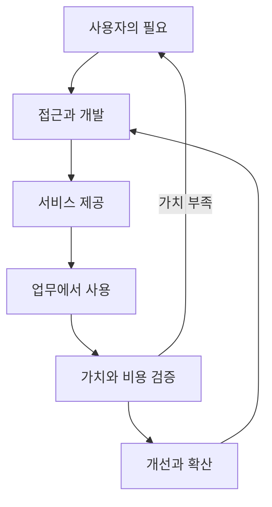

# 사고의 전환: 시스템을 잘 만드는 것에서 만들 이유를 책임지는 것까지

## 1. 변화의 본질은 목적함수다

엔지니어링에서는 지연, 처리량, 정확성, 가용성처럼 비교적 명확한 목표를 최적화한다. 플랫폼의 책임자는 이 목표들이 어떤 고객 결과를 위해 필요한지부터 결정해야 한다.

예를 들어 응답이 빨라졌다는 사실만으로 업무가 좋아졌다고 결론 내릴 수는 없다. 응답 품질이 떨어지거나 개발자가 연동에 더 많은 시간을 쓰면 최종 가치는 줄어들 수 있다. 반대로 최고 성능이 아니어도 접근 승인, 구현, 운영이 쉬워져 실제 업무에 안정적으로 쓰이면 더 큰 가치를 만들 수 있다.

**최적화할 지표를 선택하는 행위 자체가 전략적 판단**이다. 기술적 최적화는 필요하지만 그 목적과 제약을 정하는 일까지 책임 범위가 확장된다.

| 관점 | 먼저 묻는 질문 | 판단의 증거 |
|---|---|---|
| 구현 | 어떻게 정확하게 동작하게 할까? | 코드, 테스트, 성능과 오류 |
| 구조 | 어떤 경계와 계약이 합리적인가? | 의존성, 변경 비용, 확장성과 장애 범위 |
| 제품 | 누구의 어떤 일을 더 쉽게 만들까? | 사용자 행동, 반복 사용, 성공까지 걸리는 시간 |
| 플랫폼 | 어떤 공통 능력을 제공해야 여러 사용자가 성장할까? | 재사용, 채택, 중복 제거와 운영 가능성 |
| 조직 | 왜 이 영역에 자원과 책임을 배분할까? | 가치, 비용, 위험과 실행 능력 |

이 관점들은 위아래의 서열이 아니다. 서로 다른 질문이며, 책임지는 범위에 따라 여러 관점을 함께 사용한다.

## 2. Engineer, Architect, Tech Lead, Platform Lead는 일렬 승진 단계가 아니다

Engineer도 고객 문제를 발견할 수 있고 Architect도 제품 전략에 참여할 수 있다. Tech Lead는 반드시 사람의 인사평가를 맡는 관리자가 아니며, Platform Lead도 회사마다 기술·제품·운영의 범위가 다르다.

| 역할 | 주된 책임 | 충분하지 않은 상태 |
|---|---|---|
| Engineer | 제약 안에서 문제를 구현하고 검증한다. | 작동하는 코드만으로 고객 문제가 해결됐다고 간주한다. |
| Architect | 시스템의 경계, 계약과 장기적인 trade-off를 설계한다. | 도식은 정교하지만 실제 실행과 운영의 책임이 없다. |
| Tech Lead | 팀의 기술 방향과 품질, 실행을 이끈다. | 본인의 구현량에 의존해 팀이 스스로 판단하지 못한다. |
| Platform Lead | 공통 기반의 가치, 채택, 수명주기와 이해관계자를 연결한다. | 기능은 많지만 사용자가 왜 써야 하는지 설명하지 못한다. |
| Engineering Leader | 사람, 예산, 조직 구조와 성과에 책임진다. | 기술 계획과 조직의 투자 이유가 연결되지 않는다. |

이번 방향을 Technical Platform Leader로 표현할 수 있는 이유는 기술적인 판단과 플랫폼이 사용될 이유를 함께 다루기 때문이다. 명칭보다 중요한 것은 **문제 선택 → 구조 → 팀 실행 → 채택 → 결과**를 끊기지 않게 연결하는가다.

## 3. 기술적 우위와 조직적 필요성은 다르다

특정 기술을 잘 다루는 능력은 중요한 차별점이다. 그러나 도구가 쉬워지고, 다른 팀이 학습하고, 공급자가 기능을 제공하면 그 차별점은 줄어들 수 있다. 이것을 기술 전문성이 무의미하다는 뜻으로 해석하면 안 된다.

전문성은 다음으로 이동할 수 있다.

- 여러 대안의 실제 제약을 판별한다.
- 공급자의 추상화 아래에 있는 실패 조건을 이해한다.
- 품질·비용·지연의 상충 관계를 설명한다.
- 공통 계약을 설계해 공급자가 바뀌어도 고객의 운영이 유지되게 한다.
- 중요한 기술 문제에만 집중해 팀의 제한된 자원을 쓴다.

조직이 계속 필요로 하는 팀은 전문성을 통해 반복적인 고객 문제를 맡고, 그 문제를 서비스로 해결하고, 결과를 설명한다. 전문성은 기반이고 책임과 성과는 그 기반이 쓰이는 방식이다.

## 4. 가치사슬을 보면 무엇이 달라지는가

가치사슬은 고객에게 가치가 전달되기까지 필요한 활동들의 연결이다. AI에서는 수요의 발견, 접근, 개발, 실행, 평가, 운영, 비용 설명과 개선이 이어진다. 기술 컴포넌트의 호출 순서와는 다르다.

이 도식의 핵심은 피드백이다. 사용량이 늘었더라도 가치 검증에 실패하면 사용자 문제나 제공 방식을 다시 검토한다. 사용 증가를 자동으로 성공 판정하는 선형 도식으로 읽으면 안 된다.

플랫폼은 모든 활동을 직접 소유할 필요가 없다. 공통 식별자, 계약, 데이터를 통해 활동 사이의 단절을 줄여야 한다. 업무 성과를 정의하는 사람, 서비스 제공자, 재무 담당자와 협력해야 전체 연결이 성립한다.

## 5. 무엇을 소유할 것인가: 업무가 아니라 결과

Ownership은 남이 접근하지 못하는 영역을 확보하는 의미보다 결과에 대한 책임을 명확히 하는 의미로 사용하는 편이 유용하다.

“Gateway는 우리 것”이라는 표현은 자산의 담당을 말한다. “AI 접근과 정책 적용의 일관성, 그 경로의 운영 품질에 책임진다”는 표현은 결과의 책임을 말한다. 후자가 고객과 조직에게 설명하기 쉽고, 기술이 바뀌어도 유지할 수 있다.

책임은 권한, 자원과 함께 합의해야 한다. 예산이나 제공자 품질을 통제할 수 없는데 전체 성과를 약속하면 책임만 커진다. 인터페이스별 기대 수준과 에스컬레이션을 정해야 협력이 지속된다.

## 6. Problem → User → Value → Ownership → Scale → Technology

| 단계 | 확인할 내용 | 피할 지름길 |
|---|---|---|
| Problem | 지금 어떤 일이 막히고 얼마나 자주 반복되는가? | 요청받은 기능 이름을 문제로 간주한다. |
| User | 사용하는 사람, 비용을 부담하는 사람, 승인하는 사람은 누구인가? | 한 담당자의 요구를 모든 사용자 요구로 일반화한다. |
| Value | 해결 후 어떤 행동이나 결과가 달라지는가? | “효율 개선”처럼 측정 불가능한 약속을 한다. |
| Ownership | 결정권, 실행과 운영 책임은 누구에게 있는가? | 합의 없이 공통 영역을 맡겠다고 선언한다. |
| Scale | 다른 사용자에게도 공통이며 반복 제공 가능한가? | 일회성 맞춤 개발을 플랫폼이라고 부른다. |
| Technology | 가치와 제약에 맞는 최소 구조는 무엇인가? | 익숙한 기술에 맞춰 요구를 바꾼다. |

이 순서는 기본 질문의 순서다. 기술 검증은 반복적으로 돌아와야 한다. 기술적으로 불가능하거나 경제성이 없으면 문제 범위와 가치 약속을 바꾼다.

## 7. Build, Buy, Integrate를 고르는 기준

직접 만든다는 사실이 책임의 깊이를 증명하지는 않는다. 고객 가치와 차별성이 어디에서 생기는지를 기준으로 선택한다.

| 선택 | 적합한 상황 | 반드시 확인할 것 |
|---|---|---|
| Build | 반복되는 핵심 문제이며 기존 대안으로 충족하기 어렵다. | 개발 이후의 운영·업그레이드 비용과 담당 능력 |
| Buy | 표준 기능이며 구매가 가치 도달 시간을 줄인다. | 전체 비용, 계약, 데이터 이동과 종료 가능성 |
| Integrate | 기존 기능은 있지만 사용자 경험과 계약이 단절돼 있다. | 인증, 정책, 데이터 모델과 장애 책임 |
| Defer | 문제의 빈도나 가치가 검증되지 않았다. | 언제 어떤 증거로 다시 검토할지 |

기술적으로 재미있는 일의 우선순위가 높은 것은 아니다. 제한된 시간에 어떤 문제를 풀지 않는지도 리더의 결정이다.

[다음: 필요한 생태계의 설계](02-building-an-essential-ai-ecosystem.md)
