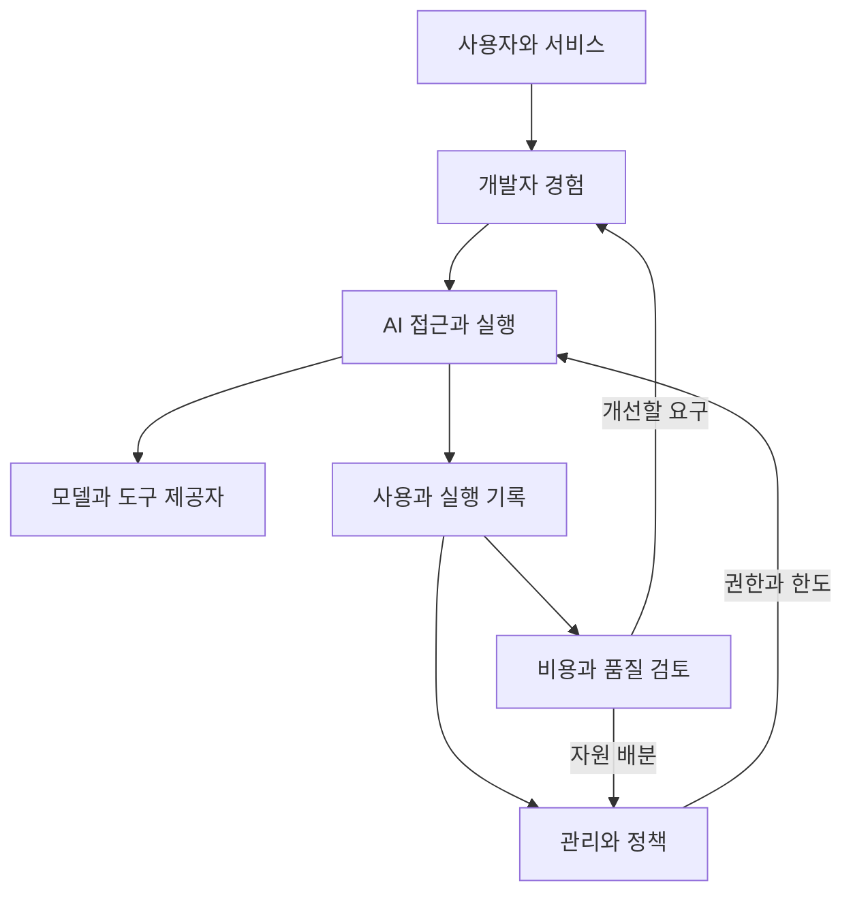
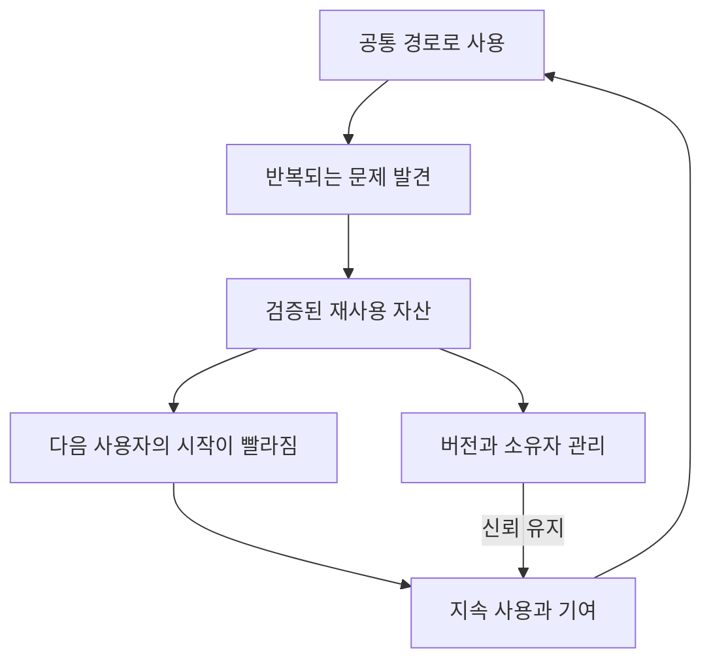

# 사용자와 조직에 필요한 AI 생태계를 설계한다

## 1. 필수성은 어떤 상태인가

사용자에게 AI 모델에 접근하는 기능만 제공하면 플랫폼은 여러 접근 경로 중 하나가 된다. 모델이나 도구가 더 쉽게 제공될수록 접근 기능만으로는 지속적인 가치를 설명하기 어렵다.

플랫폼의 필요성은 사용자가 AI를 시작하고, 서비스로 만들고, 안정적으로 운영하고, 결과를 개선하는 전 과정에서 공통 문제를 덜어 주는 데서 나온다. 조직은 같은 과정을 권한, 책임, 비용과 위험의 관점에서 설명할 수 있어야 한다.

“우리 없이는 AI를 못 쓰는 생태계”의 실무적 목표는 다음처럼 정의할 수 있다.

> 사용자에게 가장 빠르게 성공하는 경로를 제공하고, 조직에는 그 사용을 책임 있게 운영하는 공통 기반을 제공한다.

사용의 허가를 조직이 정할 수는 있다. 하지만 허가 체계만으로 제품 가치는 생기지 않는다. 사용자가 직접 조립하는 것보다 공통 경로가 편하고 신뢰할 만해야 한다.

## 2. 두 가지 가치를 동시에 만들어야 한다

| 관점 | 사용자에게 필요한 것 | 조직에 필요한 것 |
|---|---|---|
| 시작 | 무엇을 쓸 수 있고 어떻게 시작하는지 | 소유자와 목적이 식별된 사용 |
| 개발 | SDK, 문서, 예제와 재사용 자산 | 승인된 자원과 일관된 계약 |
| 실행 | 충분한 품질과 안정적인 응답 | 권한, 정책과 사용 한도 |
| 운영 | 문제를 추적하고 도움받을 수 있음 | 책임, 감사와 서비스 수준 |
| 확장 | 반복 구축하지 않아도 됨 | 비용과 수요에 근거한 자원 배분 |
| 개선 | 결과를 평가하고 더 나은 선택을 함 | 가치와 위험을 검토할 증거 |

사용자 편의만 높으면 조직적으로 유지하기 어렵고, 통제만 늘리면 사용자가 우회한다. 제품과 거버넌스를 함께 설계해야 한다.

## 3. Golden Path: 성공하기 쉬운 기본 경로

Golden Path는 자주 필요한 일을 권장 도구와 절차로 빠르게 수행하는 표준 경로다. 사용자를 위한 완결된 경험이어야 한다.

가상의 신규 서비스 개발자는 다음을 할 수 있어야 한다.

1. 사용할 수 있는 모델과 기능, 제한, 지원 범위를 확인한다.
2. 자신의 서비스와 소유자를 등록하고 필요한 접근을 요청한다.
3. 승인 후 최소 예제로 첫 유효 호출을 성공시킨다.
4. 재사용 자산으로 구현하고 정해진 평가를 실행한다.
5. 운영 조건과 책임을 확인하고 배포한다.
6. 오류, 품질, 사용량과 비용을 같은 식별자로 추적한다.
7. 변경하거나 종료할 때 접근과 자원을 정리한다.

문서 링크를 모아 둔 포털만으로 이 경로가 완성되지는 않는다. 시스템 간 재입력, 담당자를 찾아가는 대기, 수동 승인 전달과 원인을 알 수 없는 오류를 줄여야 한다.

표준 경로 밖의 요구도 있게 마련이다. 지원 범위와 예외 절차를 제공해야 표준이 현실을 수용한다. 모든 서비스를 같은 런타임으로 강제하면 복잡성이 없어지는 것이 아니라 사용자에게 전가될 수 있다.

## 4. 생태계는 기능 목록이 아니라 연결된 계약이다

개발자 경험은 문서, SDK, 카탈로그, 템플릿과 지원을 포함한다. 접근과 실행은 공통 API 계약과 정책의 적용을 포함한다. 관리 기능은 사용의 소유자, 허가와 자원 한도를 정의한다. 기록은 실행을 비용과 품질 검토에 연결한다.

모든 데이터를 Gateway 하나에서 만들 수는 없다. 서비스의 업무 결과는 서비스 쪽에서, 공급자의 원가와 상태는 공급자 쪽에서 나올 수 있다. 플랫폼의 역할은 공통 식별자로 연결하고, 어느 출처의 데이터인지와 무엇이 측정되지 않았는지 설명하는 것이다.

## 5. 세 가지 평면을 구분한다

| 영역 | 책임 | 대표적인 내용 |
|---|---|---|
| Data Plane | 실제 요청과 실행을 처리한다. | 호출, 라우팅, 스트리밍, 런타임과 도구 실행 |
| Control Plane | 실행에 적용할 상태와 정책을 관리한다. | 자원 등록, 설정, 권한, quota와 배포 상태 |
| Management Plane | 사용을 조직의 운영·경제성·책임에 연결한다. | 소유자, 비용 귀속, 예산, 감사와 성과 검토 |

이 구분은 설계 관점이다. 실제 제품에서는 영역이 겹칠 수 있다. 물리적으로 세 시스템을 반드시 만들어야 한다는 뜻도 아니다.

요청 경로에서 매번 관리 시스템에 동기 질의하면 관리 기능 장애가 전체 호출 장애로 확대될 수 있다. 필요한 정책을 실행 경로에 배포하고 변경의 전파 시간을 정하는 방식 등을 검토한다. 반대로 캐시된 정책으로 어느 시점까지 오래된 권한이 허용되는지도 결정해야 한다. 편의, 정확성과 가용성의 균형은 정책의 중요도에 따라 다르다.

## 6. 기능이 연결되는 최소 공통 언어

기능을 각각 개발하면 사용자, 서비스, 비용과 오류의 식별자가 어긋나기 쉽다. 처음부터 완벽한 통합 데이터 모델을 만들기보다 다음 연결을 일관되게 정의한다.

| 대상 | 최소 질문 | 설계상 주의점 |
|---|---|---|
| 주체 | 누구 또는 어떤 서비스가 호출했는가? | 사람 계정과 서비스 계정을 구분한다. |
| 소유자 | 누가 책임지고 누구에게 연락하는가? | 조직 이동과 소유권 이전을 처리한다. |
| 목적 | 어떤 승인된 사용에 속하는가? | 클라이언트가 임의로 보내는 라벨만 신뢰하지 않는다. |
| 자원 | 어떤 모델·도구·버전을 사용했는가? | 별칭과 실제 제공 버전을 연결한다. |
| 실행 | 어떤 논리 실행과 실제 시도가 있었는가? | 재시도·fallback·하위 호출을 구분한다. |
| 정책 | 어떤 규칙이 적용되었는가? | 당시 정책과 결정 근거를 재현할 수 있게 한다. |
| 측정 | 무엇이 확정 측정이고 무엇이 추정인가? | 누락과 불확실성을 숨기지 않는다. |

인증된 주체와 목적의 관계를 서버가 검증해야 정책과 비용 귀속의 신뢰성이 생긴다. 모든 로그에 민감한 원문을 저장할 필요는 없다. 목적에 맞는 최소 기록과 접근·보존 정책을 정한다.

## 7. 제공자가 바뀌어도 사용자의 운영은 유지한다

공통 API만 맞추면 제공자 독립성이 완성된다는 가정은 위험하다. 모델별 기능, 품질, 토큰 계산, 오류, 도구 호출과 스트리밍 동작이 다를 수 있다.

공통 계층은 다음을 명시해야 한다.

- 공통으로 보장하는 계약과 제공자별 확장.
- 지원 기능과 제한을 공개하는 capability 정보.
- 호환성 검증과 변경 공지, 버전 관리.
- 원래 제공자 오류와 플랫폼 오류의 구분.
- fallback 시 품질·비용·데이터 전송 조건.
- 교체 전 평가와 되돌리는 조건.

제공자가 경쟁하고 발전할수록 플랫폼은 선택을 쉽게 만들 수 있다. 이를 위해 차이를 숨기기보다 사용자가 알아야 할 차이를 일관되게 설명해야 한다.

## 8. 재사용이 생태계를 성장시킨다

재사용 자산은 SDK, 템플릿, 평가 데이터, 도구 연결, Skill과 운영 패턴일 수 있다. 수량보다 신뢰가 중요하다. 소유자, 버전, 지원 범위, 평가 결과, 권한과 폐기 정책이 없으면 자산이 늘수록 선택과 유지 비용이 커진다.

카탈로그에서 발견 → 검토 → 사용 → 결과 확인 → 개선 기여까지 연결돼야 marketplace가 된다. 단순 파일 저장소는 발견 기능의 일부다.

다른 팀의 기여를 받아들이려면 등록 기준, 검토, 호환성, 지원 책임과 인정 방식을 정한다. 모든 기여를 플랫폼 팀이 끝까지 지원한다고 약속하면 재사용이 오히려 중앙 팀의 병목을 만든다.

이 순환은 네트워크 효과의 후보이지 자동으로 성립하는 법칙이 아니다. 사용자가 늘 때 다음 사용자의 비용이나 품질이 실제로 개선되는지 확인해야 한다.

## 9. 반드시 필요한 공통 영역과 선택 가능한 영역

모든 기능을 동시에 필수로 만들 필요는 없다.

| 범위 | 기본 방향 |
|---|---|
| 인증·권한·책임 식별·필요한 기록 | 조직의 정책에 따라 공통 계약으로 합의한다. |
| 개발 템플릿·SDK·평가와 운영 도구 | 쓰면 빠르고 편하도록 만들고 실제 채택으로 검증한다. |
| 특정 Agent Runtime·UI·고급 기능 | 요구와 지원 범위에 따라 선택할 수 있게 한다. |
| 표준 경로 밖의 사용 | 예외 이유, 책임, 보완 통제와 재검토 조건을 정한다. |

조직의 표준 경로 지정에는 권한 있는 책임자의 합의가 필요하다. 제품 팀이 기능을 만들었다는 이유만으로 모든 사용자에게 의무를 부과할 수는 없다.

## 10. 필수성이 만들어졌는지 확인한다

다음은 기능의 수보다 강한 증거다.

- 사용자가 도움 없이 첫 성공을 경험하고 반복해서 사용한다.
- 표준 경로를 사용한 서비스의 구축·운영 부담이 줄어든다.
- 비용, 책임과 품질에 대한 질문에 설명 가능한 데이터가 있다.
- 다른 팀이 공통 자산에 기여하고 변경을 협의한다.
- 제공자가 바뀌어도 사용자의 핵심 운영 계약이 유지된다.
- 플랫폼을 사용해야 하는 이유를 사용자가 자신의 언어로 설명한다.

반대로 의무 가입만 늘고 실제 사용은 우회하거나, 운영 지식이 한 사람에게 집중되거나, 포털 없이도 같은 가치를 더 쉽게 얻는다면 필요성을 다시 검토해야 한다.

플랫폼을 제거했을 때 어떤 가치가 사라지는지를 묻되, 제거를 어렵게 만든 구현을 성과로 세지 않는다. 고객이 계속 선택할 이유를 개선하는 것이 지속 가능한 입지를 만든다.

[다음: 거버넌스·경제성·성과](03-governance-economics-and-measurement.md)
