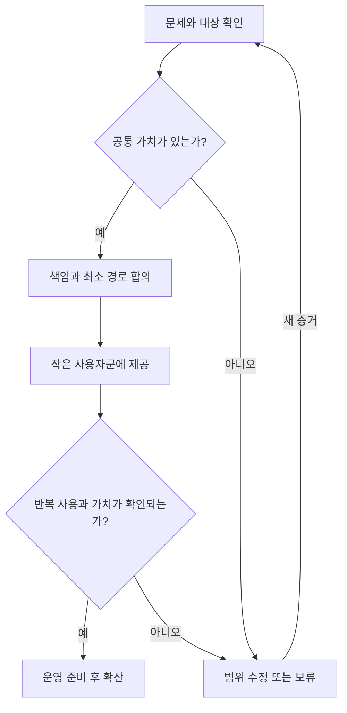

# 다음 단계: 무엇을 준비하고 어떤 증거로 움직일 것인가

## 1. 다음 산출물은 큰 설계도보다 판단 가능한 제안이다

방향에 공감한 상태에서 바로 모든 기능을 개발하면 다시 기술의 목록으로 돌아가기 쉽다. 다음 단계에서는 사용자 문제, 공통 가치, 맡을 책임과 검증 방법을 작은 단위로 구체화한다.

최소한 다음 여섯 가지가 준비되면 첫 개발 범위를 결정할 수 있다.

| 준비물 | 담을 내용 | 준비됐다는 기준 |
|---|---|---|
| Platform Charter | 고객, 가치, 책임과 범위 | 관계자가 팀의 존재 이유와 경계를 같은 뜻으로 설명한다. |
| 사용자 여정과 문제 목록 | 시작부터 종료까지의 막힘 | 실제 행동과 대기·재작업의 증거가 있다. |
| Capability Map | 보유 능력, 빈칸과 연결 | 기능 보유와 실제 고객 가치가 구분돼 있다. |
| 책임·계약 지도 | 결정권, 운영과 의존성 | 중요 실패에 담당자와 에스컬레이션이 있다. |
| 지표 정의와 기준선 | 무엇을 어떻게 검증할지 | 성공과 실패를 같은 기준으로 판단할 수 있다. |
| 최소 검증 계획 | 범위, 시간, 자원과 중단 조건 | 시범 사용자와 리뷰 시점이 정해져 있다. |

모든 정보가 완벽할 때까지 멈출 필요는 없다. 위험이 큰 의존성과 가정을 먼저 확인하고, 확인할 수 없는 것은 가설로 남겨 검증 순서를 정한다.

## 2. 첫 번째: 누가 무엇 때문에 막히는지 듣는다

사용자, 서비스 소유자, 승인자, 운영자와 비용 책임자가 보는 문제는 다르다. 한 사람의 요구를 전체 전략으로 승격하기 전에 서로 다른 관점에서 확인한다.

인터뷰는 “이 기능 있으면 쓰시겠어요?”보다 최근 행동을 묻는다.

- 마지막으로 AI 사용을 시작했을 때 어떤 순서로 진행했는가?
- 어느 단계에서 기다렸고 누구에게 도움을 요청했는가?
- 지금은 그 문제를 어떻게 우회하는가?
- 문제가 얼마나 자주 발생하며 어떤 손실을 만드는가?
- 플랫폼으로 바꾸면 무엇을 포기하거나 이전해야 하는가?
- 누가 도입을 승인하고 비용과 운영을 책임지는가?
- 성공했다고 판단할 행동과 결과는 무엇인가?

기능 선호보다 실제 행동과 대안이 중요하다. 사용자가 이미 쓰는 방식에는 이유가 있으므로, 전환 비용까지 포함해 새로운 경로의 가치를 평가한다.

## 3. 두 번째: 시스템을 고객 능력으로 번역한다

기술 컴포넌트마다 다음 표를 채운다. 이 문서에서는 실제 항목을 넣지 않고 작성 틀만 제공한다.

| 보유 기능 | 사용자 문제와 증거 | 현재 해결 범위 | 부족한 연결 | 맡을 결과 책임 | 기대 가치 | 우선순위 근거 |
|---|---|---|---|---|---|---|
| 작성 | 행동·빈도·영향 | 현재 검증된 것 | 경험·데이터·운영 | 권한과 자원 포함 | 측정할 변화 | 가치·신뢰도·노력·의존성 |

“있다”는 설치되어 있다는 뜻인지, 운영 가능하다는 뜻인지, 실제 쓰인다는 뜻인지 구분한다. 컴포넌트가 존재해도 사용자의 일을 완결하지 못하면 제품 capability가 완성된 것은 아니다.

기능을 멋진 이름으로 바꾸는 것만으로 사업 가치가 생기지는 않는다. 이름을 바꾼 뒤에도 어떤 고객 행동을 바꾸는지 설명하지 못하면 요구를 다시 확인한다.

## 4. 세 번째: 책임의 경계를 합의한다

의존하는 제공자와 팀은 경쟁 대상만이 아니라 생태계의 참여자다. 공급자는 자원과 실행 품질을 제공하고 플랫폼은 일관된 접근과 운영 경험을 제공할 수 있다. 실제 경계는 권한과 역량에 따라 합의한다.

| 결정·상황 | 결과 책임자 | 실행 담당 | 협의 대상 | 필요한 계약 |
|---|---|---|---|---|
| 접근 정책 변경 | 지정 | 지정 | 지정 | 승인권과 전파 시간 |
| 제공자 장애 | 지정 | 지정 | 지정 | 접수, 복구와 에스컬레이션 |
| 사용량 정정 | 지정 | 지정 | 지정 | 증거, 대사와 이의 처리 |
| 자산 변경·폐기 | 지정 | 지정 | 지정 | 버전, 영향과 종료 안내 |
| 지원 범위 밖의 요구 | 지정 | 지정 | 지정 | 예외와 인수 조건 |

RACI를 사용해도 표만 채우고 끝내지 않는다. 중요 결정에는 최종 판단자가 필요하고, 사고에는 연락 경로와 시간 기준이 필요하다. 책임을 받아들이는 사람이 실행 자원도 가지고 있는지 확인한다.

## 5. 네 번째: 가장 작은 완결된 사용자 경로를 고른다

MVP는 기능이 적은 제품이면서도 한 가지 중요한 일을 끝까지 수행할 수 있어야 한다. 인증 화면, 호출 화면, 대시보드를 각각 만드는 것보다 접근 → 첫 성공 → 운영 확인까지 하나의 흐름을 완결하는 것이 가치 검증에 유리하다.

단계별로 가장 위험한 가정을 검증한다. 예를 들어 “사용자는 더 쉽게 시작하면 계속 쓸 것”이라는 가설과 “조직은 공통 기록을 신뢰할 것”이라는 가설은 다른 실험이 필요하다.

## 6. 우선순위는 가치와 근거, 실행 가능성을 함께 본다

| 기준 | 질문 |
|---|---|
| 문제의 크기 | 몇 명이 얼마나 자주 얼마나 크게 겪는가? |
| 공통성 | 같은 해결이 다른 사용자에게도 적용되는가? |
| 가치까지 시간 | 얼마나 빨리 실질적인 변화를 확인할 수 있는가? |
| 신뢰도 | 요구와 기대 효과의 근거가 얼마나 강한가? |
| 의존성 | 합의나 다른 개발이 선행되어야 하는가? |
| 전체 노력 | 개발·운영·이전·지원 비용은 어느 정도인가? |
| 위험과 가역성 | 실패했을 때 되돌리거나 범위를 줄일 수 있는가? |
| 책임의 적합성 | 우리가 결과를 통제하고 운영할 수 있는가? |

점수표는 비교를 돕지만 불확실한 추정을 정확한 숫자로 바꾸지는 못한다. 점수와 함께 가정, 확신 정도, 반대 근거를 기록한다. 필수 운영 문제와 신규 성장 기능은 성격이 다르므로 같은 순위 하나로 무리하게 비교하지 않는다.

## 7. 30·60·90일은 제안용 틀이다

다음은 업무량을 확정한 일정이 아니라 준비의 순서다. 단계의 종료 기준이 충족되지 않으면 다음 범위를 늘리지 않는다.

| 구간 | 중심 활동 | 남길 산출물 | 종료 기준 |
|---|---|---|---|
| 0~30일 | 사용자 문제, 여정과 책임 조사 | Charter, capability·책임 지도, 기준선 | 첫 대상과 문제, 검증 지표에 합의 |
| 31~60일 | 최소 경로 제공과 시범 사용 | 동작하는 경로, 기록, 지원 절차 | 실제 사용자가 일을 완료하고 결과를 검토 |
| 61~90일 | 반복 사용, 운영성과 확산 조건 검증 | 유지율·품질·비용 검토, 확산 또는 수정 결정 | 지원 가능성과 가치를 함께 확인 |

자원과 책임이 합의되지 않은 상태에서 기간만 약속하지 않는다. 팀의 병렬 실행 능력이 작으면 경로의 폭을 줄인다.

## 8. 그다음 6~12개월은 검증된 능력을 연결한다

| 단계 | 확대할 수 있는 방향 | 선행 조건 |
|---|---|---|
| 공통 기반 안정화 | 식별, 접근, 운영 기록과 지원 | 기본 경로의 신뢰성과 소유자 합의 |
| 채택 확대 | 셀프서비스, 문서, SDK와 재사용 | 실제 반복 수요와 온보딩 개선 효과 |
| 책임 있는 사용 | 설명 가능한 비용·예산·정책 | 집계 신뢰성, 재무·운영 정책 합의 |
| 생태계 확장 | 기여, 카탈로그, 평가와 제공자 연결 | 자산의 품질·버전·지원 수명주기 |
| 지속 개선 | 수요·비용·결과를 반영한 자원 배분 | 측정 한계가 설명되고 의사결정에 실제 사용됨 |

이 표는 의무적인 기능 순서가 아니다. 현황에 따라 비용 설명이 먼저일 수도, 접근 경험이 먼저일 수도 있다. 앞 단계가 이미 갖춰져 있다면 다시 만들지 않는다.

## 9. 개발을 시작하기 전 한 페이지로 답한다

다음 틀은 기능 제안, 기술 투자와 신규 capability를 검토할 때 반복해서 쓴다.

1. **문제:** 어떤 사용자의 어떤 행동이 막히는가? 증거와 현재 대안은?
2. **가치:** 해결하면 어떤 결과가 달라지는가? 누가 그 가치를 인정하는가?
3. **범위:** 이번에 완결할 경로와 지원 범위는?
4. **책임:** 누가 결정하고 개발·운영하며 무엇에 의존하는가?
5. **선택:** Build, Buy, Integrate, Defer 중 왜 이 선택인가?
6. **검증:** 기준선, 성공 지표, guardrail과 리뷰 시점은?
7. **비용:** 개발뿐 아니라 운영, 전환과 지원 부담은?
8. **불확실성:** 가장 위험한 가정과 이를 먼저 확인할 방법은?
9. **종료:** 실패, 보류, 교체나 폐기를 판단할 조건은?

이 제안서는 디자인을 대체하지 않는다. 디자인에 들어가기 전에 중요한 판단이 빠지지 않게 한다.

## 10. 같은 문제를 보는 정기 리뷰를 만든다

주기적으로 요구 유입 → 시작 → 첫 가치 → 반복 사용 → 결과 확인의 흐름을 함께 본다. 기능 개발 보고와 사용자 가치 리뷰를 분리하면 기능은 완료되는데 채택 문제는 남을 수 있다.

리뷰에서는 수치뿐 아니라 새로 들은 고객 문제, 지원 요청, 우회 이유, 비용 증가와 폐기할 기능도 다룬다. “계속 투자할 것인가”와 “무엇을 바꿀 것인가”가 남아야 한다.

현재의 방향을 바꿀 반대 증거를 먼저 정해 둔다. 반복 사용이 없거나, 효과보다 지원 비용이 크거나, 기존 대안이 더 쉽게 같은 일을 한다면 범위를 바꾸거나 통합한다. 중단도 고객 가치와 자원을 책임지는 결정이다.

[다음: 리더의 실행과 성장](05-leadership-and-personal-growth.md)
